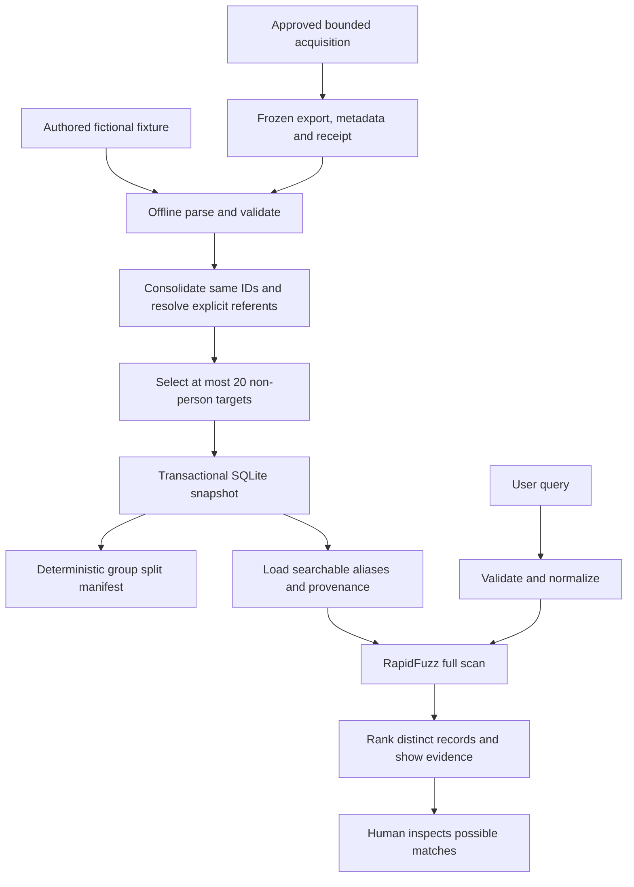

# Decision 0001: one frozen source, conservative IDs, SQLite

Accepted within approved Phase 2; no approval for Phase 3 implied.

## What and why

SQLite is a database stored in an ordinary local file. Python's built-in `sqlite3` library reads and writes it; no server or new dependency is needed. A table is like a spreadsheet with enforced rules. A primary key uniquely identifies a row; a foreign key points to a row that must exist elsewhere. An entity ID is a provider's record identifier, not proof about a real person. An alias is one recorded spelling attached to that ID.

For example, fictional entity `fixture-001` owns both `Moonberry Loom` and `مونبيري لوم`. Those are two alias rows referring to the same entity row. `fixture-003` also says `Moonberry Loom`; it stays a different row because matching text is insufficient to establish identity.

## Tables and dependencies

- `sources`: primary key `snapshot_id`; source, version, selection, license/attribution receipt, hashes and report. A snapshot ID fingerprints the raw bytes, metadata, parser version, sample/public mode and selection.
- `entities`: composite primary key `(snapshot_id, entity_id)`; source schema, display name, preserved raw record content, referents and provider-link group. Its snapshot must exist in `sources`.
- `aliases`: primary key `(snapshot_id, alias_id)` and unique `(snapshot_id, entity_id, property_name, original_name)`; original and normalized text, property kind, exclusion reason. Its entity must exist. Alias IDs hash entity ID + name property + original text.

A composite key uses multiple columns together. For example, a provider ID can appear in two different snapshots without those being the same stored observation. This implementation deliberately allows only one snapshot in each database file. Foreign keys are enabled on every connection because SQLite does not enable them automatically in every environment. SQL placeholders separate values from SQL commands. A transaction commits all rows together, or rolls back on failure. Reimporting identical inputs is a no-op; another snapshot requires a new database path.

## Architecture

Acquisition depends on permission; parsing depends on saved data, not the network. Grouping runs before selection to preserve links through excluded records. Database writes depend on successful validation. Splits and retrieval both read that frozen database independently; splitting is not part of a query. A request follows query → normalization → retrieval (with loaded aliases) → output → human inspection. These arrows form a DAG: no node depends on a later node in the same run. A human might revise a future dataset or query after review, but that feedback starts a separate run. No reviewer feedback storage, automated decision loop, or training loop exists yet.

## Grouping and missing data

Repeated identical IDs can union name lists only when other metadata agrees. Conflicting IDs stop the import for inspection; we do not automatically choose a winner or create a quarantine service. Explicit referents form connected groups using union-find: follow links to one common group label. Shared strings are diagnostic flags, never grouping evidence. Hashing `seed:group_id` assigns the whole group to one partition, independently of input order. Every selected ID gets exactly one partition; all its aliases inherit it.

Raw original names remain evidence even when normalization collides. Missing optional fields remain absent/null; malformed required fields fail; entities with no usable names are excluded and counted. Weak aliases are retained but not searched. `LegalEntity` is broad, so its type is preserved instead of silently relabeling it as `Company`.

## When, where, who and how

The learner runs acquisition once with approval, then imports locally and queries SQLite offline. The provider supplies records; the software preserves provenance and proposes text matches; the human interprets them. The database, receipts and split manifest live under ignored `data/`. The standard library handles JSON, hashing, paths, HTTPS, command arguments and storage. Existing RapidFuzz ranks strings, pytest tests behavior, Hatchling packages the schema, and uv manages/builds the existing environment. No new libraries were added. Embeddings, LangGraph, training, calibration, API/UI and review memory remain later phases; optional integrations are separately approved.

## Tradeoffs

The small selection teaches reproducible plumbing, not multilingual accuracy. SQLite retrieval loads names into memory; it is not a fuzzy SQL index. Raw JSON evidence increases storage but makes interpretation traceable. Readable sample/report exports are written after the SQLite transaction: disk failure can leave those exports missing even when the database committed; rerun the same import to regenerate them. Snapshot identity prevents accidental refresh, not malicious tampering with the local database. New source versions or broader datasets require a new review and snapshot.
