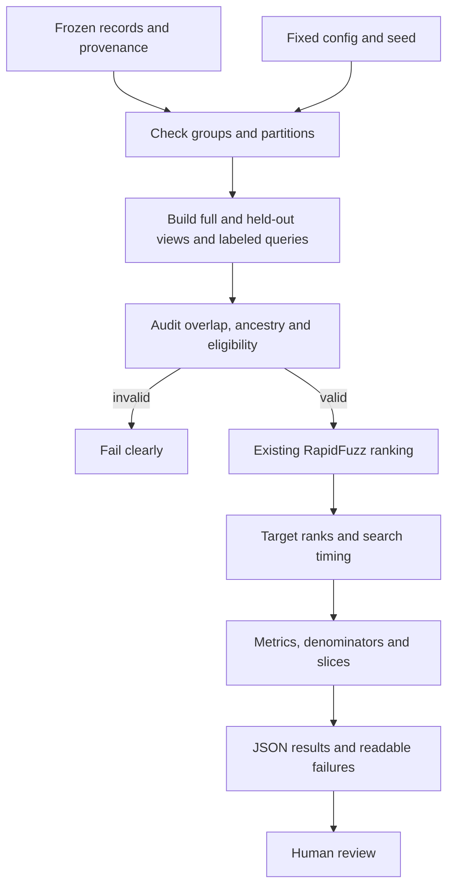

# Decision 0002: evaluate the existing character baseline before adding models

Status: implemented after explicit Phase 3 Step B approval. No Phase 4 approval implied.

## Purpose and scope

Software tests check whether code obeys its contract; evaluation measures its usefulness on labeled queries. We evaluate the existing `rank_candidates` implementation without changing its normalization, unit-cost normalized Levenshtein scorer, best-alias selection or ID tie-breaking. There is no training, new scorer, threshold, embedding model or network call.

The fictional 12-record fixture is the primary teaching benchmark. A separate exploratory experiment uses the previously approved 20-record public snapshot. The three-record fictional SQLite fixture remains covered by Phase 2 tests. No larger corpus was downloaded or imported.

## Ground truth and partitions

A query retains its generating entity ID, alias ID, base spelling, transformation, seed, source fingerprint and provenance. These are record-level labels. Public aliases and provider links have not been independently confirmed as real-world identities. A typo derived from a known record is a synthetic positive, not an observed user query. Different IDs are never merged merely because names match.

The explicit fictional manifest reserves five IDs for training, two for development, three for test and two for a separate ambiguity suite. The public Phase 2 manifest remains unchanged: 7 train, 3 development, 2 calibration-fit, 2 threshold-selection and 6 test entities. All aliases and derived queries inherit their group's partition. Reserved groups supply reference candidates but generate no evaluation queries. No model fits any group.

Reference-index access is necessary to retrieve held-out entities and is not supervised learning. The test query labels must not be used to select a scorer or tune preprocessing. The fictional examples have already been inspected during development, so their test split is a protocol demonstration, not a claim of unseen scientific validation. Settings were fixed before the public benchmark run; the scorer was not changed after results.

## Frozen query/index protocol

Stable entity and alias sorting precedes hashing. The generator applies exact lookup, uppercase/whitespace, one character deletion, adjacent-character swap, one dropped token, first/last token swap, and held-out alias lookup. SHA-256 of seed and alias ID chooses edit positions. Operations with no eligible position, invalid output or no normalized change are logged as skipped.

Two reference views are fixed before retrieval. `full` contains all searchable aliases. `heldout` removes one alias per eligible entity, chosen by highest stable alias ID, together with all its normalized-equivalent copies. At least one distinct normalized spelling remains. Held-out queries use that fixed view; all other queries use the full view. This can remove names from distractors too, so it is a distinct experiment, not a perfect isolated causal comparison with full-index retrieval. The alias choice is mechanical, not optimized for score or script.

Exact and formatting results are a sanity suite. Typos, token changes and withheld aliases form a separate challenge suite. Cross-record name collisions, repeated normalized queries within a slice, cross-partition normalized queries and unintended exact index overlap are retained as diagnostics, excluded from eligible positive denominators, and counted with reasons. Same strings occurring under different perturbation labels can appear in multiple slices; they remain correlated, not independent evidence. The two deliberately same-name fictional records remain separate IDs in the ambiguity suite.

Three authored fictional absent-target queries are separate from positive Recall/MRR. They do not claim that a real-world entity is absent from any external list. No public absent-target labels are fabricated.

## Metrics and timing

For a single known target, Recall@k is hits in the first k distinct records divided by eligible positive queries. We report k=1,10,50. If k covers the entire reference corpus, the metric is N/A with an uninformative-query count. A zero eligible denominator is also N/A, not zero performance. With 12 or 20 candidates, Recall@50 cannot distinguish ranking quality.

MRR is the sum of reciprocal target ranks divided by eligible positives. A missing target contributes zero; invalid benchmark ancestry instead stops the run. Ambiguous and absent-target queries do not enter this denominator. Each metric records value, numerator, denominator and N/A reason. Results are query-weighted, so entities with many aliases contribute more. Group/entity counts expose that limitation; no entity-macro or population accuracy claim is made.

Slices separate partitions, sanity/challenge/diagnostic/absent suites, perturbations and Unicode script categories. Latin, Arabic and Cyrillic empty slices are visible as N/A where a suite exists. Mixed/other scripts are labeled conservatively. Script categories are not language detection; query records retain available target-reference script categories. We do not invent romanizations or translations.

Latency times only the unchanged ranking function, including its existing query/alias normalization and sorting. Loading SQLite, building queries and serialization are excluded. Each query receives one untimed warm-up and 20 timed calls using `perf_counter_ns`. Reports contain milliseconds, median and nearest-rank p95, raw per-query samples, observation count and environment. Timings are variable and excluded from deterministic comparisons. They measure tiny warm local workloads, not server throughput or end-to-end response time.

The absent-target suggestion rate reports whether any candidate was returned. Since this baseline has no rejection threshold, it cannot demonstrate selective rejection. Threshold FPR, probabilities, automatic acceptance, 99%-recall operating points, confidence guarantees and calibration are not estimated.

## DAG

Data and configuration are prerequisites. Queries must pass audits before scoring; metrics depend on actual rankings. Human review can propose a future experiment but does not loop back to tune this same reported test run. No model, agent or reviewer-memory feedback loop is implemented.

## Libraries, reproducibility and limitations

Python's existing standard library handles Unicode labels, SHA-256 fingerprints, JSON, files, timing, arithmetic and environment descriptions. RapidFuzz and pytest retain their roles; uv remains available for the existing environment. No dependency files changed. Commands live in README and the Phase 3 report.

Frozen queries, source/view/config fingerprints, rankings and non-timing metrics reproduce exactly. Unknown upstream duplicates can still cross partitions despite explicit-link checks. A small selected corpus and correlated synthetic queries do not support population confidence intervals; we report counts and limitations instead of misleading bootstrap certainty. Alias ancestry checks establish what the provider recorded, not whether it is true. Public-derived detailed output stays under ignored `data/evaluation/`; source attribution and license remain in the Phase 2 data card and provenance.
