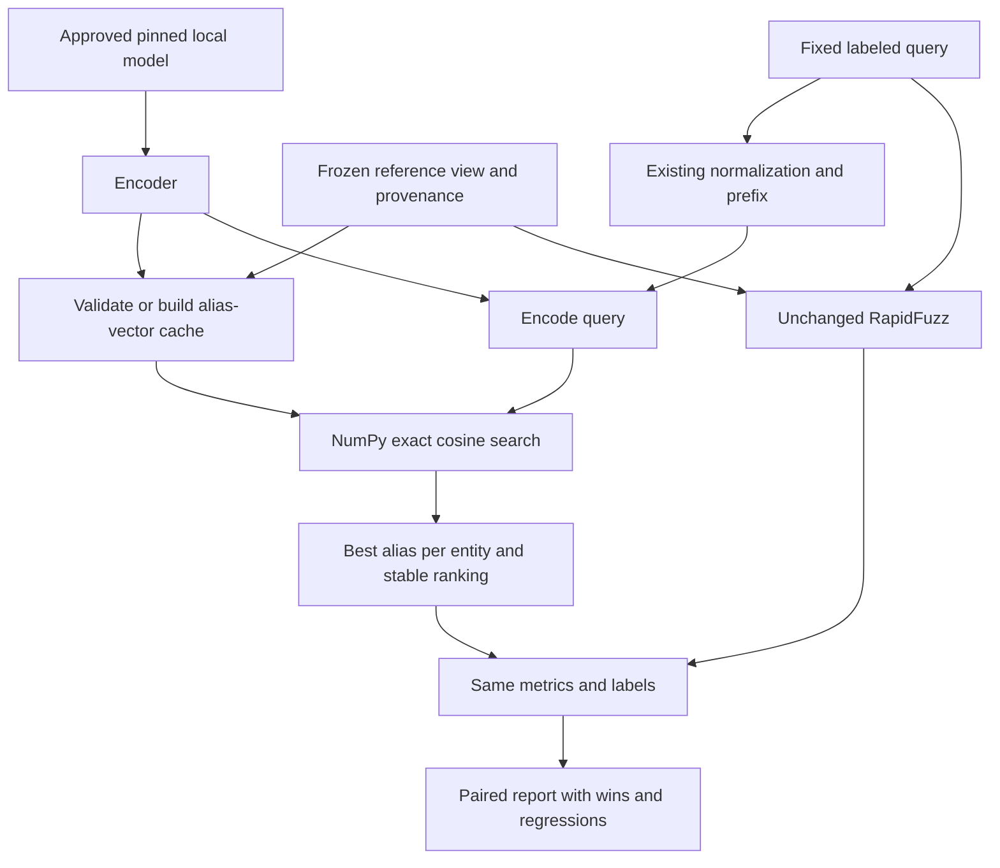

# Decision 0003: one frozen E5-small bi-encoder, exact NumPy retrieval

Approved Phase 4 scope: pretrained inference only on the existing benchmarks and a separate authored bilingual fixture. No fine-tuning, cross-encoder, Qdrant, service or Phase 5 work.

## Why this model and search method

An embedding is a learned numerical representation. A tokenizer turns text into model input pieces; the encoder represents each piece in context; pooling combines them into one vector. E5-small returns 384 dimensions. It is smaller than E5-base and LaBSE and suitable for the inspected M4 MacBook Air with 16 GB memory. We start with CPU float32 and four Torch threads to keep the experiment simple. Improvement is an experimental question, not an acceptance requirement.

A bi-encoder encodes query and aliases separately, permitting reference-vector reuse. A cross-encoder jointly reads each pair and would introduce a different reranking experiment. A multilingual model can put translations near each other, but may also confuse distinct similarly named entities. Neither embedding nor edit similarity establishes identity.

NumPy exact search compares every alias vector. At 79 aliases × 384 dimensions × 4 bytes, the public full-view matrix is 121,344 bytes before metadata. No approximate index or server is justified. Cosine between q=(1,2) and a=(2,1) is 4/(sqrt(5)×sqrt(5))=0.8. Row normalization makes cosine a dot product. Invalid dimensions, nonfinite values and zero vectors fail explicitly.

## Frozen inference contract

- Model: `intfloat/multilingual-e5-small`, full revision `614241f622f53c4eeff9890bdc4f31cfecc418b3`.
- Selected safetensors weights, tokenizer/config and documentation only. The explicit fetch command caps metadata plus selected files at 600,000,000 bytes, validates the remote revision and provided SHA-256 hashes, then records all local hashes. Inference verifies that receipt and cannot download files.
- Existing Phase 1 normalization runs on both aliases and queries; original text remains evidence.
- Prefix `query: ` on both sides: symmetric name similarity, following the model card's symmetric-task guidance.
- Mean pooling through the supplied Sentence Transformers pipeline; unit-length float32 embeddings; maximum 512 tokens; no silent truncation.
- CPU, reference batch size 8, inference/eval mode, seed 42, four Torch threads, deterministic algorithms enabled. Library/hardware changes can still cause small floating-point variation.
- Exact cosine scores remain in [-1,1], clipping only numerical excursions. Group aliases by entity ID using maximum score, break exact alias ties by alias ID and entity ties by entity ID. Similar names do not merge IDs.

## Cache and evidence

Cache keys hash the complete ordered reference records/provenance and encoder configuration, weight hashes, library versions and thread setting. Each `.npy` matrix has a JSON mapping/manifest and checksum. `allow_pickle=False` avoids object deserialization. Cache hits verify the checksum, manifest, row count and dimensions; changed views/configuration use another key. Corrupt caches fail rather than serve stale results. Cached vectors preserve row-to-alias mapping; original SQLite data is read-only.

Only reference vectors are cached for timed retrieval. Each measured query is encoded afresh. Separate measurements report model construction, reference preparation/cache loading, query encoding, vector search/grouping and total warm search. File verification and Python imports are outside the reported model-construction time. Vector search currently revalidates/normalizes rows; that overhead is included. Do not compare cached-query search-only latency with RapidFuzz total latency.

## Fair paired evaluation

Existing Phase 3 query files are consumed unchanged. Rebuilt full/held-out views, source/split audits and query hashes must equal the saved benchmark. The paired RapidFuzz candidate rankings and scores must also match Phase 3. Both methods receive exactly the same entity and alias universe per query. Original metric functions, denominators and N/A rules are reused.

The new fixture has ten authored entities: two development, six test, two ambiguity. Translation and transliteration labels are explicit. Fixed English-only and Arabic-only views test both directions; the bilingual view tests known aliases, typos and English word order. Both duplicate-name entities remain separate. It is a hand-verifiable teaching fixture, not unseen population evidence or a native-speaker-reviewed identity dataset. No training split is needed because no model is fit. Development/test ownership stays disjoint; test results are not used to alter the frozen model choice or preprocessing.

Report existing word-order/typo/held-out-alias slices and additional true cross-script-only slices, where no target reference alias shares the query script. New cross-script views exclude that script across the entire index. Translation and transliteration, and both script directions, are reported separately. Small slices and correlated aliases limit interpretation. Existing public aliases remain working provider labels; unknown duplicates/pretraining overlap remain possible.

## DAG

Reference caching is preparation, not learning from queries. Human review may propose a future experiment but does not loop back to tune this reported test run. No reviewer memory or retraining is implemented.

## Verification and approval boundaries

Offline tests use fixed vectors and mock encoders/HTTP responses. Integration requires both an explicit marker selection and `RUN_EMBEDDING_INTEGRATION=1`; it reads local weights only. Compare repeated inference with 1e-6 numerical tolerance and inspect ranking stability. No accuracy threshold is required for completion: failures are useful results.

Only the approved dependencies and one model were acquired. Exact versions, acquisition totals, test outcomes, observed results, errors and remaining uncertainties are recorded in the Phase 4 report. A different model, runtime download, training, vector database or later phase needs separate approval.
