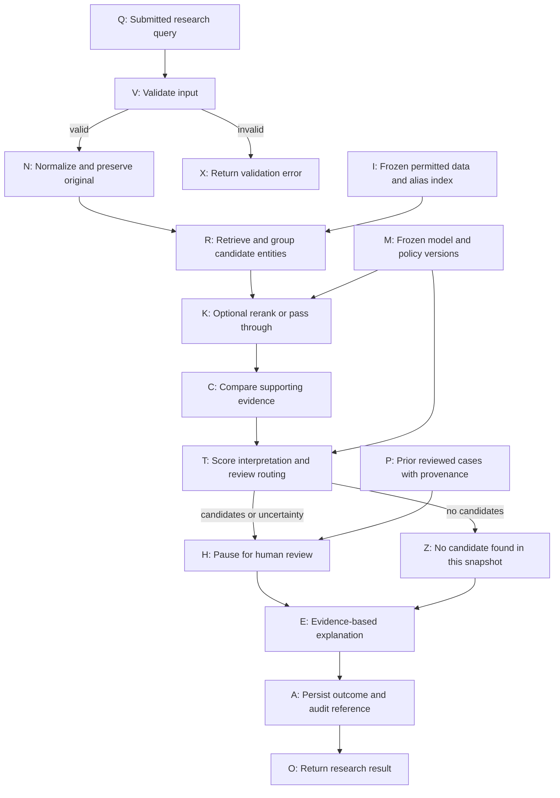
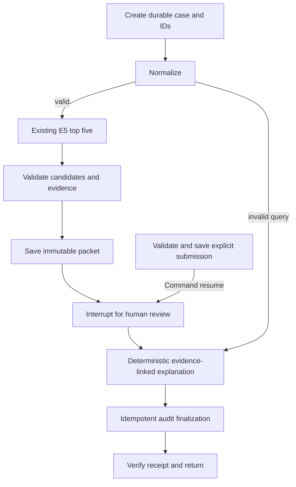

# Polyglot Watchlist — Phase 0 design

Planning date: 2026-10-21. Historical Phase 0 proposal below. Current status: Phases 1–4, Phase 5A and approved Phase 7A complete. Training, calibration and later milestones remain deferred. The implemented Phase 7A architecture at the end of this document supersedes earlier speculative routes.

Phase 2 architecture and decisions: [data/SQLite ADR](adr/0001-data-and-splits.md). Actual source permissions and counts: [data card](data-card.md). Results: [Phase 2 report](progress/phase-02.md).
Authority: [AGENTS.md](../AGENTS.md) and [reference proposal](reference/internship-2093-portfolio-plan.html), Project 1, engineering standards, and AI coding-agent guidance. Project 2 is excluded.

## One-page design brief

**Problem and purpose.** One name can have several spellings, aliases, word orders, or writing systems. Exact text search misses some related names; loose matching returns unrelated names. We will build a local research prototype that helps a human find possible matching records and inspect the evidence. It cannot establish a person's identity or wrongdoing, and is not a live screening or compliance service.

**Input.** Initially, one fictional name entered through a command-line interface (CLI: a program operated by typing a command). Later, an analyst may supply optional birth-date or country information. Initial demos contain only invented records. Blank, malformed, and oversized inputs receive explicit validation errors.

**Output.** A ranked list of distinct candidate entities, the alias responsible for each score, source identifiers, and limitations. An entity is one underlying record; aliases are its alternative names. Similarity scores are ranking aids, not identity probabilities. Later outputs add evidence comparisons, version information, review status, and an audit identifier. The human can mark a candidate as supported, reject it, or leave the case unresolved, within the reference dataset only.

**Data.** Phase 1 uses a tiny authored fictional fixture with stable entity and alias IDs. Phase 2 considers a small approved subset from one public sanctions source before adding others. UN, OFAC, EU, and OpenSanctions are candidates, not approved downloads. Public availability does not establish permission to reuse or redistribute. Verify current terms, attribution, access method, and permitted purpose before acquisition; record source provenance (where a record came from). Prefer organisations initially. Do not use INTERPOL notices, private personal data, or scraped individuals.

**Matching.** Start with Unicode text normalization and RapidFuzz character similarity. A baseline is a simple method whose measured results give later methods something to beat. Next, evaluate multilingual embeddings: numeric representations intended to place related names near each other. Only consider training and reranking after a trustworthy evaluation harness exists. Cross-script performance is an experiment, not a promise.

**Workflow.** Validate → normalize → retrieve candidate records → optionally rerank → compare supporting fields → route for review → explain with evidence → record the outcome. Initially these are ordinary Python functions. LangGraph orchestration, persistent review, memory, and interfaces come later. An optional language model may help parse free text or draft an explanation; it must not control the matching decision or invoke arbitrary tools from record text.

**Evaluation.** Keep related entities and all their aliases in a single data split. Measure whether retrieval finds the target in the first 10 or 50 candidates; separately measure wrong suggestions, missed targets, review workload, calibration when applicable, and runtime. Include cases with no target in the index. Report denominators, uncertainty, script-specific failures, and synthetic-data limitations. Never place invented performance numbers in documentation.

**Scope and completion.** Follow Phases 0–10 in [implementation-phases.md](implementation-phases.md). Each phase needs a specific proposal, approval, small changes, actual checks, explanation, and a saved progress report. Phase 0 writes documentation only. Phase 1 finishes when the fictional CLI and unit tests behave as specified, not when it reaches a production-quality accuracy target. No dependency installation, data downloads, Git initialization, model downloads, or application code in Phase 0.

## Request-level DAG

A directed acyclic graph (DAG) is a set of steps connected by arrows, with no path back to an earlier step. Here an arrow means the next step needs the earlier step's result. A request is one submitted name and its eventual review outcome. Alternative branches do not all run; a merge waits for the branch selected for that request.

| Node | What it does, why it exists, and dependencies | When and where |
|---|---|---|
| Q | Receives the user's name; optional context arrives only in later phases. | Phase 1 CLI; Phase 9 local interface. |
| V | Rejects unusable input before search. Depends on Q. Invalid input ends at X. | Phase 1 input boundary. |
| X | Gives a clear error with no candidate ranking. Does not imply no match. | Phase 1 CLI error path. |
| N | Preserves the original and creates a comparable text form. Depends on valid V. | Phase 1 Python normalization; optional later transliteration. |
| I | Supplies versioned reference entities and aliases. It is an input artifact, not an ingestion step within a request. | Synthetic fixture in Phase 1; database/index from Phase 2 onward. |
| R | Scores aliases, groups them by entity, and returns the best distinct candidates. Depends on N and I. | Fuzzy search in Phase 1; embeddings in Phase 4. |
| M | Supplies fixed model, normalization, and routing settings for this request. No training happens during a request. | Baseline configuration initially; models and calibration later. |
| K | Optionally scores each shortlisted query–candidate pair jointly. Without a reranker, forwards the existing ranking. Depends on R and M. | Optional Phase 5 model; pass through earlier. |
| C | Records field agreement, disagreement, or missingness; missing data is not disagreement. Depends on K and the preserved query. | Later evidence layer, specified before Phase 6. Name-only initially. |
| T | Labels score meaning and routes the result. Raw scores are never probabilities. Empty results go to Z; uncertain or supported candidates go to H. Depends on C and M. | Simple candidate-only result in Phase 1; calibration in Phase 6; routing in Phase 7. |
| Z | States only that retrieval returned no candidate in this snapshot. A failure or timeout must be reported as an error, not Z. | Explicit empty-result behavior; no automatic identity clearance. |
| P | Retrieves prior decisions with date, reviewer, evidence, and version. Supplies context to H; it cannot silently override current evidence. | Phase 8 memory store. |
| H | Shows candidates and evidence to a human, who can support, reject, or leave unresolved with a reason. Depends on T; P is optional until Phase 8. | Manual inspection initially; durable pause/resume in Phase 7. |
| E | Produces a deterministic evidence summary first. Optional LLM wording must cite supplied fields and pass validation. Depends on the selected H or Z branch. | Structured CLI evidence initially; fuller explanation in Phase 8. |
| A | Stores outcome, provenance, versions, and later reviewer/audit details. Depends on E. Persistence failure is surfaced explicitly. | Full persistent audit in Phase 8; Phase 1 only prints result fields. |
| O | Returns a research result and any unresolved status. Depends on successful A in the later audited workflow. | CLI first; local API/UI later. |

The diagram describes the intended system, not code already built. Phase 1 implements only validation, normalization, retrieval, and printed evidence for manual inspection. It does not simulate persistent human review, calibration, or audit storage. Pausing at H and resuming at E advances the same request; it is not a backward edge. Retries can occur inside a bounded node implementation later, but this diagram shows logical dependencies, not retry attempts.

## Offline feedback is separate

This second diagram is deliberately a feedback cycle, not a DAG. F supplies human decisions; G checks their quality and duplicate relationships; S keeps held-out entities out of learning; B fits an approved model or calibration method; J rejects regressions or unsupported claims; D records a frozen release; U uses that release in future requests. Each step depends on the previous one. Neither test labels nor unverified reviewer decisions automatically become training data. A new model version requires an explicit offline experiment and approval. Correcting a review creates a new revision rather than silently erasing history.

## Evidence, review, and safety boundaries

- Preserve original names, source-record IDs, alias IDs, dataset snapshot hashes, and transformation versions. A cleaned name must remain traceable to its source.
- A ranked name can belong to a different entity. Reviewers see competing candidates and evidence conflicts, not just the highest score. Different entities can share an identical name.
- A low score cannot establish that a target is absent: retrieval may have missed it. The initial policy has no automatic “match” or “clear” outcome. Phase 6 may study thresholds offline without authorizing operational decisions.
- Date or country agreement is supporting evidence, not proof; missing fields remain unknown. Avoid collecting document fragments in the first prototype. Other sensitive fields require a separate need and data review.
- Later persisted state includes request ID, original/normalized query, candidates and matched aliases, raw scores, source/model/policy versions, field evidence, review state and reason, explanation, and audit ID. Keep query retention minimal and document correction/deletion behavior before storing public-person queries.
- Short-term state saves one unfinished request so it can resume. Long-term memory supplies previous reviewed cases across requests. Separate namespaces and access checks prevent one review context from leaking into another.
- A hash-chained audit log links each entry to the previous entry's digest. It can reveal edits relative to a trusted saved digest; it does not prevent an attacker who can rewrite the whole log and digest. Independent anchors and access control would be necessary for stronger claims.
- Free-text records are untrusted input. They cannot set policies, trigger tools, change scores, or supply executable instructions. Test malicious record text before adding any LLM path.

## Technology map: purpose and timing

These are planning roles, not claims about current APIs, licenses, prices, availability, or benchmark superiority. We have not used the network to verify those details. Before adopting a tool, review its current primary documentation during an approved phase. No package is needed for the Phase 0 documents.

The learner owns design choices and reviews results; the coding assistant implements only approved changes. Unless a row says otherwise, the location is the local project, and the method is ordinary Python code with deterministic tests. This supplies the who/where context for the what/why/when/how in the table.

| Technology or concept | What it is and how/why we would use it | Timing and choice |
|---|---|---|
| Markdown and Mermaid | Plain-text documents and diagrams stored beside the project so decisions can be reviewed. | Now: Phase 0. |
| Python, type hints, docstrings | Implementation language, expected value types, and function explanations; keep small functions understandable. | Phase 1. Python version chosen after inspecting the existing runtime. |
| Standard library: `unicodedata`, `json`, `argparse`, `pathlib` | Normalize Unicode, read the fixture, parse CLI arguments, and handle paths without extra libraries. | Phase 1. |
| JSON | Structured text for fictional entities and machine-readable results. | Phase 1; ordinary JSON, not a public-source schema yet. |
| RapidFuzz; normalized edit similarity | Compare strings by character edits to provide a simple baseline. Length-normalized Levenshtein similarity is the proposed first scorer. | Phase 1, with explicit package/API verification before use. |
| Jaro–Winkler; token-sort similarity | Alternative string scorers emphasizing prefixes or ignoring word order. Compare under the same evaluation protocol rather than assuming improvement. | Optional Phase 3 baselines; not extra Phase 1 scope. |
| Double Metaphone | Makes sound-based keys for some Latin-script names; language limitations must be measured. | Optional Phase 3 baseline. |
| Unicode NFKC and case folding | Normalize compatible character forms and letter case. Preserve the original because transformations may merge distinct forms. | Phase 1; no automatic accent removal or transliteration. |
| ICU transliteration and script detection | Converts writing systems to alternate search forms and tags scripts. Romanization can lose information; keep it as an extra representation. | Optional later enhancement after baseline errors justify it. |
| `uv`, dependency lock, virtual environment | Manage isolated packages and record resolved versions for reproducibility. | Phase 1 if suitable and installation/network scope is approved. No install now. |
| `pytest` | Run small examples with expected outcomes to detect regressions. | Phase 1 onward. |
| Ruff and pre-commit | Check/format Python and optionally run checks before commits. | Deferred tooling proposal, preferably Phase 3; not necessary for first matcher. |
| Git, GitHub, GitHub Actions | Track revisions, optionally share code, and run automated checks on changes. CI means continuous integration checks. | Only initialize/commit/push when approved; remote CI optional later. |
| UN, OFAC, EU public sanctions sources | Potential reference records; choose one permitted bounded source before merging several. | Phase 2 license/access review and separately approved acquisition. |
| OpenSanctions; FollowTheMoney | Potential aggregated data and its structured entity format. Aggregation may introduce duplicates and source-specific obligations. | Optional Phase 2 source; current terms unverified. |
| SQLite | A local database file with related entity, alias, and provenance tables. | Phase 2; possible checkpoint storage in Phase 7. |
| PostgreSQL; LangGraph Store | Alternative shared database or memory abstraction for multi-request persistence. | Optional later; SQLite suffices until a demonstrated need. |
| OpenSanctions yente matcher | External rule-based comparison system proposed by the reference. Adds setup and data requirements. | Optional Phase 3+ comparison after terms and availability review. |
| NumPy and an exact vector scan | Represent embeddings as arrays and compare all vectors in a small index; easier to inspect than a server. | Phase 4, only if needed by the chosen embedding stack. |
| Sentence Transformers and PyTorch | Libraries for applying and possibly training neural text models. Model weights are downloaded separately. | Phase 4 inference; Phase 5 optional training. |
| Multilingual E5; LaBSE | Candidate pretrained encoders that map text to numeric vectors. Name and script performance must be measured. | Phase 4: choose one after license, size, hardware, and model-card review; no selection guarantee now. |
| Bi-encoder | Encodes query and aliases separately for fast candidate retrieval. | Off-the-shelf in Phase 4; optional fine-tuning in Phase 5. |
| Cross-encoder; XLM-RoBERTa / multilingual MiniLM | Reads a query and candidate together to rerank a shortlist. These are proposed model families, not selected or verified checkpoints. | Optional Phase 5; extra compute must earn its place. |
| MultipleNegativesRankingLoss; binary cross-entropy | Proposed training objectives: favor related embeddings, or learn a pair label. False negative labels and ambiguous aliases must be checked. | Optional Phase 5; choose after reviewing data, sampler, and loss assumptions. |
| Qdrant, pgvector, Azure AI Search | Alternative vector-search infrastructure for a larger index. pgvector extends PostgreSQL; the others add service infrastructure. | Optional after Phase 4 profiling; do not deploy all three. |
| Platt/logistic or isotonic calibration | Fit a mapping from a score to an estimated labeled-match frequency using independent data. | Phase 6, only with enough representative labels. |
| scikit-learn, SciPy, Matplotlib | Candidate tools for calibration, statistical calculations, and saved evaluation plots. | Phase 3/6 as justified; not Phase 1 dependencies. |
| Clopper–Pearson interval | A binomial interval for uncertainty around an observed success proportion under its assumptions. | Phase 6; not protection against data shift or adaptive threshold selection. |
| Conformal risk control / Learn-then-Test; MAPIE | Optional statistical methods and library to control a defined risk under explicit assumptions. | Optional Phase 6 alternative requiring methodological review. |
| LangGraph StateGraph | Connects typed workflow state to explicit steps and conditional routes. | Phase 7, after functions and evaluation work. |
| Checkpointer; interrupt/resume | Save one request and pause for a human, then continue with a validated review response. | Phase 7; exact APIs verified then. |
| LLM structured output | Optional language model returns a constrained parsing/explanation format; fields are validated against evidence. | Optional Phase 8. Deterministic parsing/templates remain the default. |
| Frontier LLM comparison; Azure OpenAI | Optional external model benchmark/provider. Requires an explicit cost, key, data-transfer, and reproducibility plan. A frontier model is not a known upper bound. | Optional after Phase 3 and safety review; no paid calls assumed. |
| SHA-256 hash chain | Links audit entries to help detect alteration relative to a trusted anchor. | Phase 8, with limited tamper-evidence claims. |
| FastAPI and OpenAPI | Local HTTP interface and a machine-readable description of its requests/responses. | Phase 9; names such as `/screen` from the proposal may be replaced by research-oriented `/match`. |
| Streamlit; Gradio | Alternative libraries for a human-facing Python interface. | Phase 9: propose Streamlit; Gradio is an alternative, not an additional requirement. |
| MCP; Python MCP SDK / FastMCP | An optional protocol and alternative libraries for exposing narrow tools to an AI client. | Phase 9 extension only after separate approval; SDK naming/version claims unverified. |
| Microsoft 365 Copilot, Copilot Studio, Teams, Adaptive Cards | Optional front end, workflow configuration, chat surface, and reviewer forms. | Separate Phase 9 extension; tenant access, licensing, authentication, and costs need review. |
| Declarative agents, Agents Toolkit, OpenAPI plugin | Optional packaged instructions and API connections for a Microsoft client. | Separate extension; no tenant or current compatibility assumed. |
| Microsoft 365 Agents SDK / Agents Playground | Optional custom-engine integration and development surface. The reference's Project 2 use is excluded. | No core-project requirement; reconsider only if specifically requested for Project 1. |
| Azure Container Apps; Azure credits | Possible remote hosting and funding source. | Optional separately approved deployment; no free-credit assumptions. |
| Colab / Kaggle GPU | Possible remote compute for approved training. | Optional Phase 5; capacity, costs, and permitted uploads unverified. |
| Hugging Face Spaces | Possible public demo hosting. | Optional after Phase 10, synthetic demo only, separate publication approval. |
| Phoenix / LangSmith | Alternative tools to inspect execution traces and experiments. Hosted traces can disclose queries. | Optional Phase 7+; start with local structured logs. |
| Docker / Compose; Makefile | Reproduce an environment and provide short command aliases such as `make eval`. | Later once working commands exist; no containers needed in Phase 1. |
| Environment variables; `.env.example` | Configure optional services without hardcoding secrets; example file contains placeholders only. | When configuration needs arise, not before. |
| ADRs, data card, model card, report, notebooks | Decision notes, dataset/model limitations, final findings, and optional exploration. Runtime code must not depend on notebooks. | ADRs for meaningful approved choices; cards from Phase 2/4; report in Phase 10. |

CrewAI, blockchain APIs, graph neural networks, wallet tracing, and Project 2 integrations are excluded. No claim about internship dates, affiliation, hosting access, licensing, or model quality is adopted from the proposal as verified fact.

## Illustrative input and output

Proposed query: `  LUMA   VESPER  `. Proposed fictional entity: `syn-001`, canonical name `Luma Vesper`, alias `LUMA VESPER`.

Expected normalized text: `luma vesper`. Intended result fields: entity ID, matched alias, rank, raw similarity score, `fictional-synthetic-v1` provenance, and “Possible record match for research review; not identity confirmation.” This is a design example, not executed output; no score or performance measurement has been obtained.

## Open decisions

Current package versions, permitted public data, dataset size, languages/scripts with reliable labels, hardware capacity, selected embedding checkpoint, calibration feasibility, and any external integration remain unresolved. The Phase 1 fixture will demonstrate software behavior in Latin, Cyrillic, and Arabic scripts using explicitly authored aliases; it cannot validate translation or real-world cross-script retrieval. Manual language review is desirable before broader claims.

See [evaluation-plan.md](evaluation-plan.md) for measurement definitions and [implementation-phases.md](implementation-phases.md) for approval gates.

## Phase 4 architecture extension

The [embedding decision and DAG](adr/0003-embedding-choice.md) add pinned local E5-small inference, checksum-protected alias vectors and NumPy exact search alongside the unchanged RapidFuzz method. Both consume identical frozen reference views and queries. Results and teaching notes live in the [Phase 4 report](progress/phase-04.md). This does not introduce training, reranking, a vector database or automated identity decisions.

## Current implemented Phase 7A architecture (2026-10-22)

This section supersedes speculative automatic-routing/memory branches above for the current application. See the [Phase 7A execution and teaching report](progress/phase-07a.md). E5-small is the agent default; MiniLM is disabled. No calibration, automatic identity decision, LLM or cross-case memory is enabled.

Successful empty retrieval also pauses. Operational failures stop the attempt and remain recoverable errors. The logical request is a DAG; crash recovery may replay a node with idempotent effects. Review feedback is not used for training or future-case memory.

The source SQLite remains read-only. `data/review/checkpoints.sqlite` belongs to LangGraph; `data/review/cases.sqlite` holds immutable packets/submissions and the event chain. They are separate transactions, reconciled by the service. A private directory and OS writer lock support the local single-user pilot. A local hash chain is not tamper-proof or an authentication system.
