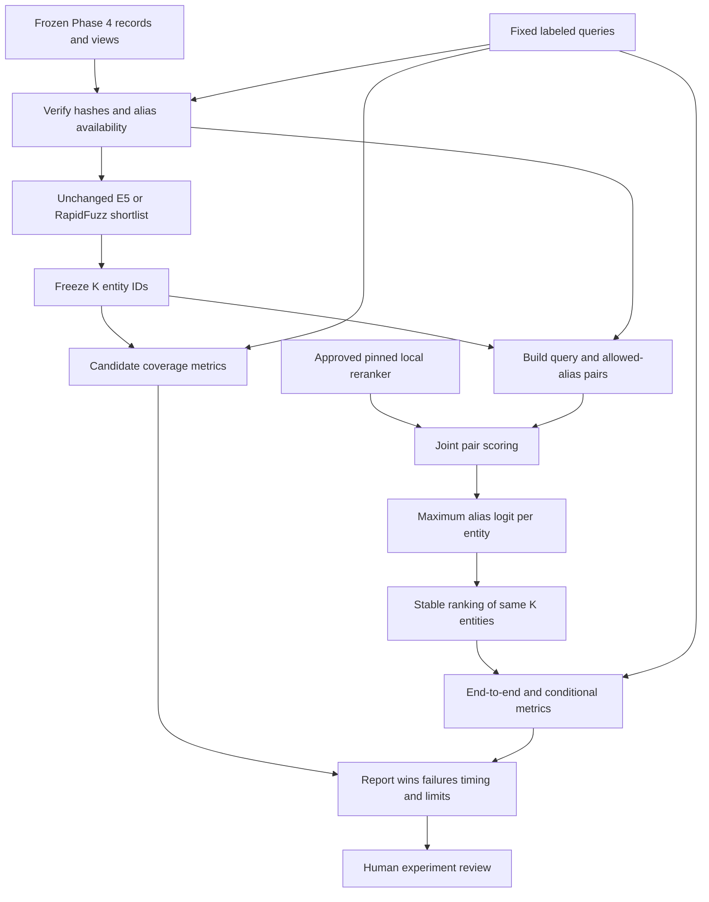
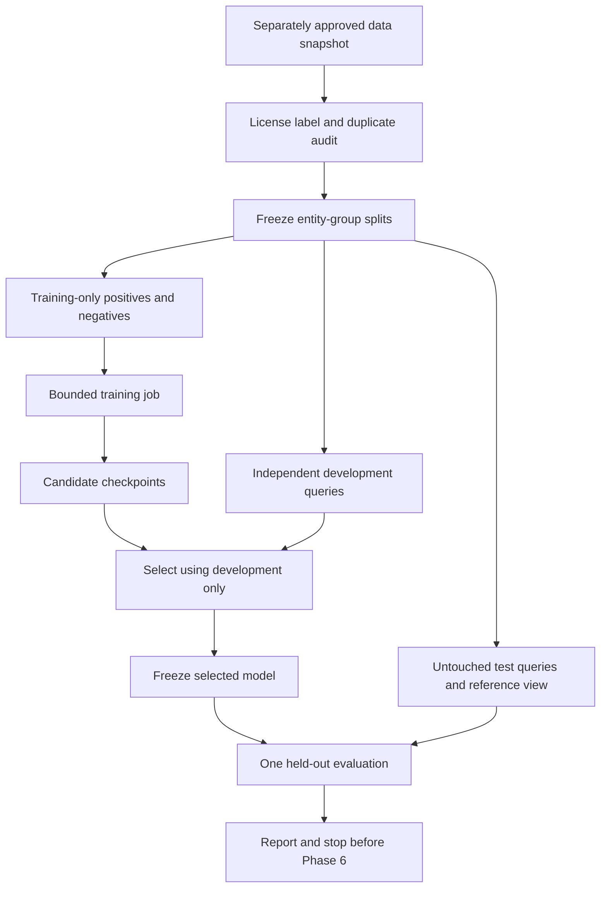

# Phase 5 plan: training readiness before fine-tuning

Planning only, 2026-10-21. Step B is **not approved**. No training, installation, dataset acquisition, model-weight acquisition or Phase 6 activity is authorized by this document. The immediate recommendation is a bounded **pretrained reranking pilot**, then a separate data-readiness decision. A negative experiment is a valid outcome.

## 1. Recommendation and the evidence behind it

Do not fine-tune on the current corpus. First test one existing multilingual cross-encoder without changing its weights. This isolates the question “does joint reading of two names improve the shortlist?” from the much harder question “did our training data teach something generalizable?”

Phase 4's saved test-challenge results, inspected again during this planning pass:

| Corpus | Independent target groups in this slice | RapidFuzz top-1 | E5 top-1 | E5 MRR |
|---|---:|---:|---:|---:|
| Original fictional | 3 | 20/27 | 26/27 | 0.981481 |
| Public subset | 6 | 129/141 | 141/141 | 1.000000 |
| New bilingual fictional | 6 | 16/30 | 25/30 | 0.911111 |

The bilingual cross-script subset was 2/12 versus 8/12, but invented person-like transliterations were only 2/4 for both methods. `Tavi O.` and cross-script `Neri Vasko` regressed to rank 2 under E5. These are exploratory error examples, not examples we may now use to train and then call unseen tests.

A reranker cannot rescue an entity absent from retrieval's shortlist. Conversely, a worse reranker can move a correct first candidate downward. We will report both effects. We will not assume a cross-encoder is more accurate merely because it is more expensive.

## 2. Fine-tuning from first principles — 5W1H

**What:** a model contains many adjustable numbers, called weights. A pretrained model has already adjusted them on another task or corpus. Fine-tuning starts with those weights and makes further adjustments using examples relevant to our task. **Why:** general language training may not teach the distinction between two near-identical names. **Who:** reviewers establish defensible record labels; the learning algorithm adjusts weights; humans decide whether results justify retaining the model. **When:** only after data, splits, license and compute approval. **Where:** local versioned data/model artifacts, or a separately approved cloud runtime. **How:** examples → predictions → loss → gradients → small weight updates → independent evaluation.

| Term | Simple meaning and name-matching example |
|---|---|
| Labeled pair | Two strings and a documented label, e.g. invented `Golden Moon Bakery` and `مخبز القمر الذهبي`, label 1 because the fixture assigns them to the same record. |
| Training | Use training pairs to change weights. Seeing the same training entity in many spellings is still seeing one entity. |
| Validation / development | Separate entity groups used to choose an epoch or configuration. We use these two words for the same partition here. Its labels do not enter gradient updates, but selection makes it unsuitable as a final test. |
| Testing | Evaluate a frozen choice on untouched groups. Do not adjust the model after seeing these results and reuse that test as independent evidence. |
| Loss | A numerical penalty for the current predictions. Smaller training loss means fitting training examples better, not necessarily matching new entities better. |
| Gradient | The direction and size of change in loss as each weight changes. Backpropagation computes these derivatives. |
| Learning rate | The size of the optimizer's steps. Large steps can destabilize learning; tiny steps can be ineffective. |
| Epoch | One pass through the defined training examples. Five passes over seven entities do not create 35 independent entities. |
| Batch size | Number of examples used together for one gradient calculation. Batch 8 means eight pairs, not necessarily eight independent entities. |
| Overfitting | Learning familiar names or synthetic-edit patterns so well that unseen entities fail. Falling training loss with worsening development retrieval is a warning. |
| Checkpoint | Saved weights plus configuration and, for resumable training, optimizer/random-state information. Select using development data only. |

Software tests prove mechanics such as loss arithmetic and split checks. ML evaluation measures how a frozen method ranks labeled examples. Neither alone proves real-world identity.

## 3. Bi-encoder and cross-encoder

A **bi-encoder** independently encodes the query and each reference alias, then compares vectors. We can cache reference vectors and search many records cheaply; E5 already fills this role.

A **cross-encoder** tokenizes the two texts as a pair and lets them interact inside the transformer before producing a score. It can attend to a mismatched word such as Golden versus Silver. Its candidate-side computation depends on the query, so it cannot replace our reusable reference-vector index. It is suitable for a small shortlist.

Together: retrieve broadly with E5, then inspect shortlisted names jointly. Names alone may still be ambiguous. An off-the-shelf passage-relevance reranker is not an identity model; neither its raw logit nor its sigmoid is calibrated identity probability. [Sentence Transformers cross-encoder documentation](https://sbert.net/docs/cross_encoder/pretrained_models.html).

## 4. Positive pairs and negatives

These examples are fictional and illustrative, not newly approved training data:

| Pair | Proposed role | Why / caveat |
|---|---|---|
| `Golden Moon Bakery` ↔ `مخبز القمر الذهبي` | Positive | Authored aliases of `ml-003`; translation label, not independent real-world evidence. |
| `Golden Moon Bakery` ↔ `Blue Cedar Library` | Easy negative | Clearly different invented records and substantially different words. |
| `Golden Moon Bakery` ↔ `Silver Moon Bakery` | Hard negative | Different invented IDs but overlapping words; a plausible ranking confusion. |
| `Neri Vasko` ↔ `Nera Vasko` | Hard negative in the authored fixture | A small spelling difference matters because the fixture explicitly defines separate entities. |
| `Amber Kite Studio` ↔ identical text under another ID | Ambiguous diagnostic | Names alone cannot justify a negative identity label. Keep distinct IDs, exclude from forced binary supervision. |

Different public IDs do **not** automatically prove different real-world entities. Same-ID aliases are provider-supported positive candidates, not guaranteed correct. Unresolved pairs go to a quarantine set with reasons. Mining means finding confusing candidates using a fixed retriever; it does not certify their labels.

## 5. Read-only training-data and license audit

The existing SQLite snapshot contains 20 `LegalEntity` records, 79 searchable aliases (20 `name`, 59 `alias`): 76 Latin and three Arabic. The parser preserves weak aliases but excludes them from retrieval; this selected snapshot contains no weak-alias rows. No normalized cross-record name collisions appear in its manifest. This does not rule out unknown duplicate identities.

| Partition | Entities | Aliases | Entities with ≥2 distinct normalized names | Possible unordered alias pairs | Entities with multiple scripts |
|---|---:|---:|---:|---:|---:|
| Train | 7 | 21 | 4 | 37 | 1 |
| Development | 3 | 9 | 2 | 13 | 1 |
| Calibration fit | 2 | 4 | 1 | 3 | 0 |
| Threshold selection | 2 | 9 | 2 | 22 | 0 |
| Test | 6 | 36 | 4 | 149 | 1 |

Pair counts use n(n−1)/2 within each ID after normalization. They are counts of combinations, not reviewed valid labels or independent samples. A single alias-rich entity can dominate them.

Additional available material: the original 12-entity/24-alias fictional fixture; the ten-entity bilingual fixture with two development, six test and two ambiguity IDs; and a three-entity fictional ingestion fixture. These demonstrate code behavior. The saved UN export contains 269 eligible non-person targets according to the Phase 2 import report, but only twenty are approved/imported. Expanding the selection is a separate decision even though the raw bytes are already local; the existing parser deliberately enforces a maximum of twenty. No persons, OFAC or EU expansion is proposed implicitly.

Known safeguards: explicit provider referents form groups before splitting; original script and provenance survive; query/alias ancestry and known text collisions are audited; Phase 4 compares frozen query/view hashes. Remaining risks: unknown upstream duplicate IDs, alias errors, related organisations mistaken for aliases, translations mistaken for transliterations, and reviewed test examples influencing model choices. All current benchmarks have been inspected, so future results on them are **regression diagnostics**, not a fresh generalization test.

The OpenSanctions bulk distribution currently permits noncommercial student/personal research under CC BY-NC 4.0. Keep OpenSanctions and UN attribution, source and license links, notices and modification descriptions. Commercial use requires a different review/license. This is not permission to publish every upstream field or relicense derived assets as unrestricted. Retain local public-data outputs and review redistribution of any later trained checkpoint separately. [Provider guidance](https://www.opensanctions.org/docs/commercial/exemption/), [CC BY-NC terms](https://creativecommons.org/licenses/by-nc/4.0/), [existing data card](data-card.md).

Why twenty records are insufficient: few independent target groups, an ID-sorted biased selection, only three Arabic aliases, no true disjoint-script public test query, repeated synthetic perturbations, tiny negative universe, and previously inspected test results. Creating thousands of pairs by recombination does not fix those problems. A high Recall@10 against twenty records is particularly weak evidence because half the index is returned.

## 6. Recommended future dataset: bounded Wikidata organisation names

Recommend a new **Wikidata structured-label/alias subset for non-person organisations**, prioritizing English and Arabic, with source-language tags and QIDs. This supports a small multilingual learning experiment with simpler reuse terms. It does not represent sanctions-screening queries or person transliteration.

Wikidata structured data is CC0; attribution is not required by CC0, but we will retain “Source: Wikidata contributors; CC0; selected and transformed for name-retrieval research,” QID/revision links, retrieval time and hashes. Do not copy Wikipedia article text, images or discussion pages: they have different terms. CC0 does not certify factual correctness or eliminate other rights. [Wikidata licensing](https://www.wikidata.org/wiki/Wikidata:Licensing), [data access and attribution guidance](https://www.wikidata.org/wiki/Wikidata:Data_access).

Proposed staged acquisition, **not performed or requested as part of the immediate reranking pilot**:

1. Separately approve a feasibility sample of at most 200 organisation groups and 10 MB of selected API responses. Check alias yield, Arabic coverage, redirects, duplicate links and reviewed labels. No people or website scraping.
2. If feasible, separately approve a target of **5,000 deduplicated organisation groups**, bounded at 100 MB of responses. This is a design target, not a verified count available under the filters. Use a frozen, documented candidate-QID selection across organisation categories and regions; resolve redirect/merge links before splitting. Avoid choosing the easiest names or ranking by model performance.
3. Use bounded paginated structured-data requests with an informative User-Agent, low concurrency, caching, backoff and a hard response-byte cap. Save selected responses and revision metadata, because live endpoints change and do not provide an automatically coherent historical snapshot. No whole Wikidata dump. If API limits or coverage prevent the plan, stop and revise rather than silently broaden it.
4. Restrict learning pairs to reviewed or clearly attributable name aliases. Exclude generic/descriptive aliases and unresolved parent/subsidiary, acronym and duplicate cases. Review at least 200 proposed positives and 200 mined negatives, stratified by script/type; report disagreements and exclusions. Have a competent Arabic reader check bilingual labels; without that review, mark them provisional and do not claim validated Arabic generalization.

A practical initial readiness gate is ≥2,000 usable groups, ≥1,000 train groups and ≥300 untouched test groups, with ≥100 distinct test groups supporting the claimed English↔Arabic slice. These are experiment-sizing targets, not statistical adequacy guarantees. If unmet, narrow the claim or defer training. Review all labels in a bounded independently authored/verified test-query set; 200–500 such queries is a proposed manageable first review workload, not data already in hand. Record natural aliases separately from synthetic edits.

A broader permitted OpenSanctions non-person corpus is a possible later domain-specific alternative, but adds NC obligations, cross-source duplicate resolution and label uncertainty. It is not necessary for the immediate pilot. Reserve the existing twenty records as a familiar domain-shift diagnostic, never report them as a pristine external test.

## 7. Candidate models and hardware feasibility

Documentation checked during this planning pass. File sizes below refer to one weight format, not repository totals. No weights were downloaded.

| Candidate | Verified role/license and rough weight size | Suitability |
|---|---|---|
| Existing `intfloat/multilingual-e5-small` | MIT; already local, ~471 MB weights, 384-dimensional bi-encoder | Keep frozen baseline. Optional later retrieval fine-tuning only if fresh evaluation shows retrieval misses. |
| `cross-encoder/mmarco-mMiniLMv2-L12-H384-v1` | Apache-2.0; ~471 MB safetensors plus ~22 MB tokenizer files; trained for multilingual query–passage relevance | Recommended **first inference-only pilot**. Names are a task mismatch; improvement is uncertain. |
| `microsoft/Multilingual-MiniLM-L12-H384` | MIT; card specifies 21M transformer + 96M embedding parameters; ~471 MB PyTorch weights | A base encoder, not a trained entity reranker. Requires a supervised scoring head and fine-tuning. Card warns of BERT architecture/XLM-R tokenizer pairing. Not the same checkpoint as the mMiniLMv2 reranker. |
| `FacebookAI/xlm-roberta-base` | MIT; multilingual masked-language-model base; roughly 278M parameters, ~1.12 GB safetensors | Reasonable later cross-encoder backbone with a new supervised head, but heavier and not an out-of-box name classifier. |

Primary sources: [mMARCO model card](https://huggingface.co/cross-encoder/mmarco-mMiniLMv2-L12-H384-v1), [mMARCO files](https://huggingface.co/cross-encoder/mmarco-mMiniLMv2-L12-H384-v1/tree/main), [MiniLM card](https://huggingface.co/microsoft/Multilingual-MiniLM-L12-H384), [MiniLM files](https://huggingface.co/microsoft/Multilingual-MiniLM-L12-H384/tree/main), [XLM-R card](https://huggingface.co/FacebookAI/xlm-roberta-base), [XLM-R files](https://huggingface.co/FacebookAI/xlm-roberta-base/tree/main), [existing E5 model card](model-card.md).

The mMARCO card describes machine-translated MS MARCO training; its English/Arabic coverage is relevant but is not evidence of name matching. Proposed fixed revision: `1427fd652930e4ba29e8149678df786c240d8825`, verified from the [repository commit](https://huggingface.co/cross-encoder/mmarco-mMiniLMv2-L12-H384-v1/commit/1427fd652930e4ba29e8149678df786c240d8825). Before acquisition, inspect that revision's exact file sizes and hashes; refuse any discrepancy or total above the requested cap. Keep the Apache license and supplied notices, mark modifications, and retain attribution on redistribution. MIT candidates likewise retain license/copyright notices. [Apache-2.0 terms](https://www.apache.org/licenses/LICENSE-2.0).

**Memory estimates, not measurements:** float32 weights require approximately 4 bytes/parameter. Full float32 Adam training additionally stores gradients and two optimizer moment arrays, giving approximately 16 bytes/parameter before activations, temporary buffers and framework overhead. For a ~117M model that is ~0.47 GB weights or ~1.87 GB training states; for ~278M it is ~1.11 GB or ~4.45 GB. Parameter counts and storage formats differ slightly by head.

| Proposed workload | Planning envelope, not a benchmark |
|---|---|
| MiniLM reranker, CPU float32, short pairs, batch 8 | ~1–3 GB process memory; budget 4 GB, measure actual peak; run sequentially with E5 or load saved E5 candidates to avoid holding both models unnecessarily. |
| Small-model full fine-tuning, pair length 128, microbatch 4–8 | Roughly 4–8 GB total working memory; establish with a bounded pilot before committing. |
| XLM-R-base full fine-tuning at similar settings | Roughly 8–14+ GB; risky alongside macOS/apps on a 16 GB machine. Prefer a suitably provisioned GPU runtime if later approved. |

Your inspected M4 Air has 16 GB unified memory shared by CPU, GPU and the OS. CPU inference is the conservative first comparison. PyTorch supports Apple's MPS backend, but availability, supported operations and reproducibility must be checked; do not silently fall back from GPU to CPU and report misleading timings. [PyTorch MPS documentation](https://docs.pytorch.org/docs/2.14/notes/mps.html).

Colab may offer a suitable CUDA GPU, but GPU type, memory, session duration and availability are not guaranteed. Inspect the assigned device before choosing batch/precision, checkpoint progress, and obtain approval before uploading data or paying for compute. The friend's “fits on free Colab” is a possibility, not a guarantee. [Colab resource FAQ](https://research.google.com/colaboratory/faq.html).

## 8. Staged experiments and precise immediate scope

**5A — recommended next approval: pretrained reranking only.** Reuse the existing dependencies and three frozen Phase 4 benchmarks. Download only the pinned mMARCO MiniLM reranker, selected safetensors/tokenizer/config/license files, with a **600 MB total acquisition ceiling**. No new dataset, training, automatic package upgrade, Colab upload or service. Reserve 2 GB additional disk for weights/results and a 30-minute local inference budget, stopping with a partial-run/error report if exceeded. Expected pilot duration is minutes, but not measured; a short timing sample will estimate the full run. No guarantee of improved rankings.

Fixed experiment contract:

- Primary shortlist **K=5**; predeclared K=10 sensitivity diagnostic, not a setting chosen after seeing results. No union/hybrid retriever added.
- Two paired arms: unchanged E5→reranker versus E5, and unchanged RapidFuzz→the same reranker versus RapidFuzz. Keep each retriever's candidate IDs fixed within its paired comparison. Compare retriever coverage separately; don't attribute different shortlists to the reranker.
- Consume saved Phase 4 queries, scores and IDs after verifying source/view/config hashes. Retain full historical results unchanged. A separate live offline timing pass can measure the old retrieval calls without overwriting those artifacts.
- For each shortlisted entity, score `(normalized query, normalized reference alias)` for every alias available **in that query's frozen reference view**. Never restore withheld aliases, query-script aliases or gold targets. Take maximum alias logit; stable ties use alias ID then entity ID. Store the winning original text, IDs, number of aliases scored and provenance. More aliases mean more opportunities for a high score; report this limitation.
- Use the cross-encoder's pair tokenizer, CPU float32, batch 8 and raw logits with no E5 `query:` prefix. Pair direction is query first. Proposed maximum pair length 512 tokens, explicit preflight length checks and no silent truncation. An oversized pair or nonfinite score is an error, not a match/clear result. No symmetrizing scores or tuning aggregation on tests.
- Return only the reranked K candidates; do not invent scores for the remaining corpus. Use MRR@K and conditional reranking accuracy as defined below. A retrieval miss contributes zero to end-to-end metrics. Never force the target into a shortlist to make evaluation easier.
- Old benchmarks are labeled exploratory/regression diagnostics throughout. Show all failures, rank changes, ambiguities, retrieval misses and wins. No training-loss plot exists in this inference-only step.

**5B — separate approval: data acquisition/label readiness.** Conduct the Wikidata pilot, audit and possible expansion described above; freeze splits and a new evaluation protocol before training. Snapshot the new dataset separately; never overwrite `data/watchlist.sqlite` or the twenty-record importer limits.

**5C — optional, separately approved training.** Decide from fresh development evidence:

- If Recall@K is the bottleneck, fine-tune a copy of E5-small with a contrastive retrieval objective such as MultipleNegativesRankingLoss, preserving the original checkpoint/cache. Positives should outrank verified negatives. Ensure no two batch records describe the same group and no alias of another positive becomes an in-batch negative. Gradient accumulation does not automatically enlarge the contrastive negative pool; choose a tested batching/loss scheme. [Sentence Transformers loss overview](https://www.sbert.net/docs/sentence_transformer/loss_overview.html).
- If the target is retrieved but ranks poorly, fine-tune a copy of the smaller cross-encoder using reviewed binary pairs and BCEWithLogitsLoss. Start with one architecture; XLM-R is an alternative requiring a separate resource decision, not a parallel automatic experiment.
- Start with a tiny correctness smoke run on training-only examples; then at most three epochs, learning rate 2e-5 as a proposed initial value, batch 4–8, fixed length budget, seed 42, development checks each epoch, and early stopping after one epoch without development MRR@K improvement. Freeze actual configuration after the data/resource preflight; no broad hyperparameter sweep. If running multiple seeds later, predeclare them, report all, and select using development only. Save optimizer/config/RNG state for resume.
- Compare the pretrained and trained versions on identical fresh views/queries. For bi-encoder changes, regenerate only its versioned reference cache and measure candidate coverage; for cross-encoder changes, freeze retrieval candidates to isolate reranking. Test once after model choice; failure does not authorize adjusting and retesting on the same claimed holdout.

## 9. Splits, sampling and leakage defenses

Keep all old manifests unchanged. A new corpus gets a new grouping/partition manifest. Use the already approved target proportions: **50% train, 15% development, 10% calibration fit, 10% threshold selection, 15% test**. At 5,000 independent groups this targets 2,500 / 750 / 500 / 500 / 750. Deterministic hash assignment gives approximate counts; any stratified allocation is defined before scoring. Calibration and threshold groups remain reserved and unused in Phase 5.

1. Resolve known redirects, merges, provider referents and explicit cross-source identity links before splitting. Keep separate IDs as evidence but assign linked records one leakage group. Parent/subsidiary and similar-name links alone are not identity equivalence. Quarantine unresolved possible duplicates. Any later merge crossing partitions invalidates the split and requires a new version.
2. Give every original alias, synthetic variant, positive pair and candidate negative a group ID and partition. Both sides of every training pair must be training entities. Development negatives come only from development groups; test negatives only from test groups. A separate final retrieval index may contain all permitted reference groups as distractors, but held-out names/labels never enter training examples or mining.
3. Within each partition, deduplicate pairs and reversed equivalents where appropriate. Detect shared normalized aliases and generated strings across partitions; exclude those query/pair cases from positive supervision and keep an ambiguity diagnostic with counts. Similar strings are flags for review, never automatic identity merging. Hash text to audit overlap without displaying private information.
4. For each train group, sample at most four distinct positive pairs, with a cap on synthetic variants and explicit natural-alias/translation/transliteration/edit tags. Preserve original and normalized strings, alias IDs, source revisions and label-review status. Exact self-pairs are sanity checks, not the whole training set.
5. Per positive, propose one easy negative drawn deterministically from different train groups and up to two reviewed hard negatives: one from unchanged RapidFuzz and one from unchanged E5's train-only index. Exclude same-group, linked, identical-name, parent/child-uncertain and unresolved candidates; log shortages instead of fabricating certainty. Review the bounded hard-negative pool or keep it out of the supervised run. Cap each group's influence; do not enumerate every alias Cartesian product.
6. With 2,500 train groups and four positives each, the ceiling is 10,000 positives plus 30,000 negatives, **40,000 pairs**, before shortages/exclusions. This is a budget, not an observed yield. Natural aliases must be reported separately from artificial variations.
7. Freeze development/test queries independently of the mining process. Hold out a real alias or one entire script direction from the target reference for challenge queries. Keep exact lookup separate. New hidden test IDs must not overlap known old IDs or reviewed duplicate groups; do not move old test examples into new training and retain their old “test” label.

For the primary fresh test, score against a fixed reference corpus of thousands of records with controlled alias availability. Report query-weighted and entity-macro results; bootstrap by entity group, not pair, only when enough groups and a justified sampling design exist. A bootstrap cannot fix selection bias or incorrect labels. Script directions, natural aliases, typos, word order, organisation translations and person-like fictional transliterations remain separate slices. Organisation-only data cannot establish person-name performance.

## 10. Binary cross-entropy and learning, with numbers

For label y∈{0,1}, let z be a raw logit and p=sigmoid(z)=1/(1+exp(−z)). Binary cross-entropy is:

`L = −[y log(p) + (1−y) log(1−p)]`.

Illustration, not an actual training result:

- A positive pair with p=0.8 has loss −log(0.8)=0.2231. Predicting p=0.2 gives 1.6094, a larger penalty.
- A negative pair with p=0.8 has loss −log(0.2)=1.6094. Lowering it to p=0.2 reduces loss to 0.2231.
- For one positive at p=0.8 and one negative at p=0.2, the mean loss is 0.2231. A balanced pair batch with p=0.5 everywhere has loss 0.6931.
- The derivative with respect to z is p−y. At p=0.8 it is −0.2 for the positive, pushing the logit upward under gradient descent, and +0.8 for the negative, pushing it downward. Backpropagation carries those gradients into the weights; the optimizer updates them using the learning rate. Shared weights mean improving one pair can worsen another.

Use `BCEWithLogitsLoss` directly on logits for numerical stability; do not apply sigmoid twice. A sigmoid output is a training score, not a calibrated probability that two real people are identical. Negative sampling changes the class mixture, and a low loss under a 1:3 pair ratio says nothing about live screening prevalence. Track training loss, fixed-development loss and retrieval/reranking metrics together. [PyTorch loss documentation](https://docs.pytorch.org/docs/2.14/generated/torch.nn.BCEWithLogitsLoss.html).

## 11. Metrics that separate retrieval from reranking

Let N be eligible positive queries, H those whose target is in the first K distinct retrieved entities, and C those ranked first after reranking.

- **Candidate Recall@K:** H/N. Measures what the retriever makes available. Reranking exactly that set cannot change it.
- **End-to-end Recall@1:** C/N. Retrieval misses count as failures.
- **Conditional reranking accuracy:** C/H, where the denominator includes only retrieved targets; N/A if H=0. Name this explicitly so it cannot hide retrieval misses.
- **MRR@K:** mean reciprocal rank within the K-candidate output, assigning zero when the target is absent. Compare with the same retriever truncated to K, not its old full-corpus MRR.
- **Full-corpus MRR:** remains a separately labeled historical retrieval metric. Do not append a guessed tail after reranking and call it measured full reranker MRR.
- **Recall@10/@50:** useful only when the underlying candidate universe is larger than k and the experiment actually retrieves that depth. The immediate pilot reports Recall@5; K=10 is a sensitivity diagnostic with N/A when it covers the corpus. K=50 is deferred to a larger index.
- **Latency:** separate retrieval, pair tokenization/scoring, alias aggregation and total live pipeline. Include per-query alias-pair counts, batch size, device, model load, median/p95 and observations. A run using saved candidates measures reranking only; do not label it end-to-end latency.

Hand example: four queries; three targets enter top-5; their reranked ranks are 1,2,1. Candidate Recall@5=3/4, end-to-end Recall@1=2/4, conditional accuracy=2/3, MRR@5=(1+1/2+1+0)/4=0.625. A reranker with perfect conditional ranking still cannot exceed 3/4 end-to-end top-1 on that shortlist.

Keep `index_entity_count` separate from `returned_candidate_count`: a returned shortlist of five does not mean the underlying index contains only five entities. The new evaluator must not accidentally reuse the old full-ranking length as the corpus-size test for N/A. Save numerator, denominator, entity count, exclusion count and N/A reason for every metric. Ambiguous/absent queries remain separate diagnostics. No pair-classification accuracy headline, screening-level precision, calibrated thresholds or operational false-positive guarantee in Phase 5; those require later approved work and suitable data.

## 12. DAGs and feedback boundaries

Immediate inference experiment:



F/Q feed validation; R needs valid names/views; S fixes membership; B may use only allowed aliases; P needs those pairs and the approved weights; G groups alias scores; O sorts the same IDs. C measures retrieval coverage; E compares ranked IDs with labels; H collects both. Gold labels feed measurement, not candidate construction. Human review does not edit this run's labels or settings.

Optional future offline training artifact flow:



Epochs and gradient updates repeat inside the training job; that optimization loop is not a request-level DAG. Future human feedback may propose a new dataset/version and new experiment. It never feeds the same reported test result back into weight fitting. Reserved calibration groups have no edge into Phase 5 training or model selection.

## 13. Planned files and commands — none implemented yet

For **5A only**, create:

| File | Intended purpose |
|---|---|
| `src/watchlist/reranking.py` | Pinned bounded acquisition/local loading; pair scores; best-alias entity ranking; provenance. Separate from the frozen E5 module. |
| `src/watchlist/evaluate_reranking.py` | Verify existing artifacts, freeze shortlists, run both paired arms, calculate coverage/conditional/end-to-end metrics and timing. |
| `eval/configs/reranking.json` | Fixed model revision, CPU/precision, pair order, normalization, token limit, K values and budgets. |
| `tests/test_reranking.py` | Mock scores, distinct IDs, tie ordering, held-out alias protection, missing candidates, token/shape/score errors. |
| `tests/test_reranking_evaluation.py` | Hand-calculated denominators/MRR, equal candidate membership, truncated baseline comparisons, frozen artifacts. |
| `tests/integration/test_reranker_model.py` | Opt-in local-weight smoke test, output shape and repeated scores; no network. |
| `eval/results/phase05/reranking/{fictional,multilingual}/{results.json,report.md}` | Fictional raw ranks, metrics and failure reports. |
| `data/evaluation/phase05/reranking/public-small/{results.json,report.md}` | Ignored local public-derived results. |

Modify only `README.md`, `docs/model-card.md`, `docs/adr/0004-training-decision.md`, `docs/progress/phase-05.md`, `docs/evaluation-plan.md` and `docs/implementation-phases.md` to record implemented scope/actual results after approval. Existing ignore rules already cover model caches and public results. Do not modify RapidFuzz/E5 scorers, normalization, original fixtures, split manifests, old results, dependency lock or existing SQLite. If compatibility requires a dependency change, explain it and obtain specific approval before installing.

Illustrative future CLI contract, **not runnable until implemented and approved**:

```sh
.venv/bin/python -m watchlist.reranking fetch --config eval/configs/reranking.json
.venv/bin/python -m watchlist.reranking verify --config eval/configs/reranking.json
HF_HUB_OFFLINE=1 TRANSFORMERS_OFFLINE=1 .venv/bin/python -m pytest -q -m 'not integration'
HF_HUB_OFFLINE=1 TRANSFORMERS_OFFLINE=1 RUN_RERANKER_INTEGRATION=1 .venv/bin/python -m pytest -q tests/integration/test_reranker_model.py
HF_HUB_OFFLINE=1 TRANSFORMERS_OFFLINE=1 .venv/bin/python -m watchlist.evaluate_reranking --config eval/configs/reranking.json
```

The first command alone acquires the explicitly approved model; the others are offline. Existing NumPy, Torch, Transformers and Sentence Transformers should support this pilot; compatibility must be tested, not presumed. No install command is proposed for 5A.

Only if **5B/5C** are separately approved, propose `src/watchlist/training_data.py`, `src/watchlist/training.py`, `tests/test_training_data.py`, `tests/test_training.py`, `eval/configs/training.json`, `data/training/phase05/` for pairs/manifests, and versioned trained-checkpoint/result directories. A Wikidata-specific acquisition adapter and fixture would be specified in that approval, not folded into the UN importer. Example later commands: `python -m watchlist.training_data audit --config ...`, `python -m watchlist.training --config ... --smoke`, then `--train` only after resource/label checks. Those interfaces are proposals, not existing commands. Any new trainer dependencies such as datasets/accelerate require version/size/installation approval; a simple existing-Torch loop may suffice.

## 14. Tests, acceptance, risks and approval gate

5A acceptance means: approved model/license/hash receipt; offline loading; both unchanged baselines preserved; shortlist membership invariant; withheld aliases absent; original text/provenance retained; correct max-alias grouping; no gold-target injection; finite/raw score handling; hand-checked conditional metrics; real integration isolated from offline tests; repeatable rankings within documented tolerance; every query/failure and actual latency saved. Improvement is not required. Stop if compatibility, download/resource caps or benchmark integrity fail; never silently change the experiment.

Training readiness additionally requires reviewed nonempty splits, explicit group disjointness, both sides of training negatives confined to training, collision/duplicate quarantine, pair caps and label audit, fresh evaluation labels, reproducible sampler, finite loss/gradients, a training-only tiny overfit smoke test, checkpoint reload agreement and budgeted validation. A tiny overfit smoke test checks that optimization can work; it is not evidence of generalization. Fresh evaluation and learning curves decide whether trained weights are worth retaining.

Risks: false identity matches from similar names; false negatives from unrecognized scripts; noisy provider/Wikidata aliases; parent/subsidiary confusion; synthetic-edit bias; underrepresented scripts; passage-relevance task mismatch; alias-rich entities favored by max pooling; automatic negative labeling of duplicate IDs; adaptive reuse of exposed tests; hidden pretraining overlap; unstable memory/time estimates; and low sampled-pair loss misrepresented as screening accuracy. Mitigate through evidence preservation, reviewed labels, frozen partitions, bounded experiments, independent testing and explicit limitations—not stronger wording in the output.

The friend's proposal motivates retrieval, hard negatives, pairwise training and rigorous evaluation. This plan keeps that direction while making training conditional on evidence. A pretrained reranker may fail; a trained model may overfit; neither is a promised improvement. Phase 6 calibration, thresholds and automatic decisions remain excluded.

**Approval requested next: 5A only — implement the inference-only reranking pilot, reuse the current environment/data, and acquire the pinned MiniLM reranker within 600 MB.** This does not approve dataset expansion, fine-tuning, cloud upload, new package installation or Phase 6.
