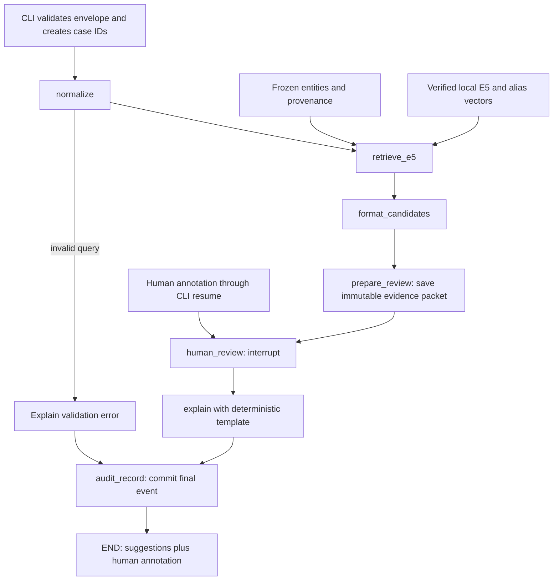

# Phase 7A plan — local LangGraph orchestration and human review

Date: **2026-10-22** (user timezone Asia/Kolkata). **Planning only. Implementation and installation are not approved.** This is the next selected milestone after Phase 5A, using the original roadmap's Phase 7 numbering. Phase 5B/5C training/data expansion and Phase 6 calibration remain deferred, not completed. The user's review-only policy supplies the routing policy needed for this milestone. We are not implementing the wider Phase 8 memory system or Phase 9 service/UI.

Read alongside [design](design.md), [evaluation protocol](evaluation-plan.md), [implementation roadmap](implementation-phases.md), [ADRs](adr/0005-review-workflow.md), [Phase 5A evidence](progress/phase-05a.md), and the original [Project 1 proposal](reference/internship-2093-portfolio-plan.html). The latest user decisions override older speculative branches in those documents.

## 1. Goal and fixed decisions

Make one research query into a durable case: retrieve candidates, show their evidence, pause, accept a human annotation later, explain what was recorded, and retain an auditable history. Completion means reliable workflow behavior, not improved matching accuracy.

- Default agent retrieval: existing `intfloat/multilingual-e5-small`, revision `614241f622f53c4eeff9890bdc4f31cfecc418b3`, CPU float32/four threads, existing normalization, symmetric `query: ` prefixes, mean pooling and exact NumPy cosine search. Reuse current model/cache verification.
- Default **five distinct candidates**, same maximum-alias and stable-ID tie rules. K is a display/retrieval depth, not an operating threshold. No score filtering.
- MiniLM reranking is absent from this graph and disabled in its configuration. Preserve its source, tests, weights and negative results. No graph flag silently re-enables it. Its standalone experiment remains available.
- No fitting, calibration, thresholds, automatic identity-match/clear decisions, new datasets, new weights, LLM calls, API keys, remote tracing, cloud upload or public service.
- Every valid successfully processed query, including an empty candidate list, reaches human review. Errors remain errors. An empty list says only that this retrieval returned no candidates from this snapshot.
- Start with the existing fictional fixture; support an explicit existing local SQLite snapshot through the same read-only adapter. No new imports or corpus expansion. No private personal data in demos.
- The new agent CLI defaults to E5. The old `python -m watchlist` RapidFuzz CLI remains a preserved baseline; its behavior will not silently change.

Measured justification, read from saved Phase 5A primary K=5 **test challenges**, not rerun:

| Dataset | Queries / groups | E5 R@1 → E5+MiniLM R@1 | E5 MRR@5 → reranked MRR@5 |
|---|---:|---|---|
| Original fictional | 27 / 3 | 26/27 → 25/27 | .981481 → .962963 |
| Public subset | 141 / 6 | 141/141 → 139/141 | 1.000000 → .991726 |
| Multilingual fictional | 30 / 6 | 25/30 → 21/30 | .911111 → .841667 |

K=10 did not reverse the regressions. Familiar, correlated query sets cannot prove broad generalization. Orchestration should preserve E5's output, not claim to improve these metrics. Original reports and result JSON stay byte-identical.

## 2. LangGraph from first principles

An ordinary pipeline is a sequence of Python calls: clean a name, retrieve records, print them. That is enough for the existing matcher. If the process closes, ordinary in-memory variables disappear. We could implement our own saved workflow in Python/SQLite; LangGraph is not mathematically necessary and will not make retrieval smarter.

For this learning milestone, LangGraph provides a standard way to describe steps and preserve progress around a human pause. A **graph** is a map of functions and the arrows between them. A **node** is one function. An **edge** names what can run next. **State** is the shared case record each function reads and updates. `StateGraph` declares that structure; compiling it produces the runnable workflow. We will use sequential functions and ordinary typed dictionaries, not a chatbot or an autonomous tool chooser. Nodes return small state updates; default replacement semantics suit our immutable candidate packet. No append-list reducer is needed. [Official Graph API](https://docs.langchain.com/oss/python/langgraph/graph-api).

| Concept | What / why | Who / when / where / how in our design |
|---|---|---|
| Orchestration | Coordinating existing functions; useful when work spans process lifetimes. | The developer defines the graph; local CLI invokes it per case. It never replaces E5 with an LLM. |
| Typed state | A named set of fields and expected value types, like a case form. | Developers use `TypedDict` to clarify contracts; runtime validators enforce them at input, resume and persistence boundaries. Type hints alone do not reject bad input. |
| Checkpoint | A saved workflow snapshot, not a model-weight checkpoint. | LangGraph saves case progress to local SQLite; the next CLI process can read it. No weights or tensors are put in state. |
| Thread ID | The stable identifier used to locate this case's checkpoints. | The application generates a fresh UUID once per query. The reviewer supplies the same ID later. It is not a password or authenticated identity. |
| Interrupt/resume | Pause for external input, then continue the case. | The review node pauses; the CLI later submits a validated human annotation. It does not hold a Python process open overnight. |
| Persistence | Keeping information after process exit. | SQLite stores checkpoints plus a separate case/audit ledger. Closing the terminal does not intentionally erase a pending review. |
| Idempotency | Repeating an operation has the same intended effect once. | Unique event/submission keys prevent a restarted node from recording a second final decision. Conflicting duplicates fail. |
| Provenance | A record of where evidence and scores came from. | The candidate packet contains source IDs/text, snapshot hashes and model recipe; the reviewer sees it before deciding what to investigate. |
| Audit trail | Ordered records of requests, evidence and human annotations. | Local transactions and linked hashes support inspection. A hash is not authentication, and a locally stored chain is not tamper-proof. |

Tradeoff: LangGraph adds dependencies, checkpoint formats and recovery semantics to learn. We use it specifically to learn and test durable human review. If durable pause/resume were removed, a normal Python pipeline would be simpler.

## 3. Proposed request DAG and nodes



Only the selected branch executes. The audit node accepts either a valid completed annotation or an explicitly invalid-input result; it never turns an error into a reviewed case. Operational failures (missing weights, corrupt index, disk full) stop the current attempt and surface a nonzero exit, outside the successful DAG; they do not take a “clear” branch. The service records an error event if storage is available and leaves recoverable checkpoint progress intact.

| Node | Inputs and output updates | Side effects and acceptance rule |
|---|---|---|
| `normalize` | Original query → existing normalized text, or structured validation error. | Preserve original text. Reuse the existing 1–200-character rules and script-preserving normalization. No transliteration, entity parsing or extra attributes. |
| `retrieve_e5` | Normalized query + frozen model/reference recipe → ordered candidates and retrieval manifest. | Adapter calls existing encoder/cache/ranker unchanged. Only local inference/cache preparation. No MiniLM import or fallback to another model. Preserve alias IDs and scores. |
| `format_candidates` | Candidates + snapshot/model metadata → evidence records, limitations and packet digest. | Pure formatting/validation, no rescoring. Keep distinctions between missing fields and disagreement. No invented DOB/nationality evidence. |
| `prepare_review` | Frozen packet → durable packet receipt, review revision 1 and `pending` status. | Idempotently store `suggestions_ready` event and packet before the review node. This separate node makes the pending state a completed checkpoint step. |
| `human_review` | Frozen packet + resume annotation → validated reviewer decision and `recorded` status. | One unconditional `interrupt()`; no writes before it. Revalidate resumed payload, check its durable submission receipt, and return the update. No nested graph, dynamically reordered interrupts or broad exception handler swallowing the pause. |
| `explain` | Packet + reviewer annotation (or input error) → structured deterministic explanation. | Cite entity/alias/evidence IDs. Distinguish recorded source claims, scores and reviewer opinion. No LLM, free-text execution or identity verdict. |
| `audit_record` | Case/evidence hashes + explanation + annotation → final audit receipt and committed status. | Transactional, idempotent final event. Return `completed` to the CLI only after receipt and checkpoint agree. Failure is visible; never claim completion if the write failed. |

**DAG versus loops:** the logical successful path has no backward edge. Pausing and continuing `human_review` advances the same case. A process crash may replay a node internally; that is a recovery loop, not an extra matching step. Invalid CLI review input is rejected before graph invocation; the reviewer can correct the form without changing the packet. A changed query or desired correction starts a new linked case, rather than silently overwriting a completed review. Cross-case memory, reviewer-to-training feedback, automatic re-search and autonomous iteration are excluded.

## 4. Typed state contract — illustrative design, not application code

Use JSON-compatible values only. The notation below specifies the proposed `state.py`; no Python source file is created during planning. Types describe structure; explicit validators enforce string limits, enum values, ID membership, finite scores and allowed transitions.

```python
from typing import Literal, TypedDict

class AliasEvidence(TypedDict):
    evidence_id: str
    entity_id: str
    alias_id: str
    original_text: str
    source: str
    synthetic: bool
    snapshot_id: str
    provider: str | None
    publisher: str | None
    source_url: str | None
    retrieved_at: str | None
    source_updated_at: str | None
    raw_sha256: str | None
    license_url: str | None
    attribution: str

class CandidateEntity(TypedDict):
    entity_id: str
    display_name: str
    entity_type: str
    rank: int
    matched_alias_id: str
    matched_alias: str
    evidence_ids: list[str]
    similarity_score: float
    score_kind: Literal["cosine_similarity"]

class RetrievalManifest(TypedDict):
    model_id: str
    model_revision: str
    model_files_sha256: dict[str, str]
    model_config_sha256: str
    normalization_version: str
    prefix: str
    pooling: str
    dimension: int
    device: str
    dtype: str
    threads: int
    package_versions: dict[str, str]
    dataset_snapshot_id: str
    reference_view: str
    reference_sha256: str
    alias_cache_key: str
    top_k: int
    reranker: Literal["disabled"]

class ReviewerDecision(TypedDict):
    submission_id: str
    review_revision: int
    evidence_sha256: str
    expected_checkpoint_id: str
    outcome: Literal["candidate_for_follow_up", "none_selected", "unresolved"]
    candidate_entity_id: str | None
    reviewer_id: str
    reason: str
    submitted_at: str

class Explanation(TypedDict):
    template_version: str
    text: str
    evidence_ids: list[str]
    limitations: list[str]

class WorkflowError(TypedDict):
    code: str
    stage: str
    message: str
    retryable: bool

class ReviewState(TypedDict):
    schema_version: str
    workflow_version: str
    workflow_sha256: str
    thread_id: str
    audit_id: str
    parent_audit_id: str | None
    created_at: str
    query: str
    normalized_query: str | None
    candidates: list[CandidateEntity]
    evidence: list[AliasEvidence]
    retrieval: RetrievalManifest | None
    evidence_sha256: str | None
    review_revision: int
    review_status: Literal["not_requested", "pending", "recorded"]
    reviewer_decision: ReviewerDecision | None
    explanation: Explanation | None
    error: WorkflowError | None
    audit_status: Literal["pending", "committed"]
    audit_event_id: str | None
    audit_head_sha256: str | None
```

Initialize all fields explicitly. Input schema exposes only the query and approved dataset selection; the service, not input text, creates IDs/configuration/status fields. Runtime dependencies (encoder, NumPy arrays, DB connections, locks) are injected into node closures/context, not serialized into state. Candidate/evidence lists use replacement semantics, not append reducers that could duplicate candidates on replay.

One source record can own several original aliases; preserve the available alias evidence and identify the winning alias separately. Synthetic provenance has an authored source tag and fixture fingerprint; do not manufacture provider URLs or timestamps. For SQLite, copy the existing `Provenance` fields and attribution. Snapshot/record IDs identify observations, not verified real-world identity.

The review packet digest covers canonical JSON of query, normalized query, candidates, original evidence, retrieval manifest, schema/workflow identifiers and review revision. Use sorted keys, stable list order, UTF-8 and no NaN; retain full finite score precision. Exclude changing review status, timestamps of later submissions and telemetry. The original packet is immutable once `prepare_review` succeeds. Compare its stored bytes/digest with checkpoint state before showing or accepting a review.

Review validation: `candidate_for_follow_up` requires exactly one supplied candidate ID; other outcomes require null. Require a nonblank reason (proposed maximum 1,000 characters), valid submission UUID, matching revision/digest/checkpoint, and a locally assigned reviewer identifier. Reject unknown fields, fabricated candidate IDs and attempts to submit `match`, `clear`, probability or edited retrieval state. A reviewer can select a lower-ranked candidate; selecting none is not a declaration that no matching record exists.

## 5. Pause, persistence and restart behavior

LangGraph's documented pause requires a checkpointer and the same `thread_id` on resume. `interrupt(payload)` exposes a serializable request; `Command(resume=payload)` supplies its return value. Crucially, the interrupted node restarts from its beginning, so preceding code can run again. We choose one fixed interrupt and keep it free of side effects. The simple `invoke()` API exposes pauses through `__interrupt__`; streaming is unnecessary for this CLI. [Interrupt documentation](https://docs.langchain.com/oss/python/langgraph/interrupts).

Illustrative calls only:

```python
config = {"configurable": {"thread_id": case_thread_id}}
# graph is compiled with a file-backed SqliteSaver kept open for this call.
result = graph.invoke(initial_state, config=config, durability="sync")
# A later process reconstructs the same workflow and opens the same files.
result = graph.invoke(Command(resume=validated_review),
                      config=config, durability="sync")
```

A checkpointer stores workflow snapshots; an in-memory saver cannot survive restart. A LangGraph Store is different: cross-thread memory. We need the former and do not introduce the latter. [Persistence concepts](https://docs.langchain.com/oss/python/langgraph/persistence).

Use synchronous checkpoint durability so a completed step is persisted before the next begins. Inspect the latest state through `graph.get_state(config)` and its pending tasks/interrupts before deciding how to recover. Do not accept user-supplied arbitrary checkpoint IDs for time travel or state edits. Reuse the same checkpoint file and workflow version; a new thread ID would start a different case. [Checkpoint guide](https://docs.langchain.com/oss/python/langgraph/checkpointers).

**Our proposed application recovery protocol** (not a claim of automatic exactly-once execution by LangGraph):

1. `start` creates thread/audit UUIDs and a durable case header once, before invocation. Keep that initial envelope for a crash before the first checkpoint. A new `start` is a new request; `recover` addresses the existing case.
2. All mutating commands hold one local process lock for the review workspace. Use an OS advisory lock that releases on process death, not a stale “lock exists” flag. Release it when the graph pauses; no database transaction stays open during human thinking time. This is a single-user, single-writer pilot.
3. `status` loads and validates the saved packet/checkpoint; it does not rerun retrieval. Show a pending review only after its packet receipt exists. Review-pending restart uses the saved candidates even if the model is unavailable; loading E5 is lazy and only needed for retrieval.
4. `review` checks thread existence, pending state, revision, evidence digest, expected latest checkpoint, candidate membership and outcome. In one case-ledger transaction it records an immutable submission with a unique submission ID and `review_submitted` event. Then it invokes `Command(resume=...)` using that exact stored payload. Submitted time/reviewer ID are assigned at this boundary once. Inside the resumed node, validate the originating checkpoint recorded in that receipt; do not incorrectly compare it with a new checkpoint created by the resume itself.
5. If the process dies after submission persistence but before graph resume, `recover` finds the stored submission and pending interrupt and resumes it. If the graph already consumed it, recover advances the failed remaining step instead of submitting another command. Use the pinned library's continuation mechanism for a failed non-interrupt run (expected `invoke(None, config=..., durability="sync")`); verify this behavior in the installation smoke test before accepting recovery implementation.
6. A repeated submission ID with identical contents returns its saved receipt/progress and performs only needed recovery; it does not add another review. A reused ID with different content, another review for an already submitted revision, a wrong thread, or an old digest/checkpoint is a conflict. Never silently replace the decision.
7. `audit_record` uses unique `(audit_id, event_key)` and canonical semantic-payload hashes. A replay after audit commit returns the same receipt; a different payload under that key fails. Database-assigned event timestamps are reused, not regenerated into a conflicting payload on replay.
8. A crash after final audit commit but before the final checkpoint is reconciled by replaying the idempotent final node. A completed checkpoint without the matching final audit receipt is an integrity error. Never print a successful completion merely because the graph returned.
9. Workflow/schema version mismatch, damaged checkpoint or evidence mismatch blocks resume. Do not migrate live cases automatically. Preserve files, report the cause and either restore a coherent backup or start a new linked case after inspection. Before an unfinished retrieval is retried, validate the original model/reference recipe; never replace it with current/latest data. After a pending packet exists, review that stored historical packet, labeled with its original source date.

A checkpoint preserves progress, not an open Python stack frame or a distributed transaction across two databases. Crash recovery is an acceptance test, not an assumed property. SQLite failure, process exceptions and invalid review input are distinct. Storage-unavailable errors may not themselves be durably logged; say so explicitly.

## 6. SQLite roles and bounded audit design

| Local storage | Owner / purpose | Access |
|---|---|---|
| Existing `data/watchlist.sqlite` or `data/sample.sqlite` | Frozen entities, aliases and source metadata. | Read-only; no new schema or edits. Packaged fictional JSON also remains supported. |
| Existing `data/embedding-cache/` | E5 alias vectors and verified mapping manifests. | Read/reuse; an explicitly needed new cache may be built locally from the same approved fixture. No new model/data. |
| Proposed `data/review/checkpoints.sqlite` | LangGraph-owned execution checkpoints. | `SqliteSaver`; do not invent or directly modify its internal tables. |
| Proposed `data/review/cases.sqlite` | Application-owned cases, packets, submissions, audit events. | Standard-library SQLite; foreign keys, parameterized SQL and short transactions. |
| Proposed `data/review/anchors/` | Explicitly exported audit heads/backups for inspection. | Local user-controlled outputs; a copy on the same writable disk is not an independent trusted anchor. |

Checkpoint and case/audit transactions are separate. Putting them in two files makes ownership clear; it does **not** make writes atomic together. The replay/reconciliation rules above bridge failures. Proposed case tables:

- `cases`: `audit_id` primary key; unique `thread_id`; original initial envelope, local owner, workflow/schema versions and optional parent audit ID.
- `review_packets`: composite key `(audit_id, review_revision)`; canonical evidence JSON and digest; one immutable version per case in this milestone.
- `review_submissions`: unique `submission_id` and unique `(audit_id, review_revision)`; canonical payload/hash, originating checkpoint, reviewer ID and timestamp; foreign key to packet.
- `audit_events`: primary key `(audit_id, sequence)`; unique `(audit_id, event_key)`; event type, payload, previous hash and event hash. Events include `request_created`, `suggestions_ready`, `review_submitted`, and `case_finalized`; bounded attempt-error events are separate and must not masquerade as finalization.

Within a transaction, an append verifies the current head, obtains the next sequence and hashes a canonical envelope containing case ID, event key, sequence, payload and previous hash. Duplicate keys with identical semantic payload return the existing receipt; conflicting contents stop. No SQL update/delete path for committed events. Integrity checks recompute the chain, check consecutive sequence numbers, foreign keys, packet/submission links and final event/checkpoint agreement.

A local hash chain detects edits relative to a trusted head. It cannot detect an attacker rewriting the entire chain and its local anchor, and an internal chain alone cannot prove no tail was deleted. An externally retained head/count is needed for that claim. No remote anchoring service or cryptographic signature is proposed. Corrections require a new linked case; cross-case recommendation memory and automatic label export remain deferred.

Store only reviewed name evidence, not full raw exports or secrets. Ignore the whole `data/review/` directory including SQLite WAL/SHM files and locks. Restrict directory/file permissions to the local OS user; no encryption or multi-user authentication claim. A `reviewer_id` records the local actor, not verified human identity. Back up both stores coherently with the writer stopped using SQLite's backup facility; do not copy an active WAL database as if it were complete. No automatic pruning in this first pilot; retention/deletion and secure erasure need a later explicit design before broader use.

For checkpoint deserialization, use strict MessagePack mode and no pickle fallback; state carries primitives only. The package recommends `LANGGRAPH_STRICT_MSGPACK=true`. Test required LangGraph internal checkpoint types under that setting, and do not solve compatibility errors by relaxing it silently. [SQLite saver package guidance](https://pypi.org/project/langgraph-checkpoint-sqlite/).

## 7. Minimal reviewer interface and explanations

Use **local CLI first**. Separate `start`, `status`, `review`, `recover` and `audit-verify` commands make process restart visible and testable. `start` prints the thread/audit IDs, candidates, score label, source/model version, review revision and digest, then exits pending review. `status` displays the same saved packet and current state. Print JSON plus a readable table without ANSI/control-sequence interpretation from names or notes. Preserve exact originals in structured evidence while escaping unsafe terminal characters for display.

No Streamlit yet: it would add another dependency and session state without solving the core durability problem. Consider it only after CLI semantics work and the user separately approves a UI. No FastAPI, network listener, browser authentication, LangSmith service or API keys. Disable tracing explicitly; being local must not depend on whether the shell happens to contain a tracing key.

Reviewer outcomes describe actions, not truth:

- `candidate_for_follow_up`: one candidate merits further verification; not “identity confirmed.”
- `none_selected`: the reviewer selected none from this shortlist; not “clear” or proof of absence.
- `unresolved`: insufficient evidence or unresolved ambiguity; no candidate required.

All require a reason. Leaving the case pending requires no submission. A completed annotation may still say unresolved. Scores never preselect a positive review outcome.

Explanation template example: “The saved E5 retrieval suggested these reference records from snapshot X. Reviewer Y marked record Z for follow-up, citing alias evidence E. This is a recorded review annotation, not identity confirmation. Names alone and this limited snapshot may be insufficient.” Reviewer notes are visibly quoted as opinions, not promoted to source facts. With no selection, do not imply a missing target. With an error, report the failed stage and no review conclusion. Model scores are labeled **cosine similarity, not identity probability**, without percent-confidence wording.

## 8. Complete fictional walkthrough — proposed behavior

This example uses **saved Phase 5A/Phase 4 E5 evidence**, not a newly executed graph. Query `Lumen Sira`, fictional full reference view:

| E5 rank | Entity / winning alias | Saved cosine |
|---:|---|---:|
| 1 | `syn-007` / `Sira Lumen` | 0.994661 |
| 2 | `syn-001` / `Luma Vesper` | 0.867311 |
| 3 | `syn-012` / `Luma Vesper` | 0.867311 |

The saved top five, including all evidence, would be passed through unchanged; only three are shown here for readability. The equal-name records keep separate IDs. This is not a new performance measurement or a claim the unimplemented graph has run.

1. **Who/when/where:** the learner starts a local fictional case. The service creates new UUIDs and a case header. Example ID tokens below are placeholders, not real persisted cases.
2. **What/how:** normalization makes `lumen sira` while retaining `Lumen Sira`. E5 encodes using the existing recipe; the adapter returns up to five distinct records. MiniLM is not loaded.
3. **Why:** formatting shows the original winning alias plus other available aliases, fictional source tag, snapshot fingerprint, model revision and raw cosine. `0.994661` is not “99.4661% identity confidence.” No DOB or country evidence exists, so none is invented.
4. `prepare_review` stores the packet/digest, then `human_review` interrupts. CLI displays pending IDs/revision/digest/checkpoint and exits. Closing the terminal is expected.
5. The next process opens the same SQLite files. `status` shows the saved candidates without recalculating E5. The learner chooses `candidate_for_follow_up`, entity `syn-007`, with reason “The reordered query resembles the recorded alias; further evidence is still needed.” The service validates IDs/digest/checkpoint, stores submission once and resumes the graph.
6. The deterministic explanation cites `syn-007` and its alias evidence, labels the note as reviewer opinion and preserves the limitations. Audit finalization records that annotation and returns a receipt. Output remains **candidate suggestions plus a human annotation**; there is no machine identity verdict.
7. If the same review command is repeated, the stored receipt/progress is returned without a second decision. If its candidate ID or digest differs, it fails. If the reviewer cannot verify anything, `unresolved` completes the annotation without declaring a match or clearance.

## 9. Tests and acceptance criteria

These tests are proposed; none is run during planning. No network, LLM or downloaded weights are needed for the ordinary test suite once approved dependencies are installed. Inject fake retrievers, clocks and ID factories. Fake score values are labeled fixtures, never evaluation metrics.

| Test layer | Cases / expected behavior |
|---|---|
| Pure state/validation | Original/normalized query, length/type/blank errors; strict resume enums/fields; finite cosine; required IDs/provenance; alias membership; duplicate-name IDs separate; no score interpreted as probability. |
| Mocked graph retrieval | Inject deterministic candidates; exact order/scores/evidence survive formatting; empty index pauses for human review; missing/corrupt model or DB is an error; MiniLM loader is a fail-fast spy and is never called. No score-based bypass even at extreme fixture scores. |
| Graph with in-memory saver | Verify exact node progression and interrupt payload, pending state before human input, valid resume, no explanation/finalization while paused, and no arbitrary state injection. |
| Real LangGraph + temporary SQLite | Run subprocess A to pause, terminate normally, subprocess B to resume; actual disk persistence with mocked retrieval. Same thread/packet maintained and retrieval spy proves no reretrieval on review resume. These are ordinary offline workflow integration tests, separate from expensive model tests. |
| Failure injection / recovery | Kill after case creation, after packet write, after submission commit, during explanation, after audit commit before checkpoint; restore process and verify one accepted submission/final event. Wrong thread, stale checkpoint, changed digest/schema/workflow and conflicting duplicate submissions fail. Two concurrent review commands serialize; only one can submit. |
| Audit integrity | SQL foreign-key/integrity checks; duplicate event idempotency; changed payload, broken hash, missing/reordered event and cross-case reference rejected. Demonstrate that full-history replacement cannot be detected without a trusted anchor; tail deletion detected only against known head/count. |
| Untrusted text | At least five fictional injection-like alias/note strings: they remain escaped evidence, cannot invoke tools, overwrite state or choose outcomes. Changing only a reviewer note cannot alter saved candidates. Avoid claiming alias changes never affect retrieval. |
| Explanation | Deterministic snapshot text, evidence IDs exist, original scripts preserved, reviewer note labeled, missing fields unknown, no match/clear/probability language. Notes that contain those words are quoted, never adopted as system verdicts. |
| Existing baseline preservation | Full existing offline suite still passes; compare hashes of old code/results/data. Preserve old CLI behavior and optional real-model tests. |
| Opt-in E5 graph integration | With already-local E5 only: graph adapter and direct E5 produce identical candidate IDs/order, scores within 1e-6, and identical alias/provenance fields on fixed fictional queries; pause/restart/resume requires no reranking. No new accuracy experiment or rewriting of saved results. |

Acceptance checklist for the whole proposed milestone:

1. Dependency preflight confirms compatible pinned packages on the existing Python, with no change to frozen E5 numerical packages/model/data. Fail and revise if incompatible.
2. New agent path is E5-only, K=5, review-only; baseline CLI and MiniLM experiments remain unchanged.
3. Every successfully retrieved valid request pauses; empty-list behavior is reviewed, not clear. Invalid input and operational failures never become automated decisions.
4. A human can stop and restart processes, recover the same frozen packet, submit once and obtain an auditable completion or an explicit failure.
5. Stale/conflicting/cross-case resumes fail; repeated valid actions do not duplicate effects. No overwrite or silent reretrieval of reviewed evidence.
6. Provenance, exact model recipe, original-script aliases, score meaning, reviewer annotation and audit ID are available in outputs.
7. All above deterministic/offline/pause-resume tests and approved opt-in model checks run with actual counts, failures and commands recorded. No accuracy target is required.
8. Preserve prior result/data/source hashes. Report a real fictional request-to-review example and every new file/function using 5W1H, then stop.

## 10. Exact proposed files, dependencies and commands

### Future implementation files — not created now

| File | Purpose / important planned functions |
|---|---|
| `src/watchlist/agent/__init__.py` | Package marker; no model loading on import. |
| `src/watchlist/agent/state.py` | Typed records above; `validate_input`, `validate_packet`, `validate_review`, canonical packet digest. |
| `src/watchlist/agent/retrieval.py` | Injected retriever protocol; lazy E5 adapter wrapping existing loader/cache/ranker; manifest/provenance capture. |
| `src/watchlist/agent/nodes.py` | Normalization, retrieval, formatting, prepare-review, one interrupt, deterministic explanation and audit nodes. Small functions with explicit inputs/updates. |
| `src/watchlist/agent/graph.py` | `build_graph` with explicit edges and checkpointer; no score-routing or reranker node. |
| `src/watchlist/agent/storage.py` | Open checkpoint saver, workspace lock, case/packet/submission ledger and restart reconciliation; local trust boundary. |
| `src/watchlist/agent/audit.py` | Canonical event hash, idempotent append, chain verification and receipt validation. |
| `src/watchlist/agent/schema.sql` | Application-owned tables only, schema version and relational constraints. |
| `src/watchlist/agent/cli.py` | `start/status/review/recover/audit-verify`; safe display, errors and explicit frozen config. |
| `src/watchlist/agent/__main__.py` | Delegate `python -m watchlist.agent` to CLI. |
| `config/agent.json` | E5 config path, top_k=5, reranker disabled, manual review policy, workspace paths, schema/workflow versions; no decision thresholds. |
| `tests/test_agent_state.py` | Input/packet/review and digest tests. |
| `tests/test_agent.py` | Mocked node/graph paths, no reranker, empty/error behavior and evidence-only explanation checks. |
| `tests/test_review_resume.py` | Real graph + temporary SQLite, subprocess restart, concurrent/stale/duplicate submissions and injected failure recovery. |
| `tests/test_review_audit.py` | Transaction, hash-chain, cross-case and partial-persistence checks. |
| `tests/test_agent_cli.py` | Local CLI transcripts, safe rendering, input/probe/error wording and no external calls. |
| `tests/integration/test_agent_e5.py` | Opt-in already-local real E5 adapter parity and workflow smoke test. |
| `docs/progress/phase-07.md` | Actual implementation report, not fabricated during planning. |

Future edits: `pyproject.toml` (optional `agent` extra and managed constraints), `uv.lock` (resolved pins after review), `.gitignore` (whole `data/review/`), `README.md` (new command semantics, existing CLI unchanged), `docs/design.md`, `docs/evaluation-plan.md`, `docs/implementation-phases.md`, `docs/adr/0005-review-workflow.md` (approved/implemented scope and actual checks). Check packaging includes the new SQL resource, using the established ingestion-schema approach. No old source/test fixtures, model configs, split manifests or result artifacts edited.

### Verified direct dependency proposal

Official package metadata checked **2026-10-22**, with documentation/metadata-only network approval. No resolver or installer has run.

| Package | Proposed pin | Purpose / evidence |
|---|---|---|
| `langgraph` | `1.2.16` | StateGraph/runtime; MIT, Python >=3.10; published 2026-10-16; wheel 260,357 bytes. [Version metadata](https://pypi.org/pypi/langgraph/1.2.16/json). |
| `langgraph-checkpoint` | `4.3.0` | Pin the shared checkpoint contract explicitly; MIT, Python >=3.10; wheel 58,063 bytes. [Version metadata](https://pypi.org/pypi/langgraph-checkpoint/4.3.0/json). |
| `langgraph-checkpoint-sqlite` | `3.1.2` | File-backed local saver; MIT, Python >=3.10; published 2026-10-12; wheel 41,844 bytes. [Version metadata](https://pypi.org/pypi/langgraph-checkpoint-sqlite/3.1.2/json). |
| `uv` (tooling only, if still missing) | `0.13.5` | Temporary isolated installer/lock manager; MIT OR Apache-2.0; Apple Silicon wheel ~14.5 MB. Not an application dependency. [PyPI release files](https://pypi.org/project/uv/0.13.5/). |

LangGraph requires `langchain-core>=1.4.7,<2`, checkpoint `>=4.3.0,<5`, `langgraph-prebuilt>=1.1.0,<1.2`, `langgraph-sdk>=0.4.6,<0.5`, `pydantic>=2.7.4`, and `xxhash>=3.5.0`. SQLite saver requires checkpoint `>=4.3.0,<5`, `aiosqlite>=0.20` and `sqlite-vec>=0.1.6`; checkpoint adds `ormsgpack>=1.12.0`. These are published dependency ranges, not a resolved lockfile or full transitive inventory. `sqlite-vec` is an installation dependency here; we do not use it for vector retrieval or add a vector database. LangGraph SDK/prebuilt dependencies do not authorize remote services or autonomous agents.

Existing Python is 3.14.0; current NumPy 2.5.4, Torch 2.14.1, Transformers 5.20.2 and Sentence Transformers 6.1.0 remain frozen, including the existing tokenizer/runtime dependencies. Metadata's Python range does not prove all native wheels or runtime behavior work on 3.14. Resolve and inspect wheels/transitive changes after approval, before syncing; if a baseline package must change or an external native source build is required, stop with a revised proposal. Do not silently replace Python or alter baseline numerical dependencies.

Neither `uv` on PATH nor pip inside the project `.venv` was available during planning. If needed, propose a temporary tooling venv using the existing Python and its bundled ensurepip, then install only the pinned uv tool there. This requires implementation/download approval; no bootstrap occurs now.

Resource **budgets, not measurements**: propose a 100 MB ceiling for new package/tool payloads (including uv), inspect the full wheel manifest and hashes before acquisition, and stop if exceeded. No model/data download. Allow 500 MB new package/cache disk and 100 MB review-demo storage; do not automatically delete old cases to fit. Start with at most 100 fictional demo cases. E5 stays CPU/four threads; budget 4 GB process memory and measure actual loading/retrieval/checkpoint costs. Do not impose an automatic human-review deadline; days spent pending are not model execution time. No latency improvement claim is made for orchestration.

### Proposed commands after explicit approval — not run now

Tooling setup only if needed and specifically included in approval:

```sh
.venv/bin/python -m venv /tmp/polyglot-agent-tools
/tmp/polyglot-agent-tools/bin/python -m pip install --only-binary=:all: uv==0.13.5
```

After reviewed edits adding the three pins to the `agent` extra and constraining existing runtime versions:

```sh
/tmp/polyglot-agent-tools/bin/uv lock
# Inspect lock changes, wheel compatibility, licenses, hashes and total download size first.
/tmp/polyglot-agent-tools/bin/uv sync --locked --extra embeddings --extra agent --dev
HF_HUB_OFFLINE=1 TRANSFORMERS_OFFLINE=1 LANGSMITH_TRACING=false LANGCHAIN_TRACING_V2=false LANGGRAPH_STRICT_MSGPACK=true .venv/bin/python -m pytest -q -m 'not integration'
HF_HUB_OFFLINE=1 TRANSFORMERS_OFFLINE=1 LANGSMITH_TRACING=false LANGCHAIN_TRACING_V2=false LANGGRAPH_STRICT_MSGPACK=true RUN_AGENT_E5_INTEGRATION=1 .venv/bin/python -m pytest -q tests/integration/test_agent_e5.py
```

Resolve with the pinned tool and recorded index metadata; cached package availability must be measured. No broad upgrade flag, model fetch, baseline evaluator rerun or old-result overwrite. Sync must use approved wheel artifacts; abort on unplanned installs/builds. Existing optional real-model integration tests can also run offline after the new dependencies pass their smoke test. Test failures do not authorize extra downloads.

Illustrative CLI syntax (interfaces do not exist yet). Each command uses the same workspace config; the service enforces offline model loading, strict deserialization and tracing disabled:

```sh
.venv/bin/python -m watchlist.agent start --config config/agent.json --name "Lumen Sira"
.venv/bin/python -m watchlist.agent status --config config/agent.json --thread-id THREAD_ID
.venv/bin/python -m watchlist.agent review --config config/agent.json --thread-id THREAD_ID --expected-checkpoint CHECKPOINT_ID --expected-evidence-sha EVIDENCE_SHA --revision 1 --submission-id SUBMISSION_UUID --outcome candidate_for_follow_up --entity-id syn-007 --reason "Reordered alias; further evidence required."
.venv/bin/python -m watchlist.agent recover --config config/agent.json --thread-id THREAD_ID
.venv/bin/python -m watchlist.agent audit-verify --config config/agent.json --audit-id AUDIT_ID
```

`THREAD_ID`, digests and checkpoint values are copied from `status`; submission ID is a UUID generated once by the CLI review form or caller and retained for retries. A bounded JSON review form may replace long arguments if usability requires it, without allowing arbitrary state fields. Start with the fictional default; existing public SQLite requires an explicit `--db data/watchlist.sqlite` on `start`, persisted with the case recipe. Resume does not take a new database or model path.

## 11. Small implementation steps and learning gates

One future implementation approval covers these bounded substeps, not later phases:

1. **Environment/contract smoke test:** inspect lock resolution and package budget; install only approved artifacts; exercise a tiny pause/resume graph with a primitive state and SQLite. Prove Python 3.14, strict serializer and recovery APIs work before adding application complexity.
2. **Pure packet + E5 adapter:** typed validation, evidence/digest and retrieval parity; mocked tests first, no persistence yet.
3. **Durable review:** real StateGraph, checkpoint saver and CLI start/status/review; demonstrate process A pause and process B resume using mocked retrieval.
4. **Idempotent ledger/audit + recovery:** submission transaction, crash reconciliation, stale/conflict checks and audit integrity tests; no claim of completion until these pass.
5. **Fictional end-to-end demonstration and report:** existing local E5 smoke test, prior-file hash check, actual test log, explanation of every function, limitations, then stop.

Do not leave a half-finished audit path labeled complete. If a compatibility or atomicity assumption fails, explain the evidence and revise that part before proceeding.

## 12. Risks, open questions and portfolio comparison

- **Wrong candidates and anchoring bias:** rankings are suggestions; show alternatives, aliases and limits. Do not preselect a “confirmed match.” Small prior benchmarks remain insufficient for operational claims.
- **Checkpoint replay duplicates:** use external submission/event IDs and idempotent transactions, test crash windows; no global exactly-once claim.
- **Cross-case/stale review:** bind thread, audit, packet digest, checkpoint and revision; serialize writes. Local OS ownership is a trust boundary, not multi-user authorization.
- **Version drift:** freeze workflow/schema/model/config and existing reference recipe. Pending cases use frozen evidence; unsupported versions block resume. No automatic migration.
- **Privacy/licensing:** stored queries and public-derived evidence inherit retention/attribution concerns. Local ignored files and fictional demos only; no public redistribution or private-person collection.
- **Untrusted strings/serialization:** escape display, no eval/tool execution, strict checkpoint deserialization, no pickle. A compromised local account can still tamper with code and storage.
- **Database consistency:** separate files are not one transaction. Make discrepancy states observable and recoverable; a local hash chain is limited tamper evidence.
- **Dependency compatibility:** no installed LangGraph/pydantic yet; full transitive pins, native wheel compatibility, final bytes and APIs await approved setup. Package versions were verified, not tested.
- **Review quality:** human annotations can be wrong. They do not become training labels or automatic future decisions. No memory-performance claim.

The original portfolio's **StateGraph, human interruption, checkpointing, evidence and audit** are directly addressed. This milestone intentionally narrows its hybrid retrieval, trained reranker, calibrated automatic routes, LLM explanation, cross-case memory and hosted interfaces. It adds a thin deterministic explanation and local audit now because an accountable pause/resume workflow needs them; it does not authorize the rest of Phase 8. Phase 6 remains deferred. This is a workflow-reliability milestone, not a new accuracy experiment.

Open implementation checks: dependency/native-wheel compatibility; exact fail/recover APIs under the chosen release; checkpoint strict-serializer behavior; resource overhead. Product choices fixed for this first scope: local single-user CLI, one immutable review revision per case, new linked cases for corrections, manual-only annotations and no automatic retention cleanup. Broader UI/authentication, revised labels, live-data refresh, external audit anchoring and policy calibration require new plans.

**Approval requested:** approve implementation of this bounded Phase 7A review-only plan, including the named package/tool setup within the proposed 100 MB ceiling, or revise it. Approval does not include training, Phase 6 thresholds, dataset/model acquisition, MiniLM default activation, cross-case memory, a service or Streamlit. Stop here until explicit approval.
