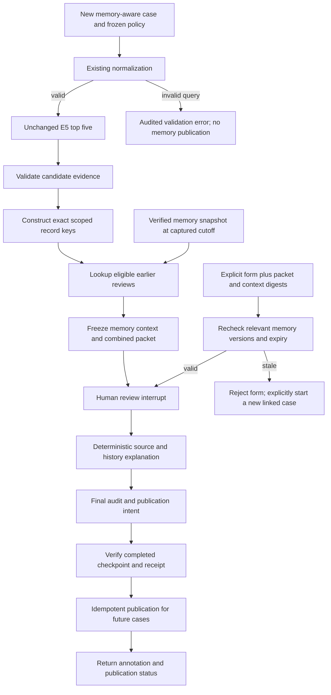

# Phase 8 plan — long-term case memory and reviewer feedback

**Status: planning only, 2026-10-22. Implementation requires explicit approval.** This document proposes a bounded fictional-first memory pilot. No packages, source code, tests, configurations, databases, models or prior results are changed by this plan.

Authority: [AGENTS.md](../AGENTS.md), Project 1 and engineering/AI-agent guidance in the [portfolio proposal](reference/internship-2093-portfolio-plan.html), [current architecture](design.md), [evaluation protocol](evaluation-plan.md), and [Phase 7A execution report](progress/phase-07a.md). The user's current decisions override speculative automatic-decision/training branches in older documents.

## 1. Recommendation and fixed boundaries

Remember **what was reviewed, with which evidence, when, and what the reviewer annotated**. Retrieve that history using exact, source-scoped reference-record identifiers. Show it beside unchanged E5 candidates. It must not become a remembered assertion that a query identifies a person or that a person has done something wrong.

- E5-small remains the sole default retriever, same pinned revision, top five, aliases, scores and ordering. No candidate promotion, filtering, addition or removal because of memory.
- MiniLM remains disabled and experimental. No training, calibration, thresholds, LLM, vector database, service, MCP or Streamlit.
- All successful queries still require explicit human review, even with history or no candidates. Similarity and repeated annotations are not identity probabilities.
- Preserve `python -m watchlist` and `python -m watchlist.agent`, their source/configuration and existing cases/results. Add an explicitly selected memory workflow in a **separate Python package and new workspace**.
- First implementation proposal uses existing fictional records and authored case histories only. No new public dataset, public-source refresh, private-person queries, or external network access.
- Feedback is review evidence, not automatic ground truth. The initial implementation has no training-data export or retraining command. A later, separately approved curation protocol is described below.
- Success means correct links, honest display, recoverable storage and measurable usability. An improvement in screening accuracy or false-positive rate is not an acceptance condition we can currently measure responsibly.

## 2. Short-term versus long-term memory, from first principles

**Short-term memory:** “Case A is waiting for a reviewer. Its query was `Lumen Sira`, and these exact five records were displayed.” A checkpoint lets us close the terminal and resume **Case A** tomorrow. It may persist for days; “short-term” describes its role within one case, not a time-to-live.

**Long-term memory:** “The reference record `syn-007` appeared in an earlier completed case. Here is that dated annotation and the evidence that was available.” A new **Case B** can inspect that history. This is a searchable record of prior work, not information learned into E5's weights.

The existing case database already retains reviews. What is missing is a controlled cross-case index, eligibility rules, exact lookup, context presentation and an evaluation of their usefulness. Adding another database does not by itself make useful memory.

| Component | What / why | Who / when / where / how |
|---|---|---|
| Case checkpoint | Saved progress for one unfinished request. | LangGraph writes local SQLite during execution; the reviewer resumes that same thread. Keep current semantics. |
| Case ledger | Evidence of what happened in a case. | The service stores immutable packets, submissions and audit events at review time. It is the source of review history, not an identity registry. |
| Memory projection | A small indexed copy of eligible historical evidence. A “projection” is a selected view of authoritative records. | A local publisher imports only verified completed reviews after finalization; readers query its SQLite indexes in later cases. It can be rebuilt from retained, permitted source cases. |
| Identifier registry | Explicit rules for what each ID means. | The developer and learner approve source namespaces and snapshot rules before lookup. Names never create identifier links. |
| Memory context | The exact historical cards shown in a new case. | A graph node freezes them before the human pause, with IDs, hashes, eligibility status and lookup time. The reviewer sees historical opinions separately from source facts. |
| Lifecycle event | A dated withdrawal, correction reference or retention action. | The local reviewer/maintainer supplies an explicit reason. The event changes future visibility, not the historical fact that an annotation was made. |
| Feedback curation | A future process for turning reviewed evidence into separately adjudicated labels. | A qualified human checks evidence and allowed use offline; no case node trains a model. |

## 3. What the code and saved report establish today

The following are observations from local files, not new experiments:

- `agent/graph.py` connects normalization → E5 retrieval → formatting → packet preparation → human interrupt → explanation → audit; invalid input has a separate error branch.
- `agent/schema.sql` has `cases`, `review_packets`, `review_submissions`, `audit_events`. Packet revision is constrained to 1. `cases.audit_id` is the application case identifier; `thread_id` is unique and locates checkpoints. There is no cross-case entity index or structured annotation-origin/retention policy.
- `state.packet()` hashes fixed fields and currently has no memory context. Therefore appending history to a display without binding it to the packet would not prove what the reviewer saw.
- `state.workflow_hash()` hashes **every `.py` and `.sql` file in `src/watchlist/agent/`**, several baseline files, and checkpoint-package versions. Even adding a new file there changes the hash and makes existing cases fail the service's version check.
- `ReviewService.__enter__` creates/initializes files and changes permissions. It is not a read-only legacy import interface. A future importer must not run it directly against original stores while claiming read-only access.
- Entity IDs and alias IDs describe reference records. The adapter preserves source provenance and the frozen reference fingerprint. It has no globally verified “person ID”; provider referents/grouping from ingestion are not independently verified identity equivalence.
- The Phase 7A report records **213 passing tests** and one completed fictional demonstration. That count is historical; no pytest or model run was performed for this planning turn.
- The saved demonstration explicitly says “Simulated fictional demo annotation by the assistant.” Its local actor label is not evidence of an actual human identity review. Legacy records lack a structured origin field; they must default to `unknown` until explicitly classified, never inferred to be human labels because they contain a username.

### Compatibility decision

Propose `src/watchlist/case_memory/` and `python -m watchlist.case_memory ...`, leaving the entire Phase 7A agent directory, baseline files and old configuration unchanged. The new versioned graph can reuse the public E5 adapter, normalization and pure validation/hash utilities. It needs its **own extended packet, service lifecycle and ledger verification**; do not subclass or monkey-patch the hard-coded v1 service as if its constants and packet digest already supported memory.

This accepts a small amount of explicit versioned orchestration code to preserve old cases. A shared-service refactor or migration of pending v1 threads would be a different proposal. New code gets its own `review-memory-v1` schema/workflow fingerprint including every reused dependency file it relies on. Old cases stay old cases; they are not resumed under the new graph.

## 4. What is remembered and what is not inferred

Remember: case/thread/submission IDs; original reference entity and alias IDs; source namespace and frozen snapshot; original-script alias evidence; retrieved rank and raw cosine; model ID/revision/configuration and runtime versions; packet/final-event hashes; annotation outcome, exact bounded reason and actor label; annotation origin; review, source and publication timestamps; applicability/withdrawal/expiry status; and the provenance of every displayed historical card.

Do not remember as established identity: “this name belongs to that person,” “two similarly named cases concern the same person,” “selected for follow-up means sanctioned/criminal,” “none selected means all candidates were ruled out,” or “many reviewers agreed, so confidence is high.” Preserve uncertainty rather than convert it to a label.

| Historical annotation | Permitted interpretation | Prohibited inference |
|---|---|---|
| `candidate_for_follow_up` with entity E | E was selected for further work in that earlier case. | The old or new query was verified to identify E. |
| `none_selected` | No record in that earlier shortlist was selected. | Each candidate is a verified negative pair, or the subject is clear. |
| `unresolved` | The earlier review remained uncertain. | The entity was accepted, rejected or absent. |
| Candidate displayed but not selected | The record was part of the earlier context. | The reviewer explicitly rejected that record. |
| Different outcomes involving the same source record | Different dated annotations exist; inspect their contexts. | They necessarily contradict one another, or the newest one automatically wins. |

The memory index omits raw query text and normalized query text by default; it does not add a searchable query/name hash. Names are low-entropy values and hashing them would not make them anonymous. A reviewer can explicitly open an authorized original case to inspect its query. Historical notes and aliases can still contain sensitive text, which is one reason the first pilot remains fictional.

## 5. Exact identifiers and lookup tools

### Define “canonical entity ID” carefully

Use a **canonical reference-record key**, not a canonical real-world identity. Proposed construction:

`record_key = SHA256(canonical_JSON([namespace_id, source_entity_id]))`

The unhashed namespace and source ID are stored and displayed too. Hashing here provides a compact deterministic key, not secrecy or identity proof. `namespace_id` is an explicitly registered source lineage, such as the existing fictional fixture version; it cannot be supplied by untrusted name text. A row is anchored to a separate `snapshot_sha256`, preferably the frozen reference fingerprint already present in the E5 recipe.

Default automatic lookup requires **record key AND exact snapshot fingerprint**. Across-snapshot identifier continuity is unverified by default. Do not assume a reused provider ID, a provider merge, an alias ID or an ingest group proves continuity. Public cross-source or cross-snapshot mappings require a later separately reviewed mapping protocol. We do not create that protocol's mappings in this pilot.

### Supported narrow tools (ordinary local Python functions, not MCP/LLM tools)

| Proposed tool | Explicit inputs | Behavior and boundary |
|---|---|---|
| `find_previous_reviews` | Registered namespace, source entity ID, exact snapshot fingerprint, memory cutoff, current case ID | Indexed equality lookup; exclude current case, future imports, unavailable/withdrawn/expired/unknown-origin entries; return stable historical cards and omission counts. No name string search. |
| `get_case_history` | Registered source-workspace ID + exact case/audit ID | Show authorized completed-case history and eligibility flags; no recursive automatic expansion to “similar” cases. |
| `get_review` | Registered source-workspace ID + exact submission ID | Retrieve one annotation and its provenance, or a clear not-found/unavailable result. |
| `get_alias_evidence` | Case ID + entity ID + alias ID | Inspect a case-local evidence item. Alias IDs alone are not cross-case identity keys. |
| `inspect_identifier_history` | Namespace + exact source ID, explicit historical-inspection option | Show other snapshots in a separate historical view labeled “identifier continuity not established.” These records cannot silently enter the default new-case panel. |
| `verify_memory` | Approved local workspace, optional separately retained anchor | Verify memory schema, payloads, event chain, source receipts and projection consistency. Unknown schemas/corruption fail; they never become “no previous reviews.” |

No names, email addresses, birth dates, passports or private identifiers are supported lookup keys. An upstream ID in a note does not create a link; only validated structured fields do. Namespace registration rejects ambiguous collisions. Parameterized SQL, bounded query inputs, and explicit namespace/snapshot requirements apply to all tools.

Default panel: up to **3 recent eligible annotations per candidate**, hence at most 15 cards for five E5 candidates. Sort by reviewed-at UTC descending, then stable annotation ID; no semantic relevance model. Report eligible/omitted counts. If more results or differing outcomes exist, show that fact and provide explicit paginated inspection; never hide a conflicting outcome behind a “consensus” badge. Metrics use this same cap and ordering.

## 6. Proposed SQLite layout

Everything below is a schema proposal, not SQL executed during planning. Use the standard-library `sqlite3` and existing checkpointer. No ORM, FTS, vector extension or new package is needed.

| Store | Purpose / ownership |
|---|---|
| Existing `data/watchlist.sqlite` and fictional fixture | Unchanged reference evidence, read-only. |
| Existing `data/review/cases.sqlite`, `checkpoints.sqlite` | Unchanged Phase 7A case history and resumable v1 threads. |
| New `data/review/phase08/cases.sqlite` | New memory-aware case ledger; own schema version, packet/context binding and publication outbox. |
| New `data/review/phase08/checkpoints.sqlite` | LangGraph-owned new-workflow checkpoints; never rewrite its internal schema manually. |
| New `data/review/phase08/memory.sqlite` | Application-owned searchable projection, lifecycle events and memory audit chain. |
| New `data/review/phase08/receipts/` | Local import/verification/backup manifests; not independent trusted audit anchors. |

These paths remain beneath the existing ignored/private review directory. The parent Phase 7A workspace counts nested bytes toward its 100 MB guard, so the new workspace must respect that **combined** budget, not assume a separate unlimited allowance.

### `memory.sqlite` tables

PK means a unique row identifier. FK means a value that must reference an existing row. JSON fields below preserve a small structured record; searchable identity fields stay in indexed columns.

| Table | Proposed key fields and stored values | Constraints / purpose |
|---|---|---|
| `memory_meta` | singleton ID, schema version, projection version, policy digest, created-at, memory instance UUID | Known version required; no automatic migration on lookup. |
| `source_workspaces` | `workspace_id` PK, approved local locator, source schema/workflow/hash, manifest digest, purpose, registered-at | Human-maintained allowlist. A path from a note or imported record cannot choose an arbitrary file. Copies of the same registered source retain the same workspace ID. |
| `namespaces` | `namespace_id` PK, provider, dataset/fixture lineage, allowed purpose, source/terms/attribution references, terms-reviewed-at nullable | No global identity claim. First allowlist contains fictional fixtures only. |
| `records` | `record_key` PK, namespace FK, `source_entity_id`, entity type | UNIQUE(namespace, source entity ID); no canonical-name uniqueness and no automatic entity merges. |
| `snapshots` | `snapshot_sha256` PK, namespace FK, source snapshot ID, source dates nullable, acquisition date nullable, provenance JSON/hash | Preserves original source date separately from local publication/review time. |
| `record_snapshots` | composite PK(record key, snapshot fingerprint), display name, record-evidence hash | FK to records/snapshots; validate matching namespace; an identifier in another snapshot is another observation. |
| `memory_cases` | `memory_case_id` PK, source workspace FK, source audit/case ID, thread ID, review-completed-at, imported-at, source packet digest, final-event ID/hash, workflow hash, source-verification receipt, origin, purpose, visibility-expires-at | UNIQUE(source workspace, source audit ID). No raw query column. Source must be verified completed with an accepted annotation; invalid-input results are excluded. |
| `model_manifests` | `manifest_sha256` PK, canonical recipe JSON | Stores E5 ID/revision, model-file hashes, configuration, normalization, package versions, reference view and disabled reranker. Never substitute the current model for a historical one. |
| `case_candidates` | PK(memory case, record key, snapshot), rank, raw cosine, score-kind, winning alias ID, model-manifest FK, relation-to-annotation | All at-most-five historical candidates retained. Relation is selected-for-follow-up / considered-without-selection / unresolved-context, not positive/negative identity. |
| `alias_evidence` | PK(memory case, record key, snapshot, alias ID), original text, source evidence ID, provenance JSON/hash, attribution | Composite FK to candidate; preserve available original-script names. Scope old evidence IDs to their case because Phase 7A's evidence hash alone does not include a snapshot. |
| `annotations` | `annotation_id` PK, memory case FK UNIQUE, source submission ID, outcome, selected record key/snapshot nullable, bounded reason, local actor label, origin, reviewed-at, annotation hash | UNIQUE(source workspace, source submission ID) enforced via source identity validation/index design. Follow-up selection must reference that case's candidate; other outcomes require null. No identity truth/probability fields. |
| `memory_events` | sequence PK, unique event key, event type, target ID, actor, UTC time, bounded reason/reference, payload hash, previous hash, event hash | Append events for publish, correction/withdrawal, expiry-policy actions and verification/import failures where possible. Chain includes payload digests without duplicating free-text notes. |
| `entry_status` | annotation ID PK/FK, active/withdrawn/quarantined status, latest lifecycle sequence, optional superseding annotation ID | Rebuildable current visibility projection. Every update must match an append-only lifecycle event in the same transaction; never overwrite the original annotation. |
| `key_versions` | PK(record key, snapshot), monotonically increasing revision | Increment when relevant history/visibility changes; detects stale forms even if a lookup originally found zero reviews. |
| `import_receipts` | import batch UUID PK, unique source-final-event identity, source payload digest, projection digest, imported IDs, bytes/counts, validated-at | Same event + same payload is an idempotent replay. Same event identity + different payload fails and is quarantined. |

Explicit indexes: candidates(record key, snapshot, memory case); annotations(memory case, reviewed-at, annotation ID); memory cases(source workspace, source audit ID); source-scoped submission IDs; lifecycle target/sequence. FKs are enabled on every write connection. All hashes use canonical finite JSON; timestamps retain UTC or explicit unknown source timezone rather than guessing.

A source-schema adapter supplies source workspace identity to annotation uniqueness. SQL design during implementation must use either a declared composite FK/unique key or repeat the workspace FK explicitly; do not rely on a cross-table uniqueness comment that SQLite cannot enforce. This is an acceptance check.

### New case-ledger additions

The new ledger retains the four logical Phase 7A case/packet/submission/audit tables in a **separate database**, with a new schema and verifier. Its packet contains `memory_context` alongside unchanged candidate evidence. Add:

- `memory_contexts`: context ID PK, case ID FK UNIQUE, lookup request, cutoff sequence/head, relevant key versions, capture time, policy digest, selected annotation IDs/hashes, warnings/counts and full displayed-card JSON/hash. Stored transactionally with the prepared case packet. This records what was shown, not merely what exists now.
- `memory_publications`: outbox ID PK, case ID FK UNIQUE, proposed publication payload/hash, final audit-event reference, pending/published status, memory receipt ID. An outbox is a durable “publish this completed review” reminder. Final audit and outbox intent are committed together; publication waits until the completed graph checkpoint and audit receipt agree.

No cross-database FK is assumed. Source receipts, deterministic publication IDs, hashes and reconciliation bridge the stores.

## 7. Integrating memory into LangGraph



The diagram is a request DAG: the memory **read snapshot M** predates this request; publication writes a later memory version for **future** cases. There is no arrow from this request's output back into its own lookup. A lifecycle-level history cycle is possible—completed reviews help later reviews—but it is not a training loop or permission to alter the current shortlist.

| Node / service boundary | What / why / how | Who / when / where |
|---|---|---|
| Normalize / E5 / validate | Reuse current functions and preserve ranking/evidence. | Software, before history lookup, local verified model/reference. |
| Construct keys | Map each returned record to registered namespace + raw ID + snapshot; refuse unknown mappings. | Deterministic adapter; no human identity resolution or name matching here. |
| Lookup | Equality-search eligible past annotations at a frozen sequence cutoff. | Local SQLite reader after E5. Include no current/future case and no unverified backdated publication. |
| Freeze context | Bind exact displayed history and omission warnings into the review packet. | New ledger before interrupt; small JSON values only, no open DB handles/tensors in graph state. |
| Validate resume | Check original packet/checkpoint plus context hash and relevant key revisions; recheck expiry/withdrawal. | Service before persisting the explicit submission. No write before the graph's interrupt itself. |
| Human review | Retain follow-up / none-selected / unresolved vocabulary, required reason and explicit origin. Add cited memory-annotation IDs, which must be in the displayed context. | The reviewer may ignore history. Citations record use, not truth. No preselected decision or auto-copied reason. |
| Explain | Distinguish current source evidence, historical source evidence and past/current reviewer opinions. | Fixed template after resume, with case/annotation/evidence citations and stale/different-model labels. No LLM. |
| Audit / complete | Bind current outcome, context digest, referenced history and final receipt. | Case ledger and LangGraph checkpoints, preserving existing recovery principles. |
| Publish | Verify completed case, project permitted content, commit memory rows/event/receipt, acknowledge outbox. | Local service after completion, without rescoring or changing the human annotation. |

### Typed state additions proposed for the new workflow

Retain the existing fields and add `memory_policy_sha256`, `memory_context` (lookup cutoff, per-key revisions, cards, exclusions and warnings), `memory_context_sha256`, explicit `annotation_origin`, `cited_memory_annotation_ids`, and an explicit memory-context schema version. Publication status/receipt live in the service response and outbox, rather than silently mutating a completed checkpoint after the graph ends. A historical card holds case/submission/record/snapshot IDs, origin, dates, original evidence, annotation, model manifest and verification status. Use typed dictionaries plus runtime validators, not unvalidated arbitrary metadata.

The new packet digest covers the complete memory context. Resume validates both context and packet. A pending case never silently picks up newly changed history. If a referenced or queried key changed, a card expired, or an entry was withdrawn, reject the stale resume and require a **new linked case** under the current memory snapshot; preserve the old pending case and its evidence. This conservative first version does not mutate packet revision 1 or introduce an untested refresh-in-place loop. Unrelated keys changing need not invalidate a pending case.

## 8. Publication, migration and recovery

### Additive migration, not in-place alteration

1. After implementation approval, first capture hashes of old code/config/results/databases and run baseline checks. Confirm existing Python/packages without installation.
2. Provide a dry-run initializer describing **new** workspace files and table versions. `init --apply` creates only the new stores. Repeated initialization validates known versions; unknown/partial schema fails without altering original stores.
3. Leave all old pending threads with `watchlist.agent`; the new CLI creates new IDs and a distinct workflow hash. Regression tests must prove v1 status/resume still works after the new package is installed.
4. An explicit backfill/import manifest selects completed old case IDs, registered source workspace, allowed namespace, purpose and origin classification. No automatic whole-directory import and no assumption that every completed case is human-reviewed.
5. Stop/acquire the old workspace's existing writer lock without rewriting its files. Use read-only source connections and SQLite backup to make a coherent pair of ledger/checkpoint copies while the writer is stopped. Do not copy an active WAL file alone. Record copy hashes and release the source lock before taking the new workspace's mutation lock; avoid inverse lock ordering.
6. Verify the copies against the supported v1 schema, final checkpoint, immutable packet, submission and audit receipt. If a v1 verifier needs writable connections/setup, run it **only on temporary copies**, never the original stores. Original paths and source manifests remain registered explicitly.
7. Import the minimized projection in one memory transaction; record source event identity, verified-at time, origin and projection digest. Skip invalid-input cases; quarantine incomplete, unknown-version, damaged or unclassified cases. Report counts/reasons and support exact replay without duplicates.
8. The known Phase 7A demo can be included only by an explicit manifest marking it `simulated_demo`. Its notes are not silently promoted into human labels. Keep simulation clearly visible and segregate it from any future human-label curation.

The source archive and original event are authoritative historical evidence; the memory projection is reconstructible. Copy receipts prove what was inspected relative to local hashes, not that the reviewer or data were correct. Old result files and stores are not migration targets.

### New-case publication and failure cases

- Final case audit + publication intent share one new-case-ledger transaction. Only a completed checkpoint with a matching receipt makes the outbox eligible.
- Publication writes all memory rows, event, key revisions and unique receipt in one memory transaction. A crash before commit publishes nothing. A crash after memory commit but before case acknowledgment reuses the same receipt on retry.
- Publication failure does not erase a completed human review. Return separate `review_completed=true` and `memory_publication=pending_retry`; never imply the annotation is already searchable.
- Before a memory-enabled lookup, reconcile outstanding eligible local publications or fail explicitly with pending-publication status. Do not misleadingly report “no history” while a known publication is pending.
- An empty lookup is distinguishable from unavailable, policy-excluded, incomplete-index or corrupt memory. No fallback to a fabricated empty result. The user can deliberately choose the unchanged legacy CLI for a new no-memory case; the new workflow does not silently fall back.
- Recovery reuses saved context and submission; it does not rerun E5 on review resume. Failure tests cover lookup/context commit, final audit/outbox, memory commit and acknowledgment boundaries.

No exactly-once execution claim: nodes can replay; durable unique keys make intended effects idempotent.

## 9. Staleness, disagreement and corruption

**Time and applicability:** always show reviewed-at, imported-at, source timestamp (or unknown), snapshot and model revision. Initial proposed visibility lifetime is **90 days from review time**, with an injected clock for deterministic tests. This is a configurable research-pilot freshness choice, not an evidence-based validity period or a legal retention requirement. Reimporting must not restart its clock. Exact expiry boundary is excluded (`now >= expires_at`).

**Changed data:** same scoped ID but different snapshot appears only through explicit historical inspection, labeled continuity unverified. Default new-case cards require the identical snapshot. Unchanged snapshot does not establish current real-world status.

**Changed model:** preserve the historical model recipe and label the difference. Historical cosine from another recipe is not directly comparable to today's score; no mixing or averaging. No automatic model update.

**Disagreement:** preserve all annotations and their case contexts. Different outcomes on one reference record can concern different query subjects, so call them “differing annotations,” not a proven identity contradiction. No majority vote, latest-wins rule, confidence boost or blacklist. A correction is an explicit lifecycle event referencing an old annotation and a verified replacement/linked case; cross-entity/snapshot corrections require explicit validation and must not create an identity merge. Withdrawn originals remain historical and unavailable for new suggestions.

**Integrity:** verify SQLite integrity/FKs, canonical projection hashes, event sequences, source receipts, status projections and key revisions. Corruption blocks memory use. Quarantine is a typed status/event, not a silent deletion. A full rewrite by a privileged local attacker remains outside what a local hash chain can detect. Separately retained heads/counts improve tail-deletion detection, but no remote anchor/authentication system is proposed.

**Duplicate events:** uniqueness is source workspace + source event/case/submission identity, not name or text similarity. Replays return the same internal receipt. Conflicting contents under the same key stop. Two different human reviews remain two historical events even if their text is identical.

## 10. Minimization, retention, access and source permissions

- Initial allowlist: authored fictional case histories. Do not copy raw public exports, private IDs, DOBs, addresses, document fragments, secrets, model vectors or full checkpoints into memory.
- Store original aliases/provenance needed to explain the displayed candidate and a bounded reviewer note, along with hashes/references. Omit raw query copies and avoid repeating notes in memory audit events. This reduces duplication; it does not anonymize alias text, notes or stable IDs.
- The existing source case ledger/checkpoints may retain the query and note. A memory visibility change does not erase those copies. New frozen contexts can also retain earlier notes. A complete data inventory must include source ledger, checkpoints, memory projection, contexts, forms, logs, backups and exports.
- **Expiry is suppression from future automatic panels, not deletion.** Propose a retention-report command that lists expired entries and all known replicas, and an explicit withdrawal command with a reason. No automatic purge, rewriting of old audits, or secure-erasure claim in this first milestone.
- A future deletion design must address all replicas and legal/purpose obligations together, including how minimal tombstones remain without prohibited personal content. It requires explicit approval before collecting sensitive real-person reviews. Preserving prior results does not justify unlimited sensitive-data retention.
- Use existing local OS ownership: private directory (0700), database/receipt files (0600), an advisory writer lock and approved-workspace path checks. Reject symlink/path escapes in import manifests. Read-only search does not initialize or migrate stores. These controls do not authenticate multiple reviewers or protect against the same privileged local account.
- No telemetry, remote traces, cloud upload or public interface. Free text is escaped data, cannot invoke tools, register namespaces, alter eligibility, execute SQL or control decisions. Carry at least the existing six malicious-text fixtures into memory-context tests.
- Historical [data card](data-card.md) records the OpenSanctions/UN subset's local noncommercial purpose and attribution requirements as checked during Phase 2. This planning turn does **not** reverify current terms or grant broader use. Before enabling public-derived memory, review the proposed purpose, current terms, source notices, retention and any redistribution requirements with explicit approval for required network reads. Preserve provider/publisher/terms/source URLs and modification notices; do not generalize one provider's license to all sources or private annotations.

## 11. Reviewer feedback and possible future training examples

A review action is not a training label. “Follow up” means investigate; “none selected” does not establish a negative pair; “unresolved” provides no binary answer. A malicious or mistaken annotation must not change the model or become ground truth by repetition.

A later separately approved pipeline could:

1. Select eligible, nonwithdrawn, permitted historical cases; exclude simulations, unknown origin, unresolved identity evidence and evaluation-only material from real-world training claims.
2. Have a human explicitly adjudicate a query–reference pair against sufficient independent evidence. Record label definition, evidence references, annotator/adjudicator, date, uncertainty, purpose permission and lineage. Names and a prior click alone are insufficient.
3. Use labels `supported_pair`, `unsupported_pair`, `uncertain` only under that declared task definition. Do not equate them with criminality. Preserve case-dependent context and possible label error.
4. Group duplicate/related entities across sources with reviewed mappings; keep all aliases, generated queries and feedback lineage for a group in one split. No query-level random split.
5. Keep train, development, calibration and final test entity groups disjoint. Mine negatives only inside training groups. Do not convert unselected candidates into hard negatives without verification.
6. Freeze a candidate training manifest with content hashes, permission/origin status, grouping and exclusion reasons. A human reviews it before export. No production/model change follows automatically.
7. Only after separate approval: train a versioned model, evaluate on independent held-out groups, compare failures and approve any deployment/change explicitly.

Within a **memory** evaluation episode, an earlier case about the same reference ID is an intentional input. That is different from using final test labels for model training. Separate repeated-entity assistance from unseen-entity performance and never relabel this intended history exposure as new model generalization. No training/export code or label table is proposed in the first Phase 8 implementation.

## 12. Evaluation plan: what usefulness can mean

Start with a frozen, hand-verifiable fictional history. Proposed size: **24 two-case episodes**, covering the existing 12 fictional entity IDs with two scenario variants each. Every episode has an earlier history stage and a later query stage, with 0–3 prior annotations, plus explicit adversarial events. No new public data. Variant scenarios are correlated; report 12 entity groups, not 24 independent identities. Freeze scenario labels before implementing lookup.

Allocate 8 entity groups to development and 4 to a held-out software-evaluation split using a saved deterministic manifest; keep both variants and their historical/later cases together. Include the same-name `syn-001`/`syn-012` pair as a deliberate challenge and ensure the allocation does not accidentally make one variant a development answer for the other's same group. No training split is consumed. Add separate tiny adversarial fixtures for namespace/snapshot collision, changed IDs, removed/expired history, publication lag, future/backdated review, disagreement and corruption.

Each scenario specifies, by hand, the expected prior annotation IDs, exact lookup keys, eligible/excluded reasons and whether the historical content helps the assigned review task. The oracle must not be generated by calling the lookup implementation itself.

Compare memory-off versus memory-on using identical E5 candidates/queries/labels. Mocked rankings isolate memory correctness; one optional already-local E5 smoke verifies parity. Prior Phase 3–5A benchmark artifacts stay unchanged. Save new results in a separate Phase 8 directory only after implementation approval.

| Measure | Definition and denominator | Limits |
|---|---|---|
| Exact-link precision | Correct scoped record/snapshot links / all displayed links | Report raw counts; N/A when none displayed. This measures record linkage, not real-world identity. |
| Incorrect-link rate | Wrong namespace, entity, snapshot or source case links / all displayed links; also cases with any wrong link / all attempted cases | Both link-level and case-level denominators matter. A missing/failure result must not disappear from reporting. |
| Eligible-history Recall@3 | Returned expected eligible annotation IDs among first 3 / all expected eligible prior annotations for a candidate lookup | Macro over lookups with history and micro with totals. Show total histories, cap/truncation and coverage; report no-history lookups separately. |
| Context usefulness precision | Human-authored task-useful returned cards / all returned cards | Exact-key correctness does not guarantee a note is useful for a different query. Labels need manual inspection and may be uncertain. |
| Unavailable/error rate | Failed lookups / attempted lookups; distinguish corruption/pending publication/policy exclusion | Failure is not an empty correct result. Do not remove failures to inflate recall. |
| Stale exposure / stale-resume rejection | Ineligible cards displayed / displayed cards; rejected stale resumes / injected stale attempts | Fixed clock, known lifecycle events and exact denominators. Zero synthetic errors is not an operational guarantee. |
| Retrieval parity | Candidate IDs/order, aliases/provenance and cosine differences between identical memory-off/on inputs | Require unchanged rankings; tolerances follow Phase 7A's 1e-6 numerical parity. Memory is not expected to improve E5 Recall/MRR. |
| Lookup/publication latency | `perf_counter` duration; median/p95; repetitions, cold/warm mode and history size | Separate DB lookup, integrity checks, publication and E5 time. Do not time “human thinking” as machine latency. |
| Reviewer workload | Active review time, explicit history opens, source-file opens and incomplete/abandoned tasks | Requires an actual consenting reviewer task study; **N/A** in automated tests. Do not invent time saved from fewer SQL calls. |
| Review-task errors and anchoring | Wrong task conclusions versus independently authored answers, and adoption of planted misleading historical notes | Fictional usability evidence only; not a sanctioned-person identity error rate. |

**Hand calculation, illustrative only:** if a lookup has four eligible historical annotations and a three-card panel returns three correct ones, Recall@3 = 3/4 = 0.75 and link precision = 3/3 = 1. A fourth card linked to another namespace would make incorrect-link rate 1/4 = 0.25. These are arithmetic examples, not measured results. An empty result with zero eligible history has recall N/A; record it as a correct no-history scenario only if storage and eligibility checks succeeded.

For a later optional reviewer workload pilot, use matched but different fictional tasks, counterbalanced memory-on/off order and recorded interruptions. Showing the same answer twice to one person creates practice effects. A one-learner exercise is descriptive; do not claim general workforce savings or population significance. Independent reviewers/larger groups are needed before confidence intervals or broad benefit claims. Task quality and anchoring must be reported alongside speed.

The original portfolio asks whether memory reduces false positives. Our system has no calibrated automatic acceptance threshold or verified real-world identity labels, so screening false-positive reduction is **N/A**. The defensible first question is whether relevant historical work is found correctly and helps a reviewer without propagating errors.

## 13. Files proposed after implementation approval

No files in this table are created during planning. The proposed separate-package location is required to preserve Phase 7A's fingerprint and CLI behavior.

| New file(s) | Responsibility / why |
|---|---|
| `src/watchlist/case_memory/__init__.py`, `__main__.py` | Opt-in package and CLI entry point; no model/index creation on import. |
| `identifiers.py` | Registered namespaces, scoped record keys, snapshot matching and strict identifier validation. |
| `state.py` | Typed memory cards/context, new packet digest, origin/citation validation and independent workflow fingerprint. |
| `schema.sql` | Memory projection tables, FKs, indexes and lifecycle constraints. |
| `case_schema.sql` | New-version case ledger, context and publication outbox; separate from legacy stores. |
| `store.py` | Explicit initialization, read-only search, transactions, memory-event chain and projection/key-version verification. |
| `publisher.py` | Verified completed-case projection, source-scoped idempotency, outbox publication/acknowledgment and recovery. |
| `legacy.py` | Bounded explicit import manifest, coherent source snapshots and supported v1 verification on copies; never mutate original cases. |
| `workflow.py` | New StateGraph, own case service/packet verifier, memory lookup/context nodes, unconditional interrupt, resume freshness checks and deterministic explanations; reuse unchanged E5. |
| `cli.py` | New CLI for init/inspect/start/status/review/recover/publish/import/withdraw/retention-report/verify; fixed policies and escaped display. |
| `evaluation.py` | Frozen fictional chronological scenario runner, explicit metric denominators and machine-readable report generation. |
| `config/case-memory.json` | New workspace, namespaces, purpose/origin policy, 90-day proposal, panel cap, E5 config pointer and no reranker. |
| `tests/fixtures/memory_scenarios.json`, `eval/configs/memory.json` | Authored chronological cases, split manifest/oracle and bounded evaluation settings, separate from old fixtures/results. |
| `tests/test_memory_identifiers.py`, `test_memory_store.py` | Exact IDs, namespace/snapshot collisions, schema and chain integrity, visibility and SQL binding. |
| `tests/test_memory_import.py`, `test_memory_recovery.py` | Read-only legacy preservation, replay/conflict, atomicity, publication lag and killed-process recovery. |
| `tests/test_memory_workflow.py`, `test_memory_cli.py` | Context-bound review, no score changes, stale context/expiry, origins, citations and untrusted text. |
| `tests/test_memory_evaluation.py` | Hand-calculated denominators, chronology, group separation and oracle checks. |
| `tests/integration/test_memory_e5.py` | Opt-in already-local E5 parity with and without memory, no download. |
| `eval/results/phase08/memory/results.json`, `report.md` | New measured fictional results only after approval/execution; no fabricated files now. |
| `docs/adr/0006-case-memory.md`, `docs/progress/phase-08.md` | Approved implementation decision and actual execution/teaching report after implementation. |

Later documentation edits: README, design, evaluation plan, implementation phases. **No edits proposed to existing application source, Phase 7A configuration/schema, pyproject/uv.lock, old tests/fixtures or previous results.** Existing packaging includes the `watchlist` package tree; verify that both new SQL resources enter the built wheel. If packaging or compatibility requires an unexpected change, explain and revise scope before changing it.

## 14. Proposed commands, dependencies and resources

These are proposed interfaces, not commands run now. `THREAD_ID`, `ANNOTATION_ID` and form values are placeholders. Each mutating command is explicit; read-only commands never initialize a missing store.

```sh
# After implementation approval, local checks only:
.venv/bin/python -m watchlist.case_memory init --config config/case-memory.json --dry-run
.venv/bin/python -m watchlist.case_memory init --config config/case-memory.json --apply
.venv/bin/python -m watchlist.case_memory import --manifest data/review/phase08/import.json --dry-run
.venv/bin/python -m watchlist.case_memory import --manifest data/review/phase08/import.json --apply
.venv/bin/python -m watchlist.case_memory search --namespace fictional-synthetic-v1 --entity-id syn-007 --snapshot-sha SNAPSHOT_SHA
.venv/bin/python -m watchlist.case_memory start --name 'Lumen Sira' --origin simulated_demo
.venv/bin/python -m watchlist.case_memory status --thread-id THREAD_ID
.venv/bin/python -m watchlist.case_memory review --thread-id THREAD_ID --review-file data/review/phase08/review.json
.venv/bin/python -m watchlist.case_memory recover --thread-id THREAD_ID
.venv/bin/python -m watchlist.case_memory publish --pending
.venv/bin/python -m watchlist.case_memory withdraw --annotation-id ANNOTATION_ID --reason 'Explicit correction requested'
.venv/bin/python -m watchlist.case_memory retention-report
.venv/bin/python -m watchlist.case_memory verify
HF_HUB_OFFLINE=1 TRANSFORMERS_OFFLINE=1 .venv/bin/python -m pytest -q -m 'not integration'
HF_HUB_OFFLINE=1 TRANSFORMERS_OFFLINE=1 RUN_MEMORY_E5_INTEGRATION=1 .venv/bin/python -m pytest -q tests/integration/test_memory_e5.py
.venv/bin/python -m watchlist.case_memory.evaluation --config eval/configs/memory.json
```

A withdrawal does not rewrite a prior annotation or imply it was a confirmed identity. The retained reason and replacement reference document why future use is stopped. Live source registration/import/public use are not implied by placeholder syntax.

**No new dependencies proposed.** Reuse locally installed Python 3.14.0, LangGraph 1.2.16, checkpoint 4.3.0, SQLite saver 3.1.2, pytest 9.1.1, standard-library SQLite/JSON/hashlib/UUID/fcntl/time and the unchanged E5 environment. Versions were read locally for this plan; no external current-version claim or documentation fetch is needed. No new LangGraph API is required beyond already exercised StateGraph/checkpoint/interrupt/resume behavior. No package upgrade or uv sync is proposed.

Planning resource envelope: **0 downloaded bytes**, 0 new weights, 0 external API calls/costs; up to 100 fictional cases in the new pilot; ≤25 MB additional working data and temporary copies, staying within the existing parent's 100 MB combined review limit; ≤4 GB process RSS for optional E5 smoke, CPU/four threads unchanged. Automated memory-only checks should be small; budget 5 minutes for the bounded suite and 1 minute for the small memory evaluation, investigate overruns rather than fabricate performance. These are proposed limits, not measurements. Human task time is reported separately without an automatic review deadline.

## 15. Implementation milestones and acceptance criteria

One future approval should explicitly name the bounded fictional memory pilot; these substeps do not authorize training, public-data expansion or a later phase.

1. **Identifiers/schema:** exact namespaces/snapshots, new stores and validators. Reject name-only and ambiguous identifiers; build wheel includes SQL. No old-file hash changes.
2. **Verified import/publication:** explicit fixture/legacy selection, origin tracking, coherent source-copy verification, receipt and outbox replay. Unknown/corrupt/incomplete/simulated-as-human imports fail. Original SQLite hashes remain unchanged.
3. **Search/lifecycle:** deterministic exact lookup, capped/paginated cards, omission counts, expiry, withdrawal, differing outcomes and source/model changes. Known wrong-namespace/entity/snapshot links are test failures, never a tolerated percentage.
4. **New opt-in graph/CLI:** bind shown context into packet, keep old E5 ranking, pause every successful query, require explicit annotation and context citations, reject duplicate/stale/withdrawn/expired resume. Existing v1 CLI and a pending v1 thread still work unchanged.
5. **Recovery/integrity:** real SQLite subprocess tests at context save, final audit/outbox, memory commit and acknowledgment; concurrent one-writer publication and review; no duplicate logical review or publication. Failure remains visible, not no-history. Changed workflow/schema blocks unsupported continuation.
6. **Evaluation/teaching:** execute frozen fictional scenarios, report actual counts/denominators/failures and timings, record human-workload measures as N/A until actually measured. Walk through two days with original scripts, same-name distractors and explicit historical uncertainty. Save implementation report and stop.

Required tests additionally cover: case/source/submission collisions; provider ID reuse; missing provenance/model versions; empty history versus unavailable memory; future and backdated imports; context-change detection for originally empty history; expiry exactly at resume; unknown origin; no training export; malicious notes/SQL/terminal content; projection tampering; orphan rows; event reorder/deletion/whole-chain limitations; path escapes; read-only searches creating no files; rollback on disk/write failure; preservation of legacy case/result hashes and model configuration.

Acceptance is all correctness/integrity tests passing, baseline parity and an honest evaluation report. No required workload reduction or accuracy gain is assumed. The memory-mode UI must explicitly show simulated origin, omissions and historical scope, and must never output “same person because reviewed before.”

## 16. Complete two-day example — illustrative, not executed

The Phase 7A `Lumen Sira` ranking and simulated annotation already exist, but the memory steps below **have not run**. Dates illustrate ordering. No new scores, reviewer benefit or correctness result is claimed.

**Day 1, 22 October: Case A.** The learner starts a fictional case for `Lumen Sira`. E5 supplies `syn-007` with original aliases `Sira Lumen` and `سيرا لومين`; it can also suggest `syn-001` and `syn-012`, which share `Luma Vesper` but remain different IDs. Case A pauses. A simulated demo annotation selects `syn-007` for follow-up and says additional evidence is needed. The completed checkpoint/audit agree.

- **What is remembered:** Case A's exact scoped candidate records, alias evidence, dates, model recipe, annotation, origin `simulated_demo`, packet/final-event receipts. No identity fact is created.
- **Who/where:** an explicitly authorized local publisher projects that verified fictional history into SQLite. It labels the actor as a local label and the review as simulated.
- **When/how:** only after completion; one source-event key and transaction prevent duplicate import. The original query stays in its source case rather than becoming a searchable name key in memory.
- **Why:** a later reviewer can find the earlier work and its limitations without pretending it answered a new identity question.

**Day 2, 23 October: Case B.** The learner submits the fictional Arabic alias `سيرا لومين`. Suppose unchanged E5 again includes `syn-007`; this is an illustrative assumption for the future example, not a new executed ranking. The memory node uses the candidate's registered namespace, `syn-007` and identical snapshot fingerprint—not the query text—to find Case A.

The panel says, in effect:

> Reference record syn-007 appeared in Case A on 22 October. Origin: simulated demo. Outcome: selected for follow-up, not identity confirmation. Earlier note: additional evidence required. Same reference snapshot; historical model revision and alias evidence attached. This does not establish that Cases A and B concern the same subject.

Case B's packet freezes that card and its context hash. The reviewer can inspect the Arabic/Latin evidence and prior note, then choose **unresolved**, citing Case A only as background. Case B's new annotation does not overwrite Case A. If both later appear for this record, show differing annotations in different cases; do not resolve them by recency or voting.

**Same-name control:** history for `syn-001` never appears under `syn-012` merely because both names are `Luma Vesper`. If E5 returns both, each gets only its own correctly scoped history.

**Interruption control:** if Case A is withdrawn after Case B pauses, or an eligible new review changes its key version, Case B's old resume is rejected. Start a new linked case with an updated context; do not silently alter what the earlier reviewer saw. If memory storage is unavailable, report that failure rather than display “no previous review.”

**Training boundary:** neither the simulated follow-up in A nor unresolved outcome in B is a positive/negative training pair. The model and its scores are unchanged on both days.

## 17. Risks, uncertainties and approval request

Fixed recommendations: separate opt-in workflow; exact namespaced/snapshot-bound record lookup; no name-based case linking; immutable historical opinions; explicit simulated/unknown origin; capped transparent display; new context-bound packet; transactional publication/recovery; no new dependencies; fictional-only first experiment; no training/export/automatic decisions.

Choices still requiring user acceptance or later evidence:

- Is the proposed separate CLI/versioned workspace acceptable to preserve existing cases? It adds a small maintenance cost instead of changing the v1 contract.
- Are 90-day visibility expiry and 3 cards per candidate appropriate for this learning pilot? These are proposed usability defaults, not validated policies.
- Who can reliably classify future annotations as human-produced, and who independently adjudicates labels? Local usernames cannot answer that.
- What retention/deletion and permission policy would cover public-derived notes and all checkpoint/backup copies? Keep this outside the fictional first pilot until reviewed.
- Which upstream IDs, if any, have trustworthy continuity across source snapshots? No cross-snapshot/source mapping is approved here.
- Will history help or bias reviewers? Only a measured task study can answer; tiny correlated scenarios cannot establish broad benefit.

The portfolio's memory goal is addressed as evidence recall and reviewer assistance. Its automatic feedback-to-training cycle and claimed false-positive reduction remain deferred until appropriate labels, permission, calibration and evaluation exist.

**Approval requested:** approve implementation of this bounded fictional Phase 8 memory pilot and its proposed defaults, or request changes. This planning approval alone authorizes no code, migration, installation, training or later phase. Stop here until explicit implementation approval.
