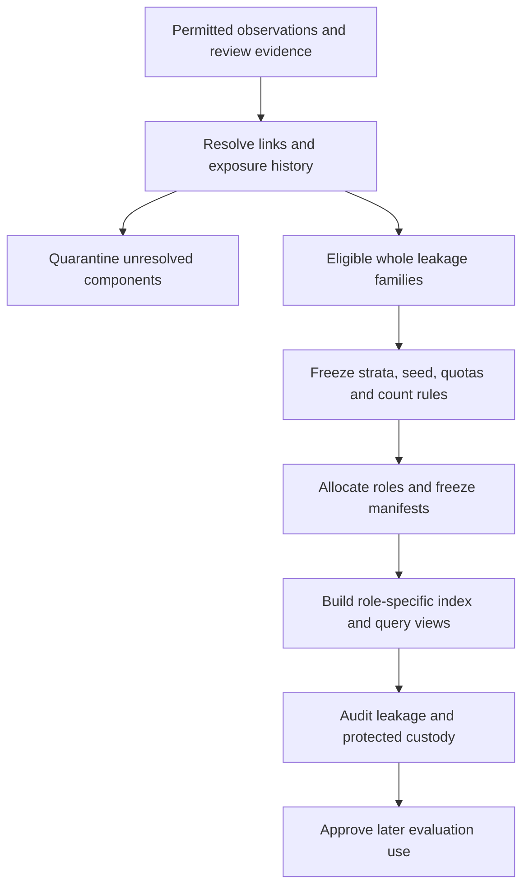

# Step 08A — partition independence and later approval gates

Date: 2026-10-25, Asia/Kolkata. **Status: planning only; no partition, label, corpus release or Step 08B acquisition is created or authorized here.**

This document designs the later Step 09 controls and the evidence that must accompany a Step 08B approval. The [approved Step 07 closure](../progress/completion-07-approved.md) establishes three successful feasibility sources: OpenSanctions UN, OFAC and EU. Direct UN and Wikidata remain investigated but not acquired. The [completion plan](../project-completion-plan.md) retains its original Step 08 quantities, review obligations and Step 09 independence requirements. Historical reports that predate the scope approval remain historical evidence, not the current closure decision.

The [central Step 08A plan](../step-08a-plan.md) owns the exact proposed acquisition/resource package. The [corpus design](step-08a-corpus-design.md) owns source observations, review and release fields. This document does not change the current feasibility limits in [corpus requirements](../../config/corpus-requirements.json), grant new permissions or implement those future contracts. The Project 1 [reference proposal](../reference/internship-2093-portfolio-plan.html) informs the design; its examples, licenses, model claims and resource assumptions are not current verified facts.

## What independence means here

A **partition** is a permitted use of data: learning, development, calibration, threshold selection or final confirmation. A **leakage family** is a set of records that must stay together because information about one could disclose an answer about another. **Custody** means who can access protected examples and labels, when, and under what recorded controls. These controls matter because a system can appear to recognize a new entity when it has already seen another alias or source copy of that entity.

**What:** design whole-family allocation and protected evaluation. **Why:** measure behavior on independently held-out families without tuning to their answers. **When:** establish the controls before acquiring or preparing prospective held-out material; allocate only after review and later Step 09 approval. **Where:** versioned local corpus contracts and, for sealed material, a separately controlled custodian location. **Who:** the project owner approves scope, human reviewers adjudicate evidence, an independent custodian manages final material, and developers use only their permitted data. **How:** record provenance, review links, quarantine uncertainty, freeze an allocation policy, and audit every data flow.

This is group independence within this project's supervised learning and evaluation. Public names may already occur in pretrained models or public benchmarks. A fresh local snapshot cannot prove that pretraining never contained them; that separate uncertainty must remain in later reports.

## Traceability to the ten requested planning requirements

The entries below summarize the user's requirements; they are not replacement wording or new approvals. “Planned” means a design exists, not that the later dataset or label is accepted.

| Requirement | Planning responsibility and acceptance evidence | Status at this boundary |
| --- | --- | --- |
| U1 — audit the existing 600 groups for possible usability, duplicates, language/script and provenance, without treating unreviewed labels as correct | The [offline audit](../../data/eval-comparisons/completion-08a/audit/report.md) supplies measured evidence. This document carries its exposure and unresolved-identity limits into every future role. | Aggregate evidence is developmental; no independently correct positive/negative labels or 600 distinct identities are asserted. |
| U2 — plan about 5,000 usable reference groups and 2,000 independent absent-query groups from permitted sources | Central acquisition/yield plan plus the distinct-population and count rules below. | Targets remain proposals; duplicates, rejection and quarantine reduce accepted counts. |
| U3 — independently verifiable Latin–Arabic, Latin–Cyrillic and especially Latin–Han coverage, with at least 100 independent final positives per claimed direction | Direction-specific eligibility, allocation arithmetic and final-count gate below; corpus design supplies human evidence. | Current script co-presence is candidate evidence only. Final eligible counts are not established. |
| U4 — evaluate Wikidata Action API or REST as supplementary learning material without replacing sanctions-domain evaluation | The [source-route proposal](step-08a-source-feasibility.md) and separate source/domain labels. | Offline route design only. No route is live-verified here; no Wikidata organization is automatically a negative. |
| U5 — keep direct UN pending legal review and do not download | Permission gate below and the preserved source-policy records. | Blocked for new acquisition; OpenSanctions UN is a distinct route. |
| U6 — design schema, source IDs, equivalence review, quarantine, human review and immutable releases | Corpus design plus family, version and exposure rules below. | Future schema/review contracts only; no release, merge or identity decision is made. |
| U7 — estimate acquisition, disk, memory, elapsed time and review cost from measured yield with assumptions | Central resource package and its source measurements; resource gate below distinguishes estimates from limits. | Extrapolations must retain uncertainty; discarded records' quality/scripts are unmeasured. |
| U8 — provide an exact bounded Step 08B package and approval list | Central numeric package plus the approval checklist below. | The initial 100 MB proposal and every revised number require explicit approval before use. |
| U9 — preserve later Step 09 partition independence and prevent leakage | Allocation, withholding, absence, negative-mining, custody and invalidation rules below. | Designed, not executed. Step 09 remains a separate phase. |
| U10 — provide the detailed phase report, file/function explanations, evidence, actual commands/results, limitations and 5W1H | Parent phase report and central plan; this document identifies proposed files/tests and its own limits. | Documentation checks are reportable; application/corpus acceptance tests have not run for this design. |

## Original Step 08 and Step 09 obligations remain intact

| Controlling obligation | Required treatment |
| --- | --- |
| Step 08.1 — measured quantities, about 5,000 reference and 2,000 absent groups; proposed 100 MB response budget | Count independent accepted families after review. Approve the exact package before transfer; if insufficient, stop and revise the proposal. |
| Step 08.2 — multilingual learning and fresh sanctions-domain evaluation populations | Record both populations and their overlap separately. Supplementary organizations may support learning or a separately named domain evaluation; they cannot fill a sanctions-domain claim silently. |
| Step 08.3 — immutable releases and complete source lineage | Bind records, aliases, source snapshots, terms, parser and transformation versions, review decisions and manifest hashes. |
| Step 08.4 — separate record equivalence, leakage grouping and uncertain candidates | Preserve these as different relations; review links and quarantine uncertainty before assignment. |
| Step 08.5 — at least 200 proposed positive and 200 negative candidate reviews across source/script/type, hard-negative adjudication and independent final-label review where possible | The 400 candidate reviews are a minimum review exercise, not a substitute for adjudicating every label used for final claims or hard-negative training. Log disagreement, unresolved cases and exclusions. Confirm independent review/custody capacity before promising protected final evidence. |
| Step 08.6 — at least 100 independent final positive groups per claimed direction and separate variation tags | Count eligible final families per query→reference direction, retain translation/transliteration/spelling tags, and report unmet gates openly. |
| Step 09.1 — approximately 50/15/10/10/15, predeclared strata/seeds | Allocate stable whole families using a frozen policy, without trying seeds for favorable coverage or performance. |
| Step 09.2 — absent/ambiguous families receive the same roles and fixed-view definitions | Keep role, presence and ambiguity separate. Remove every equivalent copy when a view declares a target absent. |
| Step 09.3 — training pairs and mining are training-only | Check both endpoints and every mining-index member against the train family set and reviewed truth. |
| Step 09.4 — natural held-out aliases, planned perturbations and complete withholding | Trace derivations and remove held text/descendants across all equivalent records and searchable metadata; retain multiple supported answers. |
| Step 09.5 — frozen denominators, uncertainty, schema, exposure and custody | Freeze these before later evaluation. A hash establishes byte identity; it does not establish that nobody read the bytes. |
| Step 09.6 — final sample size and protected diagnostics through Step 28 | Final examples, labels, rankings, distributions, failures and slice results remain with the independent evaluator until the planned confirmation. Developers receive only permitted aggregate integrity evidence. |

## Existing evidence and freshness

The current 600 retained source-local groups contain 200 from each successful source, all classified as organizations and no vessels. Saved feasibility evidence reports 3,293 name-evidence entries and 3,072 unique original strings; Latin–Arabic/Cyrillic/Han presence candidates are 35/96/4 and strict single-script pairs are 35/88/4. The 69 exact-name candidate pairs, including 65 across sources, are review candidates rather than confirmed equivalence links. The [saved workload analysis](../../data/eval-comparisons/completion-07/closure-review/feasibility-workload.md) preserves these measurements; its old five-source closure conclusion predates the approved amendment.

The new Step 08A offline audit adds 83 normalization-based candidate pairs, including the 69 exact pairs and 14 additional cross-source candidates, involving 166 source-local groups. It finds 386 groups with at least two distinct original names and 214 with only one. These mechanical checks expand the review workload; they do not adjudicate duplicates, prove cross-script equivalence or convert candidate groups into usable labels.

All 600 are conservatively classified as exposed developmental evidence for this plan. They and all equivalent/derived copies are excluded from fresh calibration-fit, threshold-selection and final-test eligibility. A later, separately approved reviewed learning use may be possible; possession of the records is not approval to train on them. Historical fixtures and public-small datasets are also exposed, as recorded in the [data card](../data-card.md).

Exposure follows the family, not a filename or source ID. Re-downloading a record, updating its timestamp, getting it from a second publisher, changing its provider ID, adding an alias or generating a perturbation cannot reset it. A source-version change may contain a genuinely new unrelated family, but reviewed continuity and duplicate checks must establish that distinction. The optimistic `5,000 − 600 = 4,400` reference deficit assumes all 600 eventually qualify as usable independent groups; it does not create fresh final-test eligibility or prove that assumption.

The full successful response bodies contained 13,658 parser-eligible source-local records before the retention caps. The discarded records' identity, scripts, labels and quality were not measured. They cannot be counted as a ready corpus or as independently sealed material: the acquisition and custody process for any future use must be approved first.

## Family identity, uncertain links and source changes

The corpus design distinguishes the following units. Each needs a version and evidence references; no unit is created by this planning document.

| Unit | Meaning and use |
| --- | --- |
| Source record key | `(source_id, provider_namespace, provider_id)` identifies a provider's record, not a globally unique real-world entity. |
| Source observation | A source record bound to a particular snapshot/content digest and parsing version. It preserves what was observed at that time. |
| Reviewed record-equivalence group and entity claim | Accepted evidence that specified records refer to the same entity; the evidence, reviewer and unresolved conflicts remain inspectable. Provider referents are evidence to review, not unquestionable identity. |
| Leakage family | The conservative unit for allocation and independence. It contains all accepted equivalent copies, aliases and descendants, plus any reviewed dependence that requires records to stay together without claiming that they are the same entity. |
| Uncertain-link quarantine | Records/components withheld from eligible pools while potentially consequential duplicate, type, provenance or continuity questions remain unresolved. |

Name similarity, exact shared names, matching transliterations and parent/subsidiary relations alone do not establish identity. An explicit link can also be stale or wrong. Review accepts, rejects or leaves each proposed link unresolved. Parent/subsidiary records may remain distinct while a documented dependence keeps them in one leakage family; this must not inflate the number of independent final families. Do not add arbitrary “similar name” edges and treat their transitive closure as proven equivalence.

Before assignment, inspect source referents, stable identifiers, repeated aliases and plausible cross-source candidates using the approved evidence fields. Uncertain connections quarantine all involved components needed to prevent leakage. Missing identifiers or provenance do not justify putting a record in a convenient unlinked partition. Log quarantined family and script counts because quarantine can remove precisely the rare-script examples needed for coverage.

Source updates require continuity review for record merges/splits, redirects, changed IDs, reused IDs and removed records. Preserve old observations; do not overwrite the source/identity/exposure ledger. A deleted record does not erase its exposure, and a newly assigned provider ID does not prove a new entity. Freeze the release's source versions so a live refresh cannot silently alter a fixed evaluation index.

If a cross-partition duplicate or consequential missing link is found later, mark the affected release and dependent results invalid. Quarantine the component, carry forward exposure, issue a new version with an explicit change record, and obtain any required new release/evaluation approval. If training or developer inspection already exposed a proposed final family, replace it with a genuinely unexposed family; moving its rows or changing the random seed does not repair the independence claim. Preserve the invalidated results for audit rather than silently patching them. Unknown duplicates can remain despite these controls; later reports must state that residual limitation.

## Proposed allocation, to be implemented only in Step 09

Freeze the family membership, stable sorting key, source/population eligibility, strata, seed, rounding/tie-break policy and allocation algorithm version before assignment. Input-file order must not change membership or role. Use opaque stable family IDs; keep the mapping to evidence in the appropriate restricted store. No seed may be chosen after inspecting model scores, failures or final cases, and do not keep trying seeds until the desired script count appears. If the declared quotas cannot be met, record the deficit and request more data or an explicit protocol revision before any model evaluation.

| Role | Approximate share | Permitted purpose | Forbidden feedback |
| --- | ---: | --- | --- |
| Training | 50% | Fit model parameters using approved reviewed pairs; build mining indexes from these families only. | Importing names, labels, pairs or negatives from any held-out family. |
| Development | 15% | Choose representations, hyperparameters and implementation behavior. | Claiming final confirmation from repeatedly inspected results. |
| Calibration-fit | 10% | Fit the declared calibration mapping after the matching pipeline is frozen. | Using these results to choose a different matcher or threshold and still call them independent calibration evidence. |
| Threshold-selection | 10% | Select the declared abstention/decision thresholds with the matcher and calibration mapping frozen. | Re-fitting the matcher/calibrator or tuning on final outcomes. |
| Final-test | 15% | One planned confirmation at Step 28 after all choices and run rules are frozen. | Developer access to case-level examples or diagnostics, or repeated testing that informs changes. |

The exact quota strategy must account for already exposed families. The nominal ratios describe the eventual total eligible role allocation; they are not permission to put exposed material into fresh roles. For example, exposed families may consume part of the permitted training/development allocation if reviewed and approved, while fresh families supply all protected allocations. If those constraints cannot coexist, the allocation specification must disclose the deviation and obtain approval before freezing it.

As arithmetic only, 5,000 independent reference families at the nominal proportions would allocate 2,500/750/500/500/750. A distinct pool of 2,000 absent families would allocate 1,000/300/200/200/300. These are not achieved counts, promised role sizes or script quotas. Ambiguity and script tags may overlap; counts must show unique families as well as memberships, with no aliases, duplicate source copies or perturbations counted as additional independent families.

### Directional coverage and the 667 planning bound

“Latin→Han” means a reviewed Latin-script query is matched to retained Han-script reference evidence for the same reviewed family in the declared view. It is different from Han→Latin; Latin→Arabic, Arabic→Latin, Latin→Cyrillic and Cyrillic→Latin are also separate claims. Script detection alone establishes neither language nor a correct translation/transliteration relation. Keep translation, transliteration, spelling variation and unresolved relation tags distinct, with competent human review of the claimed pair.

At a nominal final share of 15%, `ceil(100 / 0.15) = 667` independently eligible **fresh** pair families per script-pair stratum is a planning lower bound if that stratum also uses roughly 15% for final confirmation. For example, 667 × 0.15 = 100.05 before rounding. This is not a yield guarantee: duplicate resolution, exposure, quarantine, review rejection, direction-specific eligibility and withholding can all reduce the final count. The 35/96/4 current presence counts cannot satisfy this fresh-data calculation.

Two defensible prospective choices are available for explicit approval:

1. Acquire enough fresh, reviewed eligible families per stratum to support the nominal allocation and expected review losses; predeclare rounding and audit actual final counts.
2. Predeclare a stratified reservation of at least 100 final families per claimed direction, then allocate the remainder under published constraints. Report any changed per-stratum proportions and overall achieved ratios. Stratification means intentionally reserving known categories before modeling; it does not mean searching seeds or selecting examples by favorable model behavior.

A genuinely bidirectional family may contribute once to each separately reported direction; explain that results sharing families are not independent samples. It cannot contribute twice to one direction because it has several aliases, sources or queries. Direction-specific withholding usually needs separate views: holding out a Latin alias while retaining Han evidence is different from the reverse view. Removing both only available aliases from one common view would leave no positive reference. Multi-script families may meet several strata, but the allocation and later uncertainty method must account for shared families; summing slice counts does not yield the total independent sample size.

Before Step 09 acceptance, publish protected aggregate counts of reviewed, fresh, non-quarantined final families with valid retained reference evidence for each proposed claim. A shortfall remains unfinished data work; do not quietly drop a direction or replace sanctions-domain cases with supplementary examples. Any narrowed claim or changed domain needs an explicit decision recorded with its unmet original target. One hundred positives per direction is a minimum coverage gate, not evidence of a 99% operational guarantee or a precise false-positive bound; later sample-size planning must separately address absent cases, ambiguity, branches and uncertainty.

## Alias withholding, absence and ambiguity

All aliases and derived queries inherit their leakage family's role. A natural held-out alias is a real provider-supported form reserved as a query; a perturbation is a versioned edit with parent alias, edit rule and validity review. Perturbations may test typos, ordering, appropriate particles/initials, romanization and mixed/confusable scripts, but cannot manufacture new independent entities or unsupported translations.

For each view, remove the withheld alias and its forbidden derived forms from **every equivalent source record**, primary/display names, searchable fields, normalized caches, embeddings and other retriever-visible metadata. Check the actual preprocessing representations used by the method, not only raw-text equality. Preserve non-searchable original evidence with the custodian for audit. An alias accidentally retained through another source copy invalidates that positive view. A legitimate identical name belonging to a separately supported entity must be handled as a collision/ambiguity with a supported truth set; do not silently erase it merely to make retrieval easier.

Presence describes whether a supported target exists in the **fixed declared reference view**. It is independent of partition and ambiguity. “Absent” is not a claim that an organization is absent from all sanctions lists or is unsanctioned. An ambiguous query with several supported candidates retains a truth set, not an arbitrary single winner. A case without adequate truth evidence is unlabelable/quarantined, not automatically negative.

The 2,000 independent absent-family target is separate from the 5,000 reference-family target after cross-source/family deduplication: the proposed total is at least 7,000 distinct reviewed leakage families. The central plan's primary route is a **controlled index-absence cohort**: select 2,000 independently reviewed non-person families from permitted pools, keep them disjoint from the 5,000 reference families, and exclude every equivalent copy from the frozen index. This satisfies the original relative-to-index absence definition if the approved protocol and implementation enforce those conditions. It is a designed research population, not an estimate of naturally occurring query prevalence or global sanctions status.

Natural background nonmembers may be an optional, separately reported population after permission, identity and nonmembership review. A Wikidata item, missing cross-link, failed lookup or low fuzzy score alone does not establish absence. Review all potentially equivalent source copies and fix the view/version used to establish nonmembership. Source membership alone establishes neither a positive match nor a negative.

Additional “all equivalent copies withheld” diagnostics that reuse any of the 5,000 reference families may be useful, but cannot count those families again toward the independent 2,000 target. The approval package must declare controlled and natural absence populations and their count rules, rather than combine them silently. For every absence construction, no family appears in different roles merely because one query is marked present and another absent.

## Training pairs and hard-negative mining

A hard negative is a reviewed different entity whose name is easy to confuse with the query. A high retrieval rank only nominates a candidate; it is not evidence of different identity. Both endpoints of every training pair/negative, and every record in the mining index, must map to approved **training** families. Reject quarantined links, same-family candidates, unresolved identity and unsupported negatives before use. Every hard negative actually used requires adjudication; the minimum 200 negative candidate reviews do not waive that rule.

Record the corpus release, family/partition manifest, reviewed pair evidence, retriever/index version and mining configuration. Training exports must reject held-out poison identifiers, source-copy aliases and derived descendants even if their displayed provider IDs differ. In-batch negatives must obey the same reviewed distinction requirements, including multiple positives and related/ambiguous entities.

Held-out references may participate in their approved evaluation retrieval view. They must not become supervised pairs, mining candidates, retrieval-memory examples or tuning feedback. Development/debug views must not expose sealed final-family names as distractors. The independent evaluator constructs final reference views and runs frozen code with their required distractor population; role-specific index differences must be declared so later metrics are not compared as though their candidate universes were identical.

## Independent custody and the exposure ledger

Before preparing future final candidates, name a human or independently controlled evaluation process accountable for custody. Separate its storage/account/access from developer-accessible working files and logs. A shared workspace available to the same unrestricted coding agent does not establish independent blinding. Private file modes, content hashes or encryption whose keys developers can read do not solve that access problem. An independent reviewer may examine protected cases as necessary, but must not then convey case details to developers or tune the matcher using them.

| Material | Permitted access before Step 28 | Developer-visible output |
| --- | --- | --- |
| Exposed development pool | Approved developers/reviewers | Reviewed examples and diagnostics with their exposure status. |
| Prospective protected families and evidence | Approved curator/reviewers/custodian under the agreed access plan | Aggregate capacity/eligibility counts and documented exclusions without identifying examples. |
| Calibration-fit and threshold-selection material | Designated evaluation roles; fit/select only their declared components after the upstream system is frozen | Predeclared aggregate artifacts/results needed for their allowed decisions, with no upstream retuning. |
| Final queries, labels and index views | Independent custodian/evaluator; necessary independent label reviewers | Counts, manifest hashes and pass/fail integrity attestations only. No case identities, alias strings, rankings, score distributions, failures or slice results. |
| Final results | Independent evaluator until the planned confirmation release | Full results only under the frozen Step 28 procedure, followed by an exposure-ledger update. |

Freeze a ledger with at least: event ID/time; actor and role; artifact/version/hash; affected family IDs or a restricted membership-manifest reference; operation/purpose; whether examples, labels or diagnostics were disclosed; access location/policy; downstream derivatives; approval/evidence reference; and resulting eligibility restriction. Record human inspection, automated agent/tool context, exported reports, screenshots, logs, notebook output and previously published examples. Distinguish actual observed exposure from merely possible access, but do not claim confirmed blinding when unrestricted access/auditing makes it unprovable. Keep case-level ledger mappings restricted; public planning reports should expose aggregates rather than names or hashes of individual names.

The evaluator's integrity runner must suppress sensitive failures and route case details to the custodian. A failed check can report “withholding violation” and a release-level failure without leaking the responsible query. Developers may repair a generic invariant using fictional fixtures; the custodian rechecks protected material. Freeze evaluation code, model versions, score mappings, thresholds, branch rules, metrics, denominators, uncertainty method and permitted run count before confirmation. Unexpected failures need a documented decision under that procedure, not an unrecorded rerun followed by cherry-picked success.

If independent custody cannot be arranged, keep prospective material inaccessible until it can, or explicitly classify the resulting evaluation as exposed development evidence and postpone confirmatory claims. Do not waive independence by renaming the run “final.” This is a condition for a credible later claim, not evidence that a suitable custodian is already available.

## Step 08B approval gates

The central plan must contain the exact proposed numbers, staged scope and named owners. None of the following is approved by this document; no unused Step 07 allowance carries over automatically.

| Gate | Concrete reviewable content required before the dependent action | Stop condition |
| --- | --- | --- |
| G1 — source and purpose permission | Exact sources, publisher/version/endpoint/redirect rules, allowed non-person types/fields, purpose, attribution, retention and use constraints; dated primary terms and unresolved points. Evaluate supplementary Wikidata separately; keep sanctions-domain targets visible. | New purpose or unsupported terms: no acquisition/training/release. Direct UN remains unavailable until its applicable reuse/access issue is separately resolved and approved. |
| G2 — metadata and route investigation | Exact metadata/terms/API-documentation requests, response limits, allowed hosts and explicit live-verification scope. Action API/REST candidate discovery, details and pagination require a finite bounded route; endpoint existence alone does not supply candidate organizations. | No live metadata or alternative route request from this offline plan. Stop on an unapproved host, redirect, schema or field expansion. |
| G3 — acquisition quantities and byte budget | Per-source retained maxima; total/per-source response-body limits; a **new** Step 08B ledger covering all attempts including failures; separate terms/metadata accounting; one-request-at-a-time rule or explicit revised concurrency; request/phase deadlines, attempt caps, redirect handling and stop/resume rules. State whether “100 MB” means 100,000,000 bytes and exactly what the cap counts. | Exhausted cap, oversized body, timeout/HTTP/service failure or insufficient yield: record the honest outcome and stop at the declared boundary. No automatic retry, larger transfer, new source or borrowed allowance. |
| G4 — decoded memory, storage and compute | Separate encoded/network, decoded XML/JSON/archive/member and total process-memory ceilings; bounded parser plan, temporary-buffer policy, permitted retained disk, free-space reserve, elapsed/CPU limits and measurement method. Mixed/person-containing raw responses stay transient under the approved policy. | Decompression/record/memory/disk/time bound exceeded or unaudited parser retention: reject the run; do not save mixed raw bodies for debugging. A 100 MB transfer limit is not a 100 MB RAM guarantee. |
| G5 — review capacity and cost | At least 200 proposed positives plus 200 negative candidates sampled across source/script/type; all used hard negatives; final-label review workload; language competence including Han; independent second review/adjudication process; named availability, pilot timings, maximum hours and explicitly approved currency/spend if any. | Unstaffed review, inadequate language competence, unresolved conflicts or exceeded approved work/cost: keep cases unreviewed/quarantined. An LLM response is not human adjudication. |
| G6 — freshness and custody | Identify existing exposed families, independent curator/evaluator, controlled storage/access, exposure ledger, final-label sealing, protected review and allowed aggregate diagnostics before collecting prospective held-out cases. | No enforceable custody: do not claim fresh final data or create final labels in the shared development workspace. |
| G7 — data yield and acceptance | Unique reviewed family counts, source/domain/script/type breakdown, candidate→accepted attrition, uncertainty/exclusion counts, required directional eligibility and distinct absent population; exact allowed next action after a pilot. | Below target: Step 08 remains unfinished. Return a measured revised proposal; do not substitute supplementary coverage, synthetic variants or seeds for missing data. |
| G8 — implementation/release boundary | Exact files/commands/tests approved for each 08B substage, registry/terms provenance, immutable output locations, preservation checks and review receipts. Actual partition freeze remains Step 09, and model training remains later. | No implicit permission for later phases, new dependencies, paid resources, Git publication or service exposure. |

The safest practical sequence is an explicitly bounded metadata/route verification, then a bounded acquisition/review pilot under named limits, then a measured stop/report. A larger continuation must be described in the same explicit approval package or separately approved after that report. The user must be able to approve a concrete finite action; “continue until 5,000/2,000/100 are reached” is not a sufficient byte/time/cost bound.

## Proposed implementation and acceptance checks

These are later dependencies, not files created or commands run in Step 08A. The central plan must identify the exact Step 08B subset; Step 09 needs its own approval.

| Later files/contracts | Purpose and meaningful acceptance checks |
| --- | --- |
| `src/watchlist/corpus.py`, `src/watchlist/corpus_schema.sql`, `src/watchlist/ingest/link_records.py`, `src/watchlist/label_review.py`; corpus/link/review tests | Preserve observation/alias lineage, distinct relation types, review provenance, uncertainty quarantine and immutable releases. Reject missing evidence and conflicting relation state. A similar-name pair must not auto-merge. |
| `src/watchlist/training_data.py`, existing split/query modules; `tests/test_training_data.py` and leakage/view tests | Stable whole-family allocation under reordered input; all aliases/source copies share role; exposed/poison held-out descendants never enter training or mining; uncertain components reject; in-batch false negatives reject. |
| `eval/configs/research-v1.json`, `docs/training-protocol.md`, `docs/calibration-protocol.md` | Freeze quotas/strata/seed, view and query definitions, direction eligibility, uncertainty and allowed fitting decisions. Separate fit and threshold data. |
| `docs/benchmark-exposure.md`, restricted exposure/review/custody manifests and immutable query/view artifacts | Bind exposure, custody, hashes and allowed diagnostics. Corrupted ancestry or an alias left in any equivalent copy fails. An absent family's surviving equivalent copy fails. Case-level errors stay with the custodian. |
| Versioned local `data/corpora/research-v1/` release plus protected counterpart under approved custody | Acceptance counts independent families, not query rows. Detect a late cross-partition duplicate, invalidate the affected release, and preserve historical artifacts. |

The completion plan's future commands include `python -m watchlist.corpus build/audit`, `python -m watchlist.label_review export/validate`, `python -m watchlist.splits freeze`, `python -m watchlist.training_data build --partition train` and evaluation-data build/audit. Slash-separated verbs here describe alternative subcommands, not executable shell syntax. Their exact implemented CLI arguments and test files must be approved and checked in their own phase; this document does not assert that the proposed interfaces exist today.

Fictional acceptance example: source records `fictional_a:R1` and `fictional_b:R7` are reviewed copies in leakage family `FIC-001`. If `FIC-001` is development, neither copy nor a derived alias may enter final-test. If the Han alias is held out for a Han→Latin query, both source copies and every searchable cache must omit that alias while retaining approved Latin reference evidence. A constructed absent view must omit both equivalent records. These are illustrative contracts, not new labels for real records.

## Limits and handoff

This document creates no labels, identity links, source records, partitions, model scores or numerical performance claims. No new application function is implemented. Its review surface is the requirements tables, family/exposure rules, allocation arithmetic, view/mining contracts, custody design and approval checklist. The parent report records the actual offline reads and document checks; future tests above remain unexecuted proposals.

Open risks are source availability/rights, scarce fresh Han coverage, incorrect or missing duplicate links, incomplete alias evidence, human review capacity, uncertain nonmembership and the absence of a confirmed independent custodian. The 600-group audit can estimate work but cannot resolve those risks by itself. Retain measured shortfalls and failed investigations as evidence.

**What:** a reviewable Step 09 design and Step 08B approval checklist. **Why:** prevent exposed aliases, duplicate sources and unreviewed labels from overstating research results. **When:** before new acquisition/corpus preparation and before later partition freeze. **Where:** this planning document, the central resource proposal, the corpus contract and future restricted evidence stores. **Who:** the user approves scope/resources; named reviewers and the custodian establish label/custody evidence; developers implement only an approved substage. **How:** acquire within exact bounds, review and quarantine families, preserve exposure, allocate prospectively and audit views without disclosing final cases.

The next action after Step 08A is a user decision on the central bounded Step 08B package. This document provides no authorization to execute that package or start Step 09.
