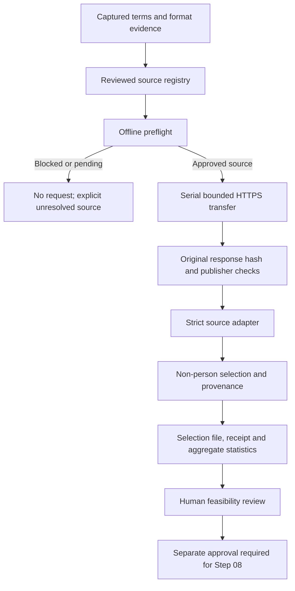

# Completion Step 07 — source permissions and bounded acquisition

Date: 2026-10-25, Asia/Kolkata. Status: **implemented locally; source acquisition gates remain open, so Step 07 is not complete**. The user explicitly approved Step 07 and requested an actual hosted CI run. This is Completion Step 07, not the historical LangGraph Phase 7. Step 08 is not started.

**Latest closure decision: APPROVAL REQUIRED.** The [Step 07 closure report](completion-07-closure.md) records the new official UN database-permission evidence, the single smaller Wikidata query (attempt 06, HTTP 504), completed 600-group feasibility/workload analysis, criterion-by-criterion acceptance review and exact proposed scope revision. No revision has been applied. The implementation/full-suite/CI evidence below remains its dated snapshot; the closure report distinguishes the narrower subsequent validation.

## Goal and rationale

Establish current, source-specific permission and technically bounded acquisition before building a new corpus. Public availability alone does not establish reuse, redistribution or training permission. The default tests use fictional organisations and vessels; real feasibility data is retained only after source review.

## Approved plan and concrete working scope

The previously presented completion plan specifies OpenSanctions UN, direct UN, OFAC, EU and a supplementary Wikidata organisation-name corpus. The initial feasibility ceiling was 200 selected non-person groups and 10,000,000 response-body bytes per source, 50,000,000 bytes in total, one request at a time. After official size checks established that the EU XML is 25,899,600 bytes and even its smallest examined CSV exceeds 10 MB, the user explicitly approved **28,000,000 bytes for EU only**. After the partial transfer, the user authorized the suitable **32,000,000-byte EU retry amendment**, with all failed bytes included; its actual accounting is recorded below. Other sources retain the 10,000,000-byte ceiling, the combined ceiling remains 50,000,000 bytes, and selection remains at most 200 groups per source. Terms and endpoint inspection has a separate conservative 5,000,000-byte ceiling. A source that cannot be used within its permission and size limits stays blocked; the implementation must not silently exceed the limit or substitute an unrelated source.

Selected types are organisations/legal entities and vessels. People, aircraft and unknown types are excluded. Wikidata supplies supplementary unlabelled organisation names; it does not establish sanctions presence/absence. Provider identifiers and explicit references may support grouping; matching names alone must never merge entities.

New files:

- `docs/source-permissions.md`, `docs/data-retention.md`.
- `config/data-sources.json`, `config/corpus-requirements.json`.
- `src/watchlist/ingest/source_registry.py`, `acquire.py`, `parse_ftm.py`, `parse_un.py`, `parse_ofac.py`, `parse_eu.py`, `parse_wikidata.py`, `_parse_common.py`.
- `tests/test_source_acquisition.py`, `tests/test_source_adapters.py`.
- Fictional `tests/fixtures/acquisition/ftm.jsonl`, `un.xml`, `ofac.xml`, `eu.xml`, `wikidata.json`.
- This report, `docs/progress/completion-07.md`.

Integration edits, announced before implementation: `Makefile`, `pyproject.toml` lint scope, `README.md`, `docs/access-and-resource-ledger.md`, and the existing publication checker only if new verified public-checksum findings require narrow review. No new application dependency was added. The user's hosted-CI repair request also authorized fixes in `.github/workflows/ci.yml`, `scripts/project_checks.py`, `tests/test_project_checks.py` and `tests/test_packaging.py`; the public copy's README/publication note now identifies those repairs. Historical ingestion modules, the original 20-record contract, archived cases, model/config files and completed reports remain preserved.

The internal `_parse_common.py` helper was added within this phase to share strict JSON/XML validation, alias ordering and accounting across all five parsers. It introduces no dependency and avoids inconsistent copies of these boundaries.

## Dependencies, commands and tests

Dependencies: completed Step 06 tools/lock, existing Python 3.14 environment, approved source permissions/endpoints and fictional parser fixtures. No live API key, paid service, model download or public deployment is part of Step 07.

Planned commands are `python -m watchlist.ingest.acquire preflight --profile feasibility --registry config/data-sources.json`, explicitly approved `fetch --profile feasibility` invocations with fresh output roots, focused acquisition/adapter pytest, scoped Ruff, the real publication scanner, packaging and the full offline regression suite. Exact commands and actual results are recorded below and in the linked execution receipts.

Acceptance requires dated permission evidence, truthful allowed-purpose/redistribution/training status, bounded real receipts and measured script/alias/duplicate yield for usable sources; strict malformed JSON/XML, redirect, byte/deadline, interruption and path/overwrite tests; no private inputs or original-store mutation; and preservation of the legacy ingestion tests. Parser tests use fabricated responses, not network services. Unknown permission or an infeasible source remains an explicit unfinished item until resolved or the user approves a scope revision.

## Risks and controls

Bulk exports may exceed the allowed size or mix people with non-person entities. Reject oversized responses before transfer where a trustworthy length is available, enforce stream limits regardless, filter bounded mixed content in memory, and never retain its mixed raw body. Receipts must distinguish the downloaded-body hash from the retained non-person data hash, report actual partial-transfer failures, and state when raw input was not retained.

Provider schemas and terms may change. Validate explicit source format/type markers; preserve provenance and language fields; reject unsupported shapes instead of guessing. Check allowed destinations before following redirects, retain TLS verification, use finite deadlines and refuse existing/symlink output paths. No fallback may hide a missing permission or a failed acquisition.

## Work ownership and hosted CI boundary

Five Astra/max workers own: hosted Step 06 CI readiness; official source-permission review and retention docs; registry/transport/CLI/configuration; five parsers/fictional fixtures; and independent adversarial tests. The coordinator integrates checks, performs serialized approved feasibility requests and reports actual evidence.

Hosted CI previously remained unrun because earlier approval explicitly excluded it and this workspace has no Git repository. The user subsequently requested execution, supplied the public repository and completed local Git sign-in. The exact completed Step 06 source was captured separately before Step 07 changes, with a 136-file hash match to its final verification plus four required fictional historical result fixtures. The reviewed publication copy excludes Finder metadata, marks omission of a real-source excerpt in the public copy of Phase 2, and documents unavailable historical local evidence links. Local originals remain unchanged.

The initial 140-file reviewed copy was published as `eddbddb3452171a72832c72d3f9aeab7921934dd`. All hosted runs below were manual validations of distinct commits. Original Git configuration was not modified; the isolated publication checkout uses per-command `Codex <codex@localhost>` commit identity. Real source selections, model files and review stores were not uploaded.

### Hosted failures: distinguish the old runs from the final correction

| Run / commit | Actual failing check and root cause | Repair and verification |
| --- | --- | --- |
| [40125202734](https://github.com/raiha-siddiqui/Polyglot_watchlist/actions/runs/40125202734), `eddbddb` | Secret-scan subprocess failed. detect-secrets used a multiprocessing pool; Python 3.14 Linux's forkserver opened a local Unix socket, which the audit guard rejected. macOS uses a different default process-start method. | Commit `2a12fe0` scans sequentially through pinned detector APIs under the unchanged guard. Local forced-forkserver regression and exact detector-finding parity passed. Later hosted runs passed this hook. No detector was disabled. |
| [40127554015](https://github.com/raiha-siddiqui/Polyglot_watchlist/actions/runs/40127554015), `2a12fe0` | `test_clean_install_and_cli_run_outside_repository` could not resolve `rapidfuzz==3.14.6` offline. CI had no explicit wheelhouse and relied on a prior locked installation providing the cache state required for a separate registry reinstall. The solver reported RapidFuzz absent from its usable cache. | Commit `764ef04` acquires one exact compatible lock-listed wheel before isolation, verifies size/SHA-256 and passes its absolute path across the environment reset. The clean-install test then uses its existing hash-checked `--no-index` path. Empty-cache local installation passed. The next hosted run completed installation. The log does not establish which internal uv cache metadata was missing, so that deeper cause is not invented. |
| [40130195494](https://github.com/raiha-siddiqui/Polyglot_watchlist/actions/runs/40130195494), `764ef04` | The same packaging test reached its native-backend assertion and compared `rapidfuzz.fuzz_cpp_avx2` with the Mac-oriented expected string `rapidfuzz.fuzz_cpp`. It had 1,645 passing tests, one failure and 13 passing subtests. This was a CPU-dispatch assertion bug; wheel installation had succeeded. | Final commit `9f992822af6f059d5d342d78dcb0a657720fb015` accepts the exact generic/AVX2/SSE2 names in the pinned dispatcher and additionally requires a real `ExtensionFileLoader`, valid compiled-extension filename, matching exported scorer, and extension path inside the clean environment's RapidFuzz package. Actual Python fallback and a Python wrapper falsely claiming the native name were rejected locally. |

The final commit also corrects obsolete public README/publication statements about hosted execution and preserved Step 06 bytes. No test was skipped, disabled or marked expected-failure to repair CI. Application dependencies and the offline network boundary remain unchanged. The final candidate was checked locally **before** push: all three pre-commit hooks passed; **1,646 tests and 13 subtests passed**, with three model tests deliberately handled separately in the main workspace; packaging and the 157-query fictional evaluation smoke passed. Hashes of all 140 tracked publication files were stable throughout verification. The candidate imports were explicitly checked to resolve from its own captured `src/` tree.

The coordinator verified the pushed `main` SHA, checked that no run already existed for that SHA, and dispatched **one** final validation on 2026-10-25 Asia/Calcutta: [run 40132627832](https://github.com/raiha-siddiqui/Polyglot_watchlist/actions/runs/40132627832), commit `9f992822af6f059d5d342d78dcb0a657720fb015`. **GitHub confirmed success: all workflow jobs (1/1) and check-runs (1/1) passed.** The final log records `1646 passed, 3 deselected, 13 subtests passed in 638.57s (0:10:38)`. All three pre-commit hooks passed; wheel/source-archive builds, dependency inventory and the 157-query fictional evaluation smoke passed. The clean-install test verified the native scorer's loader, exported function and installed-package origin. Successful pytest output does not print its selected CPU backend, so no particular backend is inferred.

The Linux isolation assertions executed successfully before the hooks: distinct network namespace, non-root execution without supplementary groups, empty capability sets, no-new-privileges, and only loopback networking. The three model integration tests remain separately opt-in and all passed locally, as recorded below; they were not disabled to repair CI. The legacy status endpoint returns `pending` with zero legacy contexts; the actual Actions check-run is completed/success, not pending.

The [terminal log/result receipt](../../data/eval-comparisons/completion-06/hosted-ci/run-40132627832-result.json) and [independent final GitHub verification](../../data/eval-comparisons/completion-06/hosted-ci/coordinator-final-independent-verification.json) confirm the exact commit, successful jobs/checks, matching remote `main`, and one final run. The publication checkout is clean. No additional CI run was triggered for these local report corrections. Hosted success covers the published Step 06 code plus CI repairs; the larger Step 07 acquisition implementation has the separate local evidence below.


The CI repair files have these concrete responsibilities:

- `scripts/project_checks.py` — `SCANNER_BOOTSTRAP` installs the socket audit hook before detector imports, parses the pinned scanner arguments, scans files in the same process and emits the normal baseline format. It avoids a multiprocessing socket while preserving detector behavior. The reviewed-finding map binds each exception to a whole-file hash, exact location and detector type.
- `tests/test_project_checks.py` — real clean-file/canary tests run under default and forced-forkserver settings; the network-event cases prove a caught socket exception still makes scanning fail.
- `.github/workflows/ci.yml` — the wheel-preparation step selects the best compatible artifact from the lock, checks official HTTPS location, exact bytes and SHA-256, refuses redirects/overwrites, and runs under a 60-second outer timeout. The absolute wheelhouse is explicitly passed into the isolated offline stage. No network is enabled inside that stage.
- `tests/test_packaging.py` — `test_clean_install_and_cli_run_outside_repository()` now inspects the actual scorer module under the installed-package network guard. Its native-loader/file/function/path assertions preserve the purpose of the original check across CPU-specific dispatch; resource, dependency, isolation and CLI assertions remain active.

Evidence is under `data/eval-comparisons/completion-06/hosted-ci/`: saved job logs and run-result JSON; `ci-scanner-repair.json`, `ci-wheelhouse-repair.json`, `ci-native-extension-repair.json`; the final-candidate local receipt and packaging artifacts; and dispatch/status receipts. Logs were fetched without forwarding GitHub authorization to signed storage URLs. No credential/signing value was saved.

## Executed acquisition and repair work

The initial preservation snapshot was taken before implementation. The following work has actually run. Direct UN and Wikidata remain open source deliverables; successful local engineering checks do not close those gates.

| Source/run | Actual outcome | Body bytes | Retained provider groups / alias evidence |
| --- | --- | ---: | ---: |
| OpenSanctions 01 | Failed transport; exposed response/socket lifetime bug, fixed and tested. | 0 | 0 / 0 |
| OpenSanctions 02 | Successful first parser version. | 3,026,789 | 200 / 696 |
| OpenSanctions 03 | Successful final FTM v2 provenance capture; same selected IDs as 02. | 3,026,789 | 200 / 696 |
| OFAC 01 | Successful ZIP transfer and verified decoded XML. | 2,582,121 | 200 / 724 |
| EU 01 | Partial transport failure; retry refused because the complete file exceeded the remaining source budget. | 5,471,048 | 0 / 0 |
| EU 02 | Successful complete XML transfer after the bounded retry amendment. | 25,899,600 | 200 / 1,873 |
| Wikidata 01–06 | No selection: 01 generic failure, 02 timeout, 03 HTTP error with unrecorded status, 04/05 and the closure review's smaller query 06 confirmed HTTP 504. | 0 | 0 / 0 |
| Direct UN | No acquisition: current permission gate remains unresolved. | 0 | 0 / 0 |

Successful selections are local, private research artifacts under `data/eval-comparisons/completion-07/acquisition-*/`. Neither mixed raw bodies nor selected real names were published. The OpenSanctions 02 selection is superseded by 03 for coverage counting, but both transfers remain charged. Dataset bytes total **40,006,347 / 50,000,000**. Including the closure review's three UN requests, terms/schema/metadata inspection used **3,290,827 / 5,000,000** bytes across 63 capture receipts (65 confirmed HTTP responses including followed redirects). These measure body bytes actually returned by reads, not all network overhead.

The user delegated the suitable EU retry choice after the failed attempt. The selected amendment raises EU's session cap to **32,000,000 bytes** and gives it **180 seconds per request / 240 seconds per source**. Its two transfers total **31,370,648 bytes**. Wikidata's later diagnostic uses one 90-second request inside its unchanged 120-second source deadline and 10 MB source cap. OpenSanctions/OFAC/direct UN retain 30/120-second time limits. Every new execution policy subtracts all earlier session bytes from the source and combined balances. Failed receipts are preserved.

**Implemented corrections from actual evidence and review:**

- Native HTTP response readers now retain socket ownership until body reading ends, including `Connection: close` responses.
- Mixed payload references and handled exception frames are released on success, rejection and interruption before the next source/receipt. Reference release does not claim memory zeroization.
- EU classification uses the official `classificationCode=E/P`; `strong` is a main-name Boolean, not confidence. XML Boolean whitespace is interpreted according to the schema while its original evidence is preserved. Unrelated function/title/gender attributes are not retained.
- The current OFAC schema uses child `uid` fields. ZIP and decoded-XML hashes are separate; the decoded XML matches the publisher's SHA-256. There is no claimed publisher ZIP digest.
- FTM v2 preserves original schemas, datasets, topics, referents and the narrowly evidenced UN classification basis.
- Wikidata provenance records direct `P31 Q43229`; subclass traversal is used only for human exclusion. After HTTP 504, candidate selection was bounded before human filtering; excluded candidates are not replaced. The revised query also returned HTTP 504, so no service-availability fix is claimed. No supplemental record is labelled absent or sanctioned.
- Timeout receipts distinguish `transport_timeout`; HTTP attempts now retain the validated numeric status rather than losing the reason behind `http_error`.

## Commands and verification evidence

Final local verification is saved in [the complete validation receipt](../../data/eval-comparisons/completion-07/final-validation/run-20261024T205948Z-9101d3/receipt.json) and [readable summary](../../data/eval-comparisons/completion-07/final-validation/run-20261024T205948Z-9101d3/summary.md).

| Check actually run | Actual final result |
| --- | --- |
| Acquisition/adapter tests | **520 passed** on fictional inputs and fake transports. Includes numeric HTTP-status preservation, bounded retry, malformed/oversized input, safe paths, deadlines and failure-path memory release. |
| Full local offline suite | **2,166 passed, 13 subtests passed; 3 model integration cases deselected** in 110.88 seconds. |
| Separate real local-model tests | **All 3 passed**, zero failed/skipped, zero recorded Python network attempts. Existing model files/configs/cache were preserved; no model download. These are regression checks, not new accuracy measurements. |
| Packaging | All 13 subprocess checks passed: wheel/source archive builds, identical wheel rebuilt from archive, clean core/native RapidFuzz installation, outside-checkout fictional CLI and separate locked QA recreation. |
| Ruff / lock | Scoped lint and formatting passed; offline lock check passed. No dependency version changed. |
| Actual secret scanner | 156 files, 71 reviewed non-secret findings, **zero unresolved findings** at this snapshot. A narrow whole-file/line/type-bound review covers the explicitly fictional signing fixture. Detectors and socket guard remain active. Final documentation changes receive a separate final scan. |
| Fictional evaluation smoke | 157 current-contract regression queries, zero skipped transformations. No fresh generalization claim. |
| Dependency inventory | 82 installed distributions, 113 locked packages, zero version mismatches/unlocked installed packages. All 82 application names/versions match the pre-phase baseline. |
| Preservation during validation | All 105 monitored source/config inputs, both local model directories and existing embedding cache unchanged. The broader original-file audit is recorded separately. |

Commands actually executed, using the existing local interpreter/tools and absolute cache/wheelhouse/evidence paths:

```sh
make PYTHON=.venv/bin/python QA_PYTHON=.tools/qa/bin/python UV=.tools/bin/uv source-tests lint
make PYTHON=.venv/bin/python QA_PYTHON=.tools/qa/bin/python UV=.tools/bin/uv lock-check secret-scan
WATCHLIST_WHEELHOUSE=/absolute/path/to/approved/wheelhouse \
WATCHLIST_PACKAGING_EVIDENCE=/absolute/path/to/new/packaging-evidence \
  make PYTHON=.venv/bin/python QA_PYTHON=.tools/qa/bin/python UV=.tools/bin/uv test
make PYTHON=.venv/bin/python QA_PYTHON=.tools/qa/bin/python UV=.tools/bin/uv test-local-models
make PYTHON=.venv/bin/python QA_PYTHON=.tools/qa/bin/python UV=.tools/bin/uv eval-smoke inventory
```

These reproduce command shapes; exact absolute paths, arguments, environment overrides, exit codes and hashes are in the linked receipt. `UV_CACHE_DIR` was the absolute existing `.tools/uv-cache` path. Earlier intermediate checks and failures were retained; the earlier 2,038-test run was superseded by the final 2,166-test run after the source fixes.

The live calls use this explicit CLI shape, with a saved reduced execution policy and a new output directory for every attempt:

```sh
.venv/bin/python -B -m watchlist.ingest.acquire fetch \
  --profile feasibility --registry /absolute/path/to/reduced-policy.json \
  --project-root /Users/odin/Desktop/polyglot-watchlist-starter \
  --source SOURCE_ID --output-dir /absolute/path/to/new-private-run
```

The coordinator sets `SSL_CERT_FILE` to the already-installed certifi bundle, preserving certificate verification. The existing host default trust store lacked an issuer; TLS verification was never disabled. Exact actual commands, exit codes and reduced budgets are recorded beside each acquisition manifest in `*-command.json` and `*-console.json`. The supporting `run_bounded_source.py` is an ignored coordinator evidence utility, not a new public command or application dependency.

The [final original-file audit](../../data/eval-comparisons/completion-07/review/final-preservation.json) checks 225 manifest-listed paths across the Step 06 and Step 07 baselines. Original models, source databases, review stores, configs and historical reports remain unchanged. Its Step 07 comparison records exactly eight approved changes to previously existing files: README, ledger, Makefile, Ruff configuration, scanner helper/tests, packaging tests and CI workflow. New Step 07 modules/evidence are outside that original-file baseline. Only Ruff scope changed in `pyproject.toml`; `uv.lock` and all 82 installed application package names/versions remain unchanged. The [final documentation scan](../../data/eval-comparisons/completion-07/final-documentation-scan.json) covers the updated report and supporting source documents separately from the earlier validation snapshot.

## Detailed implementation walkthrough

**What changed and why**

Step 07 introduces a separate, bounded acquisition route for reviewed public
sources. It first checks the source's reuse permission, exact address and
resource limits; then reads the approved response, validates its format and
retains a small selection of explicitly non-person name records. The purpose
is to measure whether each source can support a later research corpus. It does
not establish that two names identify one entity, that a record proves
wrongdoing, or that a matching system is ready for operational screening.

An **adapter** is a small source-specific translator. Here the input is a
provider's XML or JSON and the output is the same `SourceRecord` structure used
by the other adapters. It is needed because publishers use different field
names and type markers. The acquisition function calls the appropriate adapter
after the response passes its transfer checks. It runs locally, and the project
maintainer reviews changes when the publisher's format changes.

A **receipt** is a local record of what an acquisition actually did: which
source, policy and parser it used; how many bytes it read; whether validation
succeeded; and which hashes describe the input and retained selection. The
coordinator uses it after a run to support the report. A receipt is evidence
about the run, not evidence that a listed subject did something wrong.

The dependency flow is:



**Files and their responsibilities**

| File | What the reader should look for | Why it belongs in Step 07 |
| --- | --- | --- |
| `docs/source-permissions.md` | Dated decisions, primary evidence, attribution, exact formats/endpoints, direct-UN resolution routes and later-use limits. | A public download URL alone does not grant permission to compile or transform a corpus. |
| `docs/data-retention.md` | Selected fields, transient mixed-body handling, receipt contents and later review gates. | A non-person record can still contain unnecessary personal or descriptive information. |
| `config/data-sources.json` | Five named sources; permission status, exact requested/redirect URLs, evidence paths and hard limits. | Makes the approved policy inspectable before a request. |
| `config/corpus-requirements.json` | Feasibility scope, required record/receipt evidence, grouping rules and explicit lack of training/evaluation eligibility. | Prevents a successful download from being mistaken for a completed reviewed corpus. |
| `src/watchlist/ingest/source_registry.py` | Policy validation and typed evidence containers. | Gives transport and parsers one checked contract. |
| `src/watchlist/ingest/acquire.py` | Preflight, transport, selection serialization, private outputs, receipts and CLI. | Connects permission, finite transfer, validation and retention in one serial path. |
| `src/watchlist/ingest/_parse_common.py` | Shared text/JSON/XML checks, exact evidence deduplication, deterministic selection and count accounting. | Avoids five different interpretations of the same boundary. |
| `src/watchlist/ingest/parse_ftm.py` | OpenSanctions FTM names, schemas, datasets, topics, referents and the narrow UN mapping exception. | Retains original provider evidence rather than rewriting it as an unexplained organization label. |
| `src/watchlist/ingest/parse_un.py` | Fictional direct-UN XML adapter. | Allows offline format tests while direct-source acquisition remains permission-blocked. |
| `src/watchlist/ingest/parse_ofac.py` | Exact ZIP member checks, bounded decoding and the reviewed current SDN XML profile. | A small compressed response can contain much larger XML; both forms need separate checks. |
| `src/watchlist/ingest/parse_eu.py` | EU XML 1.1 type classification, name evidence and explicit version metadata. | The authoritative type boundary is `classificationCode`, not an inferred meaning of a name. |
| `src/watchlist/ingest/parse_wikidata.py` | Fixed SPARQL projection, QID grouping, labels/aliases and language tags. | Keeps supplemental names unlabelled and preserves all returned evidence for each selected item. |
| `tests/test_source_acquisition.py` | Fabricated transport responses and native-transport simulations. | Exercises unsafe paths without depending on a live publisher. |
| `tests/test_source_adapters.py` | Fictional provider formats and malformed variants. | Tests type exclusion, provenance, exact names, limits and failure behavior. |
| `tests/fixtures/acquisition/{ftm.jsonl,un.xml,ofac.xml,eu.xml,wikidata.json}` | Explicitly fictional organizations, vessels and exclusion placeholders. | Provides repeatable public examples without real selected names. |
| `Makefile` | `source-preflight`, `source-tests` and extension of the reviewed lint file list. | Makes the local checks easy to repeat with the existing environment. |
| `pyproject.toml` | Ruff scope includes the new modules and tests. | Keeps quality checks explicit; these adapters add no application dependency. |

README and the access/resource ledger describe the available commands and current source/hosted evidence. This report records actual checks and unresolved gates; the scanner retains narrow whole-file-bound reviews for fictional test markers. The historical
`fetch_source.py`, `import_source.py` and legacy 20-record parser remain a
separate contract; preservation must be demonstrated by the actual regression
and file checks, not inferred from this explanation.

**`source_registry.py`: policy and evidence types**

- The constants identify the five allowed source IDs, parsers, finite ceilings,
  exact Wikidata query and permitted OFAC storage route. The query first samples at
  most 20 service-order items with direct `P31 Q43229` organization declarations, then
  excludes any explicit `P31` type with a `P279* Q5` human path without replacement. The closure review removed global sorting. It fetches labels and aliases without an
  outer row limit that could split one item's evidence.
- `AliasEvidence` keeps one original text value, its source field path, optional
  supplied language and limited name-related attributes. A language is not
  guessed from a name or nationality.
- `SourceRecord` keeps the source-local provider ID and non-person type, primary
  display name, aliases and original classification/provenance fields. Its
  `qualified_id` property prefixes the provider ID with `source_id`, so the same
  identifier in two sources is not silently treated as one entity.
- `ParseContext` carries the adapter's finite group, alias, name-length and
  input-byte limits. `ParseResult` carries selected records, exclusion counts,
  parser/version evidence and the original input hash; optional ZIP evidence
  has its own decoded byte count and digest.
- `AcquisitionLimits.source_byte_limit()` applies the EU-only larger allowance.
  Other sources keep their own smaller ceiling. `SourcePermission`, `SourceSpec`
  and `SourceRegistry` hold the reviewed purpose, evidence, URLs and profile.
- `_validate_ofac_signed_query()` allows the nine observed provider signing
  parameter names exactly once. It bounds values and checks the signing
  algorithm, region/service/date scope, finite expiry and signature shape.
  This validates the approved public-download shape; it neither creates an
  account credential nor verifies an AWS signature cryptographically.
- `validate_source_url()` requires uncredentialed HTTPS and the narrow
  source-specific host/path/query pattern. Acquisition separately checks the
  exact configured redirect object, so a permitted storage hostname does not
  authorize arbitrary objects on that host.
- `registry_from_dict()` rejects unknown fields, inconsistent roles/parsers,
  increased limits and stored ephemeral OFAC signatures. It hashes the
  canonical policy so receipts can identify the configuration used.
- `strict_json_loads()` rejects duplicate JSON keys, nonfinite numbers and
  excessive structure in small policy/evidence files. `load_registry()` reads
  the local registry; it does not contact a provider.

**`acquire.py`: transport, retention and receipts**

- `Response` and `Transport` are small interfaces. Production uses
  `HTTPTransport`; tests supply fabricated responses through the same methods.
  This is dependency injection: the caller supplies the network component so
  tests can control bytes, timeouts and errors locally.
- `_remaining()` measures an absolute deadline. `_DeadlineRaw` and
  `_DeadlineSocket` constrain socket reads and preserve the response reader's
  lifetime even when HTTP declares `Connection: close`. Repeated short reads
  do not restart the request clock.
- `_resolve_public()` waits a bounded time for DNS and rejects private or
  otherwise non-global addresses before connecting. The chosen address is
  pinned for that request. A slow system resolver thread may finish after the
  caller has timed out, but it cannot issue an HTTP request itself.
- `_PinnedHTTPSConnection.connect()` connects to the selected address while
  preserving the original hostname for certificate verification and HTTP.
  `_StrictHTTPResponse` requires complete chunk framing, including the final
  trailer boundary; premature EOF must not look like a complete response.
- `_HTTPResponse` exposes bounded reads and closes both response and connection.
  `HTTPTransport.open()` makes an explicit GET with the approved project
  User-Agent and identity encoding. It does not use automatic redirects,
  environment proxies, cookies or operator credentials.
- `_permission_evidence()` hashes local terms/schema captures. It additionally
  binds the OpenSanctions artifact to its saved version, URL, size and published
  SHA-1. For OFAC it binds the exact object and sizes, records the absence of a
  publisher ZIP digest and carries the separate publisher XML SHA-256.
- `preflight()` revalidates the complete policy and requested sources before
  output creation or HTTP. Explicitly asking for a blocked source fails; the
  normal candidate summary still shows that source and its unresolved reason.
- `_exclusive_directory_rename()` and `_PrivateRun` create a new private output
  directory without adopting or replacing an existing path. Directory
  descriptors, no-symlink traversal, inode checks, exclusive publication and
  0600 output files reduce overwrite/substitution hazards. Unsupported OS
  primitives fail closed; this implementation targets macOS/Linux.
- `_header_values()`, `_redirect_allowed()` and `_url_receipt()` validate
  response headers, enforce exact reviewed redirects and remove OFAC signing
  query values from saved URLs. Receipts retain the canonical object path,
  query/redaction flags and a SHA-256 fingerprint of the full URL.
- `_transfer()` requests one source at a time, counts every returned body chunk
  against both source and profile budgets and requires complete framing. A
  failed attempt's bytes stay charged. HTTP 429 stops; only transport failures
  and HTTP 502/503/504 can use the remaining bounded attempt allowance. A partial
  body receives a partial hash, never a successful complete-body claim.
- `_selection()` checks that the adapter's original-input hash matches the
  received bytes, checks source/group identity, serializes only selected
  `SourceRecord` objects and calculates aggregate name/script/language counts.
  Equal text values do not merge provider groups.
- `_release_exception_frames()` drops handled traceback/context references
  that could otherwise keep parser or transfer buffers alive. Transfer cleanup
  clears chunk references, and the per-source `finally` clears `payload` before
  saving its receipt or starting another source. This releases Python
  references; it does not promise physical memory erasure or a swap/crash-dump
  guarantee. The final local verification results below include these cleanup
  changes.
- `fetch_profile()` combines preflight, serial transfer, publisher validation,
  parsing, selection and private file publication. OFAC's decoded digest must
  match before a selection is published. Each source gets an honest status;
  earlier successes remain visible if a later source fails. The run manifest
  says complete/partial/failed only about requested acquisitions, not corpus
  readiness or completion of every named project deliverable.
- `main()` exposes the offline `preflight` and explicitly networked `fetch`
  commands. `--registry` is the implemented policy-file flag; the old proposed
  `--sources` spelling in planning prose is not a valid command.

**`_parse_common.py`: shared interpretation rules**

- `validate_payload()` checks the source context and approved finite bounds
  before decoding. `utf8_text()` and `prepare_payload()` require supported UTF-8
  bytes, reject empty/NUL content and preserve original meaningful text.
- `_unique_object()`, `_nonfinite_constant()` and `strict_json()` reject
  ambiguous JSON and malformed or excessive content. `require_text()` rejects
  empty, invalid or excessive strings without normalizing away useful source
  text. `identifier()` disallows whitespace in IDs; `unique_identifier()`
  rejects duplicate IDs, including excluded records encountered by adapters.
- `alias_evidence()` validates names, language-tag shape and attribute pairs.
  `source_record()` deduplicates only identical evidence tuples and sorts them
  deterministically. The same text from different fields or languages remains
  distinct evidence. It requires the primary name to be present in that evidence.
- `finish()` checks input-record accounting, sorts provider groups, applies the
  group cap only after validation and hashes the original adapter input bytes.
  Invalid content after the first 200 groups cannot hide behind early stopping.
- `xml_root()` rejects DTD/entity declarations and unsupported encoding before
  parsing; it checks root/namespace, depth, node count and mixed namespaces.
  This is the reviewed adapter's structural profile, not full validation of
  every optional field against the complete publisher XSD.
- `children()`, `one()`, `node_text()` and `field_text()` implement explicit
  child/field lookup and reject missing, repeated or nested text where the
  profile expects a single field. `xml_language()` uses supplied nearest-node
  language inheritance and respects an empty `xml:lang` reset to unknown.
  `check_schema_version()` rejects an unreviewed explicit version attribute
  rather than assuming compatibility.

**Source-specific parser walkthrough**

`parse_ftm.py`: `_string_list()` requires FTM's arrays of strings.
`parse_ftm()` reads every JSON Lines entity, checks IDs/property shapes and
excludes explicit people and unsupported types. Organization, Company and
Vessel use explicit schemas. Generic LegalEntity remains excluded except for
the reviewed OpenSanctions UN route with `un_sc_sanctions` membership and the
`sanction` topic. The selected record retains its original schema, datasets,
topics, referents and classification basis. Names from `name`, `alias`,
`previousName` and `weakAlias` retain separate field paths. The deterministic
display primary is an original `name` value; weak aliases are not promoted to
trusted match labels. No language tag is invented where FTM supplies none.

`parse_un.py`: `_provider_id()` checks numeric `DATAID` values.
`parse_un()` accepts the reviewed no-namespace root and the explicit
INDIVIDUALS/ENTITIES structure. It counts but excludes individuals; entity names,
original-script text and aliases keep their field paths and alias quality.
Later name parts remain metadata rather than a fabricated concatenated name.
The root's generation timestamp is version evidence when present. This module
is tested on fiction and does not overcome the unresolved direct-UN reuse gate.

`parse_ofac.py`: `_zip_member()` accepts exactly one flat regular `SDN.XML`
member. It checks central/local headers, compression, flags, sizes, descriptors,
CRC-related declarations and absence of hidden extra content; it never extracts
to disk. `_decode_zip_xml()` incrementally decodes under both declared and
absolute limits and verifies actual length/CRC. `_uid()` requires current
child `uid` elements, not the provisional old UID-attribute format.
`_name_attributes()` preserves supplied name parts and alias qualifiers.
`parse_ofac()` requires the captured current namespace, checks publication
counts when supplied, selects Entity/Vessel, excludes Individual and unsupported
types, and retains alias IDs/type/category. It returns the original ZIP input
hash and separate decoded XML evidence. Missing optional publication fields
remain missing and may use the captured publisher metadata fallback; they are
not invented from the local clock.

`parse_eu.py`: `_subject_type()` requires the XSD's explicit E/P
`classificationCode`; `code` remains provider evidence and recognized
contradictions fail. `_name_language()` keeps supplied valid-looking name
language tags and preserves unrecognized short source values as attributes
without inventing a language. `parse_eu()` checks the current root/namespace,
both generation/version fields, entity and alias IDs, and required alias
regulation metadata. Only E records are selected. `strong` marks a main name,
not matching confidence. The adapter selects an original main name for display,
or an original deterministic alternative if none is flagged. Missing wholeName
uses separate supplied name parts without joining them. Name language is never
filled from regulation language. Unrelated function, title and gender fields
are now excluded from retained alias attributes.

`parse_wikidata.py`: `_entity_uri()` requires canonical QID URI bindings;
`_literal()` validates literal, optional language and datatype structure.
`parse_wikidata()` requires exactly the reviewed result variables and groups
repeated rows by QID. Original label/alias field paths and language tags remain
attached, and the same text in two languages stays separate evidence. A group
needs label evidence for its display name. A consistent supplied organization
type is required, while people/other types are excluded. These records have no
sanctions/absence label. The parser's current docstring and
`provider_schema="wikidata:P31:Q43229"` now match the direct organization
declaration required by the pinned query. Subclass traversal is used only for
human exclusion. The final local verification results below include that
provenance correction.

**Tests and fictional fixtures**

The acquisition tests cover offline preflight, blocked/unknown sources,
registry ambiguity, exact route/query checks, cumulative source/profile byte
limits, malformed lengths, unknown-length boundary behavior, partial attempts,
deadlines, interruption, public-DNS/TLS requirements, chunk framing and redirect
checks before a second request. They also cover refusal to reuse outputs,
directory substitution races, signed-URL redaction, publisher input/decoded
checksums and explicit project roots for installed-package preflight.

The adapter tests cover original Unicode names, deterministic ordering,
duplicate/provider-ID handling, separate alias fields and languages, person
and unknown-type exclusion, the narrow FTM LegalEntity exception, exact input
and alias caps, malformed JSON/XML, DTDs and encodings, invalid tails beyond the
selection limit, EU E/P semantics, optional/current OFAC XML fields and strict
ZIP integrity/expansion checks. A legacy regression asserts the historical
20-record parser contract. Actual executed commands and passing results are
recorded in the final local verification section and its linked receipts.

Each fixture is a deliberately small fabricated response. The formats include
names in multiple scripts plus person/unsupported-type placeholders so tests
can check exclusions. Source-like field names and namespaces reproduce a
provider format; fixture subjects and identifiers are fictional. The ZIP tests
build temporary archives from the fictional OFAC XML rather than downloading
or checking in a real archive.

The local terms helper `permissions/capture_terms.py` is separate evidence
tooling. It captured bounded official terms, schema and metadata responses,
including explicit failure/verification pages, under its own cumulative
5,000,000-body-byte allowance. It did not acquire dataset bodies. The saved
`http-receipts.json`, `permission-decisions.json` and evidence bodies support
the permission review; successful HEAD responses and metadata sizes do not
replace later dataset-transfer receipts.

**A fictional input/output example actually run**

The documentation worker ran the existing FTM fixture locally with
`.venv/bin/python -B`, `PYTHONPATH=src` and a Python audit hook that rejects socket
operations. It read the fixture, called `parse_ftm()` and printed counters and
one fictional selected record. It made no network request and wrote no data
selection. This was a focused documentation example, not a pytest suite run.

Input: `tests/fixtures/acquisition/ftm.jsonl`, six fabricated provider objects.
One source object uses schema `LegalEntity`, dataset `un_sc_sanctions`, topic
`sanction` and the name `Fictional UN-Profile Willowglass Cooperative`.

Observed output:

```json
{
  "input_records": 6,
  "selected_groups": 4,
  "alias_evidence_count": 11,
  "excluded_person_records": 1,
  "excluded_other_records": 1,
  "input_digest_matches_original": true,
  "example": {
    "qualified_id": "opensanctions_un:fictional-ftm-un-entity-006",
    "entity_type": "organization",
    "primary_name": "Fictional UN-Profile Willowglass Cooperative",
    "provider_schema": "LegalEntity",
    "provider_datasets": ["fictional-acquisition-fixture", "un_sc_sanctions"],
    "provider_topics": ["sanction"],
    "classification_basis": "reviewed-un-entity-mapping"
  }
}
```

The output shows that the mapped organization retains its original LegalEntity
schema and the reason the exception applied. The unrelated generic LegalEntity
fixture is excluded. These counts say nothing about real-world corpus yield or
matching accuracy.

**Approved limits and what they measure**

| Control | Current ceiling or behavior | Interpretation |
| --- | --- | --- |
| Retained groups | At most 200 provider groups per approved source. | A group is a source-local ID and its names; it is not a proven cross-source identity. |
| Non-EU response bodies | 10,000,000 bytes per source across attempts. | Failed-attempt bytes returned by reads remain charged. |
| EU response bodies | 32,000,000 bytes across session attempts. | User-approved source-specific amendment; it does not enlarge other source caps. |
| Combined dataset budget | 50,000,000 body bytes including failed attempts. | In-code counters are per `fetch_profile()` call; the coordinator must also keep session-wide source and combined totals across separate invocations. |
| Terms/schema/metadata budget | Separate 5,000,000 captured/read body bytes. | It is not permission to consume more dataset bytes. |
| Concurrent requests | One dataset request at a time. | No parallel source downloads. |
| Request/source time | EU 180/240 seconds; Wikidata 90/120 seconds; other sources 30/120 seconds. | DNS, connection, headers and body share each request's absolute deadline; redirects/retries share source time. |
| Attempts/redirects | At most two attempts and three redirects per attempt. | Only approved exact destinations; 429 stops, and only the documented transient failures permit retry. |
| OFAC decoded XML | At most 32,000,000 decoded bytes. | Separate from ZIP transfer bytes; not a hard ceiling on Python process memory. |
| Names and aliases | At most 128 distinct alias-evidence tuples per group; at most 1,024 characters per name. | Excess rejects the source/profile input; evidence is not silently truncated to create apparent success. |
| Structural parsing | Bounded JSON/XML depth and node counts. | The parser checks a narrow reviewed profile; byte limits do not imply complete XSD validation or a peak-memory guarantee. |
| Training/evaluation/release | Not authorized by Step 07. | No model download, fine-tuning, operational deployment, public real-data demo or corpus/model release follows from this work. |

The measured transfer counter is response-body bytes returned by the reader.
It excludes HTTP headers, TLS/DNS overhead and unread redirect/error bodies.
Do not call it a measurement of all wire traffic. A provider's metadata size
is an expected size; only a completed transfer receipt establishes actual read
bytes. The group cap limits retained groups, not all transient parsed records.

**Hashes and version evidence are different claims**

A hash is a deterministic fingerprint of exact bytes. The same bytes produce
the same fingerprint; a changed byte normally changes it. Maintainers use hashes
locally after transfer and before comparing artifacts. A hash is not encryption,
permission, proof of identity, or an assertion that the content is true.

| Evidence field | What it fingerprints or records | What it must not be called |
| --- | --- | --- |
| `complete_body_sha256` / parser `input_sha256` | Exact complete downloaded response, including original ZIP bytes for OFAC. | A retained raw file; the mixed input is not saved. |
| Attempt `partial_body_sha256` | Bytes actually read during an incomplete attempt. | A complete publisher artifact digest. |
| `decoded_sha256` | OFAC XML decoded from the validated ZIP member. | The ZIP hash. |
| OFAC publisher decoded digest | Captured publisher SHA-256 for `SDN.XML`, compared with the decoded bytes. | A publisher ZIP digest; the captured ZIP metadata has none. |
| OpenSanctions publisher checksum | Captured SHA-1 for the pinned FTM artifact, checked separately from local SHA-256. | The same algorithm or field as local SHA-256. |
| `normalized_selection_sha256` | Exact serialized selected evidence file. | Evidence that name text was linguistically normalized; the new adapters preserve original names. |
| Permission/evidence hashes | Saved terms, schema and metadata files used for the decision. | A legal guarantee or a hash of the dataset itself. |
| Redacted redirect `url_sha256` | Full provider redirect URL before signing query values were removed. | A reusable credential or downloadable-body digest. |
| Source-version fields | Supplied publication/version metadata, or a clearly identified saved-metadata fallback. | A fabricated version inferred from the current local time. |

**Direct UN remains an unresolved named deliverable**

The direct `un_consolidated` source is blocked in the registry. The captured
general UN terms do not establish the required compilation/transformation
rights, and the examined XML candidate returned HEAD 404. These are separate
permission and access issues. A fictional parser or a successful OpenSanctions
UN acquisition does not close the direct-source deliverable.

Owner: the project owner and coordinator. Next action: locate a source-specific
UN grant or review an existing written permission covering the proposed local
corpus transformations. If necessary, obtain separate user authorization before
contacting the official UN rights route; the saved inquiry is an unsent draft.
Closure evidence: the actual applicable grant/permission, its dated capture and
conditions, a reviewed working endpoint and a permitted bounded acquisition
receipt. If that cannot be obtained, only an explicit user-approved scope
revision can remove the direct-source deliverable. No inquiry has been sent.

**Practical limitations to retain in the final report**

- A source may be permission-approved yet fail format, size, deadline or
  availability checks. Record the actual failure and next action. Zero selected
  groups may be an honest acquisition outcome but is not a usable corpus claim.
- A deterministic first-200 sample and the direct-organization Wikidata query
  are biased feasibility samples. They do not establish population coverage or
  representative multilingual matching performance.
- Script counts use alias evidence as their unit; mixed-script strings can
  contribute to several script counts. Script is not language. Missing supplied
  language remains unknown, and totals are not automatically independent groups.
- Same-name groups, referents and source type assertions support later review;
  they do not prove identity. Cross-source duplicates and conflicts are not
  adjudicated in this step, and weak aliases are not automatically positive
  evaluation labels.
- The retained-field policy excludes biographies, addresses, contact details,
  dates of birth, identity documents and free-text sanctions narratives. A
  record classified as non-person is not a guarantee that every source field
  is non-personal. Source strings remain untrusted data.
- Parser, Unicode, schema and publisher versions can change. Current format
  evidence is not a permanent promise. The OFAC adapter deliberately rejects
  unsupported archive variants and the distinct advanced/enhanced formats.
- Mixed bytes are transient and references are released, but no forensic
  erasure, hard process-memory ceiling, OS-swap policy or backup configuration
  change is claimed. Local selected artifacts remain private research material.
- Permission review does not establish evaluation labels, independent train/
  calibration/test partitions, calibrated probabilities or operational
  guarantees. This step reports acquisition feasibility only.

**5W1H recap for the learner**

| Question | Answer |
| --- | --- |
| What did we build? | A reviewed registry, strict local source adapters, bounded acquisition code and receipts for small non-person name selections. |
| Why does it matter? | A later matching experiment needs permitted data, original evidence and honest failure/count reporting before it can claim useful results. |
| When does it run? | Offline preflight runs first; explicitly approved acquisition runs next; human feasibility review happens before any larger corpus phase. |
| Where does it run and save work? | In the local workspace. Mixed source bodies stay transient; selected evidence and receipts go to new private output directories. |
| Who decides? | Publishers supply terms and source assertions; the project owner approves scope/resources; code enforces mechanical limits; human reviewers later adjudicate identity/labels. |
| How does it work? | Check evidence and policy, validate each destination, read serially under budgets/deadlines, validate the source profile, keep original name/type provenance, save selected records and aggregate receipts, then review gaps. |

**What the next phase would contain — not started**

Completion Step 08 would require a separately approved full-corpus scope and
budget based on measured yield. It would build immutable source-qualified
releases, review cross-source duplicates, distinguish uncertain links, collect
human-reviewed positive and negative candidates, and document independent
group/script coverage. The proposed group targets in the completion plan are
workload proposals, not achieved counts. Permission shortfalls, uncertain
identity links and insufficient coverage remain data work to resolve before
training. Step 08 corpus creation, larger acquisition, labelling and training
have not started; that next phase retains its separate approval gate.


## Measured feasibility and remaining project work

The [final coverage report](../../data/eval-comparisons/completion-07/coverage-workload-final.md) verifies the three successful selections against their receipts. They contain **600 source-local organization groups, zero vessels, 3,293 alias-evidence entries and 3,072 unique original strings**. These are not 600 independently adjudicated identities. Broad Latin–Arabic/Cyrillic/Han candidate-group counts are **35 / 96 / 4**; stricter single-script alias-pair counts are **35 / 88 / 4**. There are **69 exact-name candidate pairs to triage**, including 65 across sources. No name-based identity merge or positive/negative label was made.

Step 07 is **not complete** because two named deliverables remain unresolved:

1. **Direct UN:** the reviewed terms do not establish compilation/transformation permission, and the examined endpoint failed its earlier access check. Close with an applicable reviewed grant plus a working permitted acquisition, or an explicit user-approved scope revision. The permission inquiry remains unsent; no silent replacement by the OpenSanctions distribution.
2. **Wikidata:** the original-query, revised-query and closure review's smaller 20-candidate query returned HTTP 504, with zero read body bytes and no retained selection. Resolve service/query access and obtain a validated selection, or explicitly approve the scope revision in the closure report. HTTP 504 establishes gateway timeout, not which internal query operation caused it. No further speculative CI/source reruns are substituted for evidence.

The user requested CI investigation and a clear unresolved-work report; these gates are reported openly rather than being labelled complete. No Step 08 work has started. Remaining approved-plan milestones are:

| Completion steps | Remaining deliverable |
| --- | --- |
| 08–09 | Full permitted/reviewed multilingual corpus, identity/duplicate adjudication, positive/negative review, fresh entity-disjoint partitions and prospective evaluation protocol. Current optimistic deficit is at least 4,400 reference groups toward the proposed 5,000; no confirmed absent-query groups exist toward the proposed 2,000. Directional reviewed coverage remains unestablished. |
| 10–12 | Complete normalization/structured evidence reconciliation, full baseline matrix and real indexed hybrid retrieval. |
| 13–18 | Bounded training/resource pilot, actual bi-encoder and cross-encoder fine-tuning, development selection, calibration/abstention and frontier/hybrid comparisons. Compute, model/data rights and external-service budgets need their planned gates. |
| 19–23 | Shared review service, exact-ID memory, corrections/retention/backup/audit anchoring, feedback evaluation, grounded parsing and explanations. |
| 24–27 | FastAPI, Streamlit, MCP with real client verification, observability and adversarial hardening. |
| 28–32 | Independent final confirmation, clean release reproduction/notices, bounded fictional HF demo, authorized Azure/Microsoft 365 integration, final documentation/demo/reviewed release. |

The [complete step-by-step plan](../project-completion-plan.md) retains each file scope, dependency, command, risk and acceptance gate. Each future phase requires its explicit approval; none of these deliverables is silently dropped or represented as completed by this CI repair.
