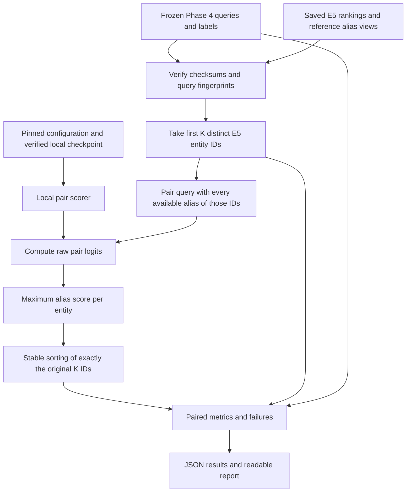

# Phase 5A — pretrained MiniLM reranking pilot

Status: **approved Phase 5A implementation and evaluation complete**, 2026-10-21. Only inference-only Phase 5A is authorized. No training, expanded datasets, threshold changes, Phase 5B or Phase 6.

## Approved scope and resources

The sole model is `cross-encoder/mmarco-mMiniLMv2-L12-H384-v1`, revision `1427fd652930e4ba29e8149678df786c240d8825`, declared Apache-2.0 in both pinned API metadata and the acquired model card. See the [pinned model card](https://huggingface.co/cross-encoder/mmarco-mMiniLMv2-L12-H384-v1/blob/1427fd652930e4ba29e8149678df786c240d8825/README.md) and [Apache license](https://www.apache.org/licenses/LICENSE-2.0). Keep the model card, license text and acquisition receipt with redistributed artifacts; the model license does not relicense benchmark data. The public subset retains its existing noncommercial/data-attribution restrictions.

The latest user approval narrows the older two-retriever plan to **E5-only reranking**. RapidFuzz is preserved as a historical baseline. K=5 is primary; K=10 is the predeclared sensitivity diagnostic, not a test-selected winner. Existing environment only: no dependency installation. CPU float32, four Torch threads, seed 42, deterministic algorithms, batch size 8, pair limit 512 tokens, raw logits. Five fresh timed repetitions follow one untimed call per query/K. All aliases available in the frozen reference view are scored; withheld aliases stay withheld.

Budgets: 600,000,000 downloaded payload bytes including metadata preflight and license; 2 GB additional disk; 4 GB process high-water memory planning envelope; 1,800 seconds for the evaluation process. Memory/time checks happen between inference batches: these are stop checks, not an OS-enforced memory or wall-clock limit. TLS/header traffic is not counted as model payload. No substitute checkpoint or alternate format is downloaded.

## Request-level DAG



Labels enter evaluation, not scoring or candidate selection. Sorting cannot restore a missing target. Timed repeats are measurement loops around the same request, not training or feedback edges in the DAG. Human review may motivate a separately approved experiment; it does not alter this run.

## Files and functions, explained with 5W1H

**Who** uses these files: the learner runs and reviews experiments; the software preserves record evidence and calculates rankings. It makes no identity decision. **When**: after Phase 4 and only within the approved Phase 5A experiment. The following table supplies what, why, where and how for each new executable component.

| File / component | What and why | How the important code works |
|---|---|---|
| `src/watchlist/reranking.py`: constants, `validate_config` | Lock the approved model and inference settings. | Compare ID, commit, license, device, precision, batch/token settings and normalization to fixed values; reject changes. |
| `PairScorer` | A small common interface for real and fake scorers. | Requires `score([(query, alias), ...])` returning one number per pair; unit tests do not load weights. |
| `fetch_model` | Acquire only approved files within the payload cap. | Read pinned metadata; check license/revision/total size before weights; stream bounded chunks into `.partial` files; check upstream SHA-256 or Git blob hashes; rename verified files and write receipt. A partial directory requires inspection instead of automatic redownload. |
| `verify_model` | Check local files before inference, with no internet. | Verify receipt ID/revision/license/file list and every local file's size and SHA-256. It detects accidental corruption, not a malicious actor rewriting both files and receipt. |
| `peak_memory_bytes`, `check_budget` | Observe the resource envelope. | Convert process high-water RSS to bytes; check elapsed deadline and RSS before/after batches. |
| `MiniLMScorer.__init__` | Load the one approved scoring model. | Verify files; set seed/CPU threads/deterministic operations; load tokenizer and classifier with local-only access and remote code disabled; require one output logit; record library versions. `eval()` disables training behavior. |
| `MiniLMScorer.score` | Score a query and alias jointly. | Normalize copies using existing NFKC/casefold/whitespace rules; tokenize two separate sequence fields without E5 prefixes; pad batches; reject overlength pairs rather than silently truncate; use `inference_mode()` without gradients; require one finite raw logit per pair. Original evidence text is unchanged. |
| `rerank` | Reorder exactly the shortlist. | Reject duplicate/missing IDs; enumerate only their available aliases; choose the maximum alias logit for each entity. `(-score, alias_id)` selects the best alias with a deterministic tie; `(-score, entity_id)` sorts entities. Same-name records keep separate IDs. Return original aliases/source/provenance with scores. |
| `reranking.main` | Fetch/verify command entry point. | Parse action/config, call the bounded operation and print the receipt summary; report invalid acquisition as an error. |
| `src/watchlist/evaluate_reranking.py`: `frozen_benchmark` | Make the comparison fair. | Verify old JSON checksum, query order/labels/fingerprint, original E5 configuration, complete reference-view fingerprints, candidate membership and alias availability. |
| `summarize` | Calculate metrics using explicit denominators. | Exclude unresolved/absent labels from positive ranking metrics; keep retrieval misses as zero in end-to-end metrics; distinguish conditional from all-positive denominators. |
| `aggregate` | Explain where changes occur. | Separate development/test and overlapping challenge, exact known alias, held-out alias, typo, word-order, cross-script, script and available pair-type slices. Do not sum overlapping slices. |
| `failure_reason` | Describe observable failure without guessing causes. | Distinguish a target missing from E5, a higher-scoring competitor and a top-logit tie. It does not claim to know why the neural model preferred a spelling. |
| `evaluate` | Run paired frozen shortlists and real timing. | Slice saved E5 at K; score once then five fresh repeats; verify repeat equality and unchanged IDs; save before/after ranks, all candidates, evidence, timings and failures. Stop with partial-result status on memory/time overrun. |
| `render_report` | Make saved measurements readable. | Derive paired tables and improvement/unchanged/regression galleries directly from the result object. Full details stay in JSON. |
| `evaluate_reranking.main` | Run the approved experiment. | Load model once; process three datasets at K=5/10; write fictional reports to `eval/results/phase05/reranking/` and public-derived output to ignored `data/evaluation/phase05/reranking/`. |
| `eval/configs/reranking.json` | Reproducible inputs and settings. | Store exact commit, model path, prior metadata bytes, K values, repetition count, runtime and SHA-256 of each original Phase 4 artifact. |
| `tests/test_reranking.py` | Offline scoring/acquisition contracts. | Fake HTTP and model outputs check license/hash/cap failures, raw logits, no prefix/truncation, ties, candidate IDs, original text, provenance and withheld aliases. |
| `tests/test_reranking_evaluation.py` | Offline evaluation arithmetic and membership. | Hand-check denominators/ranks, frozen artifact checksums, unretrieved targets and partial-budget reports. |
| `tests/integration/test_reranker_model.py` | Separately opted-in compatibility check. | Load only acquired local weights; require finite shape `(3,)` and repeat scores within absolute tolerance `1e-6`. No assumed accuracy requirement. |
| `results.json` / `report.md` in each dataset output | Actual machine-readable and readable evidence. | Preserve every query, labels, model receipt, timings, full shortlisted evidence and all observed failures; Markdown is rendered from JSON data. |
| `data/models/mmarco-minilm/` | Local ignored model assets. | Seven pinned upstream files, Apache license text and acquisition receipt; no new dataset or second model. |

NumPy represents score arrays and checks finite numbers. Torch executes the pretrained neural network. Transformers supplies the tokenizer and classifier loader. `pytest` checks software behavior. Python's standard library handles files, hashes, JSON, timing, argument parsing and the bounded HTTP acquisition. All were already available. Sentence Transformers remains an existing dependency for E5; the new scorer follows the model card's direct Transformers usage.

## Metric lesson: what, why, when, where, who and how

The learner reads these after each frozen experiment to separate retrieval failures from reordering failures. All metrics describe labeled record retrieval in this benchmark, not criminality or identity confidence.

Let **N** be the number of eligible positive queries, **H** the number whose target enters the E5 shortlist, **C** the number whose target finishes first, and **rᵢ** its rank within K (missing means reciprocal rank zero).

- **Candidate Recall@K = H/N:** can E5 supply the right candidate? Reranking leaves it unchanged. If K spans the entire entity index, report N/A as uninformative, while retaining target-presence counts.
- **End-to-end Recall@1 = C/N:** how often does this retrieval-plus-ranking order put the labeled record first? Retrieval misses still count in N.
- **Conditional reranking accuracy = C/H:** among queries that the shortlist can answer, how often is the target first? If H=0, N/A. This can look higher because it excludes retrieval failures.
- **MRR@K = Σ(1/rᵢ)/N:** reward an earlier target but assign zero beyond K. Unlike full-index Phase 4 MRR, this explicitly truncates at K.
- **Latency:** milliseconds for fresh normalization, tokenization, pair inference, alias grouping and sorting. Each query has five observations; pooled median/p95 are also reported. Load/checksum/import costs and E5 retrieval are excluded. Historical E5 latency is retained separately; it is not a simultaneous end-to-end measurement.

Hand example tested in code: target ranks `[1, 1, 2, missing]` at K=5 with an index larger than five. N=4, H=3, C=2. Retrieval recall=3/4=.75; top-1=2/4=.50; conditional=2/3=.6667; MRR=(1+1+.5+0)/4=.625. An ambiguity probe has no single target and adds nothing to these denominators. It remains in output as a probe; without an abstention policy it cannot establish screening false-positive rates.

`known_alias_exact` means a verbatim alias already in the reference view: a sanity check. `heldout_alias` means a distinct alias removed from that view: a harder retrieval check. The challenge suite excludes exact and formatting queries. Cross-script labels select only views where matching cannot simply use a same-script alias. Corpus/group sizes remain small and correlated.

## Measurements and worked examples

All **430 frozen queries** were evaluated at both K values: 94 fictional, 272 public-subset and 64 multilingual. Each query/K had five fresh timed calls after one untimed call: **4,300 timing observations** across **860 query/K cases**, not 4,300 independent accuracy examples. All six runs completed. No setting was changed after seeing results.

### Paired test-challenge results

| Dataset | K | Method | Queries / groups | Candidate Recall@K | Recall@1 | Conditional accuracy | MRR@K |
|---|---:|---|---:|---|---|---|---:|
| fictional | 5 | e5 | 27 / 3 | 27/27 (1.0000) | 26/27 (0.9630) | 26/27 (0.9630) | 0.981481 |
| fictional | 5 | e5_cross_encoder | 27 / 3 | 27/27 (1.0000) | 25/27 (0.9259) | 25/27 (0.9259) | 0.962963 |
| fictional | 10 | e5 | 27 / 3 | 27/27 (1.0000) | 26/27 (0.9630) | 26/27 (0.9630) | 0.981481 |
| fictional | 10 | e5_cross_encoder | 27 / 3 | 27/27 (1.0000) | 25/27 (0.9259) | 25/27 (0.9259) | 0.951852 |
| public-small | 5 | e5 | 141 / 6 | 141/141 (1.0000) | 141/141 (1.0000) | 141/141 (1.0000) | 1.000000 |
| public-small | 5 | e5_cross_encoder | 141 / 6 | 141/141 (1.0000) | 139/141 (0.9858) | 139/141 (0.9858) | 0.991726 |
| public-small | 10 | e5 | 141 / 6 | 141/141 (1.0000) | 141/141 (1.0000) | 141/141 (1.0000) | 1.000000 |
| public-small | 10 | e5_cross_encoder | 141 / 6 | 141/141 (1.0000) | 136/141 (0.9645) | 136/141 (0.9645) | 0.979905 |
| multilingual | 5 | e5 | 30 / 6 | 30/30 (1.0000) | 25/30 (0.8333) | 25/30 (0.8333) | 0.911111 |
| multilingual | 5 | e5_cross_encoder | 30 / 6 | 30/30 (1.0000) | 21/30 (0.7000) | 21/30 (0.7000) | 0.841667 |
| multilingual | 10 | e5 | 30 / 6 | N/A | 25/30 (0.8333) | 25/30 (0.8333) | 0.911111 |
| multilingual | 10 | e5_cross_encoder | 30 / 6 | N/A | 21/30 (0.7000) | 21/30 (0.7000) | 0.840000 |

Every test-challenge target entered top five. Consequently conditional top-1 accuracy equals end-to-end Recall@1 in these headline rows; the code separately tests retrieval-miss denominators. K=10 covers all ten multilingual entities, so that coverage is N/A. Recall@50 is uninformative for all three indexes and is not reported as a success.

### Primary K=5 test slices

| Dataset / slice | Positive queries / groups | E5 top-1 | E5 + MiniLM top-1 |
|---|---:|---:|---:|
| fictional / known_alias_exact | 6 / 3 | 6/6 (1.0000) | 6/6 (1.0000) |
| fictional / heldout_alias | 3 / 3 | 2/3 (0.6667) | 3/3 (1.0000) |
| fictional / typos | 12 / 3 | 12/12 (1.0000) | 12/12 (1.0000) |
| fictional / word_order | 6 / 3 | 6/6 (1.0000) | 6/6 (1.0000) |
| fictional / cross_script | 1 / 1 | 1/1 (1.0000) | 1/1 (1.0000) |
| public-small / known_alias_exact | 36 / 6 | 36/36 (1.0000) | 35/36 (0.9722) |
| public-small / heldout_alias | 4 / 4 | 4/4 (1.0000) | 2/4 (0.5000) |
| public-small / typos | 72 / 6 | 72/72 (1.0000) | 72/72 (1.0000) |
| public-small / word_order | 34 / 6 | 34/34 (1.0000) | 34/34 (1.0000) |
| public-small / cross_script | 0 / 0 | N/A | N/A |
| multilingual / known_alias_exact | 12 / 6 | 12/12 (1.0000) | 8/12 (0.6667) |
| multilingual / heldout_alias | 0 / 0 | N/A | N/A |
| multilingual / typos | 12 / 6 | 11/12 (0.9167) | 9/12 (0.7500) |
| multilingual / word_order | 6 / 6 | 6/6 (1.0000) | 5/6 (0.8333) |
| multilingual / cross_script | 12 / 6 | 8/12 (0.6667) | 7/12 (0.5833) |

The public test has no true cross-script queries in the frozen views. Its excellent E5 result cannot establish cross-script generalization. The multilingual exact-alias regression (12/12 to 8/12) is especially concerning for an extra ranking stage. Every metric, denominator and available script/direction/pair-type slice for K=5 and K=10 is in each generated report and JSON.

### Measured added latency and resources

| Dataset | K | Timed observations | Median ms | p95 ms |
|---|---:|---:|---:|---:|
| fictional | 5 | 470 | 13.121 | 14.577 |
| fictional | 10 | 470 | 23.525 | 25.737 |
| public-small | 5 | 1360 | 46.340 | 60.907 |
| public-small | 10 | 1360 | 96.300 | 144.909 |
| multilingual | 5 | 320 | 19.471 | 24.490 |
| multilingual | 10 | 320 | 34.504 | 40.532 |

Elapsed time at final result collection was **278.810 seconds**, including loading, checks and earlier output writes; final result serialization is excluded. Model construction took **0.772 seconds**, excluding imports and receipt verification. Peak process RSS was **1,080,147,968 bytes** (about 1.08 GB), below the 4 GB planning envelope. CPU-only, four threads. Higher alias counts increase pair work; per-query `pair_count` is saved.

Environment: macOS 27.0.1 ARM64; Python 3.14.0; NumPy 2.5.4; Torch 2.14.1; Transformers 5.20.2; tokenizers 0.23.3; Sentence Transformers 6.1.0; pytest 9.1.1; RapidFuzz 3.14.6. No dependencies were installed. Timing is machine/load dependent; no throughput or cost claim is inferred.

### Four actual query-to-ranking examples

All names below are authored fictional examples. E5 cosine and MiniLM raw logits have different scales and must not be numerically compared to each other. Candidate IDs are the ground-truth units.

#### Example 1: improved — Tavi O.

**What:** `heldout_alias` query, target `syn-011`, reference view `heldout`. **Who/where:** the learner can inspect query `bd6f510d6ad7ee0da52b88510fe6f0fc8b363883e003a14440b83fe9b081f636` in the corresponding fictional result JSON. **When:** primary K=5 run. **Why:** compare the same shortlist before/after joint pair scoring. **How:** normalize scoring copies, pair with all available aliases of those five IDs, score and keep one maximum per entity.

| Rank | Original E5 entity / alias / cosine | MiniLM entity / winning alias / raw logit |
|---:|---|---|
| 1 | `syn-008` / Daro Nuvem / 0.860451 | `syn-011` / Tavi Orlun / -1.806980 |
| 2 | `syn-011` / Tavi Orlun / 0.859723 | `syn-008` / Daro Nuvem / -2.558894 |
| 3 | `syn-005` / Mira Velune / 0.838744 | `syn-001` / Luma Vesper / -3.088721 |

Target rank **2 → 1**. Retrieval hit stays 1. Top-1 contribution changes **0 → 1**; reciprocal-rank contribution changes **0.500000 → 1.000000**. Conditional accuracy uses the same contribution here because this target was retrieved. Reranking median: **6.031 ms**, 5 alias pairs. Source remains `fictional-synthetic-v1`; original alias text is retained. The labeled target finishes first.

#### Example 2: unchanged — Lumen Sira

**What:** `word_order` query, target `syn-007`, reference view `full`. **Who/where:** the learner can inspect query `07fa1bf6d1d8bcc14149582b08f7f5ec1ab2abdce1573c35af5b3207047207fe` in the corresponding fictional result JSON. **When:** primary K=5 run. **Why:** compare the same shortlist before/after joint pair scoring. **How:** normalize scoring copies, pair with all available aliases of those five IDs, score and keep one maximum per entity.

| Rank | Original E5 entity / alias / cosine | MiniLM entity / winning alias / raw logit |
|---:|---|---|
| 1 | `syn-007` / Sira Lumen / 0.994661 | `syn-007` / سيرا لومين / 3.868829 |
| 2 | `syn-001` / Luma Vesper / 0.867311 | `syn-002` / Lumo Vespar / -1.688679 |
| 3 | `syn-012` / Luma Vesper / 0.867311 | `syn-012` / Luma V. / -1.934971 |

Target rank **1 → 1**. Retrieval hit stays 1. Top-1 contribution changes **1 → 1**; reciprocal-rank contribution changes **1.000000 → 1.000000**. Conditional accuracy uses the same contribution here because this target was retrieved. Reranking median: **13.316 ms**, 10 alias pairs. Source remains `fictional-synthetic-v1`; original alias text is retained. The labeled target finishes first.

#### Example 3: worse — Lumen

**What:** `missing_word` query, target `syn-007`, reference view `full`. **Who/where:** the learner can inspect query `2d25c6124b3981d26a5fced62d2ed59b3a73f6995543a6f49cb1f0ab51e463dd` in the corresponding fictional result JSON. **When:** primary K=5 run. **Why:** compare the same shortlist before/after joint pair scoring. **How:** normalize scoring copies, pair with all available aliases of those five IDs, score and keep one maximum per entity.

| Rank | Original E5 entity / alias / cosine | MiniLM entity / winning alias / raw logit |
|---:|---|---|
| 1 | `syn-007` / Sira Lumen / 0.917500 | `syn-012` / Luma V. / 0.006820 |
| 2 | `syn-001` / Luma Vesper / 0.880949 | `syn-007` / سيرا لومين / -0.253516 |
| 3 | `syn-012` / Luma Vesper / 0.880949 | `syn-002` / Lumo Vespar / -1.317833 |

Target rank **1 → 2**. Retrieval hit stays 1. Top-1 contribution changes **1 → 0**; reciprocal-rank contribution changes **1.000000 → 0.500000**. Conditional accuracy uses the same contribution here because this target was retrieved. Reranking median: **11.748 ms**, 10 alias pairs. Source remains `fictional-synthetic-v1`; original alias text is retained. another shortlisted record has a higher cross-encoder logit

#### Example 4: worse — مخبز القمر الذهبي

**What:** `cross_script` query, target `ml-003`, reference view `english`. **Who/where:** the learner can inspect query `7f3fd18c8551f4dae43df3fd4196ab673fe5845d01035f2e1abaae95cf969c56` in the corresponding fictional result JSON. **When:** primary K=5 run. **Why:** compare the same shortlist before/after joint pair scoring. **How:** normalize scoring copies, pair with all available aliases of those five IDs, score and keep one maximum per entity.

| Rank | Original E5 entity / alias / cosine | MiniLM entity / winning alias / raw logit |
|---:|---|---|
| 1 | `ml-003` / Golden Moon Bakery / 0.812395 | `ml-004` / Silver Moon Bakery / 3.463061 |
| 2 | `ml-004` / Silver Moon Bakery / 0.790263 | `ml-003` / Golden Moon Bakery / 3.181237 |
| 3 | `ml-008` / Nera Vasko / 0.789462 | `ml-006` / Green Mountain Workshop / 0.211748 |

Target rank **1 → 2**. Retrieval hit stays 1. Top-1 contribution changes **1 → 0**; reciprocal-rank contribution changes **1.000000 → 0.500000**. Conditional accuracy uses the same contribution here because this target was retrieved. Reranking median: **9.550 ms**, 5 alias pairs. Source remains `authored-multilingual-v1`; original alias text is retained. another shortlisted record has a higher cross-encoder logit

The held-out `Tavi O.` spelling is not restored as candidate evidence; its winning reference alias is `Tavi Orlun`. For `Lumen`, the competing record receives the highest logit and the target falls to second. These observations show ordering behavior, not a discovered identity or a proven explanation of the model’s internal reasoning. All failures and unchanged cases are retained, not just this gallery.

## Commands, checks and errors

### Actual checks and execution ledger

- Initial new scoring/acquisition tests: **10 passed in 0.85 seconds**.
- Expanded targeted tests after the fixture syntax repair: **14 passed, 1 skipped in 0.81 seconds** (real-model test not yet opted in).
- Full offline suite after the provenance/alias-tie test: **159 passed, 2 deselected in 1.63 seconds**.
- Opt-in MiniLM integration: **1 passed in 3.96 seconds**.
- Final complete suite with E5 and MiniLM integrations enabled: **161 passed in 6.03 seconds**. No test failure remained.
- Evaluation: all **430 queries × 2 K values** completed; 4,300 timed reranking calls. No training call ran.
- Fresh-process replay: all **860** candidate orders and winning alias IDs matched; original alias evidence, provenance and membership matched; maximum absolute logit difference **0.0**, tolerance `1e-6`. All generated Markdown reports exactly matched rendering of saved JSON.
- Scope audit: SHA-256 comparison of **85 pre-existing files** found exactly the five intended documentation edits; the other **80** files were byte-identical, including all original source, tests, fixtures, SQLite files, old results, manifests and dependency files in that inventory.
- Logical file sizes for acquired model files plus new result/verification directories: **513,703,390 bytes** at inspection, below the 2 GB disk allowance. This is file-content size, not filesystem allocated blocks.

The main executed commands are the six in “Reproduction commands” below. Additional commands and their purposes:

| Command / operation actually used | Why / outcome |
|---|---|
| `cat`, `sed`, `rg --files`, `rg -n` on AGENTS, reference Project 1, approved plans, source/tests and saved results | Read the existing contracts before implementation and inspect result evidence; no original data modified. |
| `ls -l` / `ls -lh data/models/mmarco-minilm` | Observe download progress and inspect the short tokenizer file without retrying the full model. |
| `.venv/bin/python` read-only Hugging Face pinned revision metadata preflight via `urllib.request` | Confirm exact file sizes, revision and Apache-2.0 declaration; 9,451 payload bytes counted. |
| `SSL_CERT_FILE=/etc/ssl/cert.pem .venv/bin/python /tmp/phase05a-recover.py` | One inspected recovery of only the tokenizer/config; reused and reverified completed weights, counted failed bytes and fresh metadata. This temporary repair script is not a routine fetch dependency; final receipt stores its accounting. |
| `.venv/bin/python -m pytest -q tests/test_reranking.py` | First offline contract checks. |
| `.venv/bin/python -m pytest -q tests/test_reranking.py tests/test_reranking_evaluation.py tests/test_reranking_integration.py` | Initial expanded checks; first failed during collection, then passed after brace repair. The integration file was subsequently moved to planned `tests/integration/test_reranker_model.py`. |
| `mkdir -p tests/integration` and `mv tests/test_reranking_integration.py tests/integration/test_reranker_model.py` | Put the new opt-in check in the approved integration-test location. |
| `HF_HUB_OFFLINE=1 TRANSFORMERS_OFFLINE=1 .venv/bin/python /tmp/phase05a-replay.py` | Load a fresh model process, reconstruct and verify frozen views, rescore each saved shortlist once, compare order/alias/provenance and logits against saved results; no network. |
| `.venv/bin/python /tmp/phase05a-report.py` | Render the measured teaching tables and four worked examples from actual result JSON into this report. |
| Local Python/heredoc edits and `apply_patch` | Create the approved code/config/tests/docs and store the pre-edit SHA-256 inventory; no installer or dataset fetch invoked. |
| Read-only Python `hashlib` / `pathlib` / JSON audit | Compare original file hashes, count result/model bytes, verify report rendering, inspect metrics and model/package versions. |
| `git status --short`, `sysctl -n machdep.cpu.brand_string hw.memsize` | Read-only environment probes; failed as described below. No Git initialization or hardware claim followed. |

Local audit files under `data/evaluation/phase05/` are `verification-before.json` (original hashes), `scope-verification.json` (scope comparison), and `replay-verification.json` (fresh-process reproducibility). They contain counts/checks, not new training examples. Temporary `/tmp` helpers may disappear; the durable evaluator command reproduces results, and offline/integration tests remain in the project.

The initial new evaluation test fixture had one missing closing brace, causing collection failure; fixing that syntax made the targeted tests pass. The first tokenizer transfer returned only 775,970 of 17,082,660 expected bytes. Acquisition rejected it before model loading. A single inspected recovery reverified the completed files against fresh pinned metadata and downloaded only the tokenizer and remaining tiny tokenizer configuration. The receipt counts the failed payload and all three metadata reads: **493,563,933 bytes total**, below 600,000,000. No model substitution or dependency change occurred.

The diagnostic was improved to identify the incomplete filename and expected/received bytes. The model emitted a Torch note that multiprocessing redirects are unsupported on macOS; this did not fail local inference. A read-only `git status --short` found no repository; nothing was initialized or committed. Two exploratory reads used nonexistent guessed filenames (`models.py`, `test_embeddings_integration.py`); the actual files are `entities.py` and `tests/integration/test_embedding_model.py`. A `sysctl` hardware query was sandbox-blocked; environment reporting therefore uses Python/platform and package metadata, without asserting a newly measured physical RAM size.

## Interpretation and phase gate

**Recommendation: retain E5 as the default and keep this pretrained cross-encoder only as an optional experimental artifact. Do not adopt it as an improvement or fine-tune it on the current data.** It regresses on all three primary challenge sets while adding latency, and K=10 does not reverse that conclusion. The retrieve–rerank pattern itself is not disproven; the measured result argues for reconsidering the relevance-trained reranker’s suitability for short names. Any future name-specific reranker or fine-tuning proposal should first secure independently reviewed, adequately varied labels and fresh held-out groups under separate approval.

The benchmark has already been inspected in previous phases; it is an exploratory paired diagnostic, not fresh evidence of generalization. Public data has only 20 legal entities; six public test groups generate many correlated queries. Hidden upstream duplicate entities and model pretraining overlap remain unresolved. Synthetic bilingual examples cannot establish broad multilingual name-matching quality. Max-alias pooling may favor records with more aliases. This model learned passage relevance, not identity matching.

The original portfolio proposes retrieve–rerank–calibrate with a trained cross-encoder over top 50. This pilot isolates pretrained reranking at K=5/10 because indexes contain only 10–20 entities. Recall@50 would be trivial. It advances paired retrieval/reranking, script/error analysis and latency measurement, but does not implement training, calibrated confidence, 99% precision/recall claims, bootstrap population inference, reviewer memory, orchestration, LLM comparisons or deployment. Those objectives remain later work with separate approval and adequate data.

No training loss exists: weights were not updated, no optimizer ran and no gradient/loss curve was measured. Raw negative or positive logits only determine order. Neither logits, their sigmoid, nor E5 cosine scores are calibrated identity probabilities.

**Stop after Phase 5A. Any training, data expansion, threshold change, Phase 5B or Phase 6 requires explicit approval.**

## Reproduction commands

Run from `/Users/odin/Desktop/polyglot-watchlist-starter` using the existing `.venv`. Acquisition is already authorized for this pinned model; `verify` and all subsequent commands use local files. A complete existing model directory is verified rather than downloaded again.

```sh
SSL_CERT_FILE=/etc/ssl/cert.pem .venv/bin/python -m watchlist.reranking fetch --config eval/configs/reranking.json
.venv/bin/python -m watchlist.reranking verify --config eval/configs/reranking.json
HF_HUB_OFFLINE=1 TRANSFORMERS_OFFLINE=1 .venv/bin/python -m pytest -q -m 'not integration'
HF_HUB_OFFLINE=1 TRANSFORMERS_OFFLINE=1 RUN_RERANKER_INTEGRATION=1 .venv/bin/python -m pytest -q tests/integration/test_reranker_model.py
HF_HUB_OFFLINE=1 TRANSFORMERS_OFFLINE=1 RUN_EMBEDDING_INTEGRATION=1 RUN_RERANKER_INTEGRATION=1 .venv/bin/python -m pytest -q
HF_HUB_OFFLINE=1 TRANSFORMERS_OFFLINE=1 .venv/bin/python -m watchlist.evaluate_reranking --config eval/configs/reranking.json
```

The evaluation command recreates the Phase 5A output files; archive a run before repeating if its original timing must be retained. Accuracy/order is expected to reproduce for this frozen environment; wall-clock timing is not. A different Torch/kernel/platform version may change floating-point details, so record versions and inspect close scores rather than assume bit-identical results across machines. Pretrained training-corpus overlap cannot be reconstructed from this local run.

## Supporting documentation changes

| Existing file | What changed and why |
|---|---|
| `README.md` | Added local verification, test and evaluation commands and the Phase 5A report link so the learner can reproduce the pilot. |
| `docs/evaluation-plan.md` | Added the implemented E5-only pairing, truncated/conditional metric denominators and precise timing scope. |
| `docs/model-card.md` | Added the exact pretrained checkpoint, license/provenance, raw-logit behavior and passage-versus-name task limitations. |
| `docs/adr/0004-training-decision.md` | Updated approval state and narrowed the original two-arm proposal to the user's E5-only scope; training remains deferred. |
| `docs/implementation-phases.md` | Recorded the approved pilot boundary and explicit stop before further phases. |
| `docs/progress/phase-05a.md` | This new execution/teaching report records actual changes, measurements, errors and the next approval gate. The earlier Phase 5 planning report is retained as history. |

No scoring or normalization logic in the existing RapidFuzz/E5 baselines is edited. This pilot uses saved E5 outputs after integrity checks, rather than changing E5 or comparing different candidate universes. The standalone reranking API accepts only supplied candidate IDs and their available reference aliases.

## Final 5W1H recap

- **What:** implemented and evaluated a pretrained pair scorer that only reorders E5 candidates; no local model fitting.
- **Why:** test the portfolio's reranking idea independently before investing in training. The measured regressions are evidence against adopting this checkpoint as-is.
- **Who:** software ranks labeled records; the learner reviews errors and authorizes next experiments. Human review, not similarity scores, addresses identity questions.
- **When:** after frozen Phase 4 evaluation, within Phase 5A only. The next step would be a separately approved data/readiness or architecture plan; no implementation of it starts here.
- **Where:** local CPU and existing environment; fictional shareable results under `eval/results/phase05/reranking/`, public-derived output and model artifacts under ignored `data/`.
- **How:** verify model/license/hashes and frozen benchmark inputs, keep E5 top-K IDs, score allowed aliases jointly, pool by entity, evaluate paired rankings, retain failures, run offline/real-model tests and replay independently.

Acceptance is satisfied by a valid, reproducible experiment with preserved baselines—not by requiring an accuracy improvement. Remaining uncertainties are independent-data generalization, label/duplicate quality, broader script behavior, pretraining overlap and portability of timing/numerics. Training-loss interpretation and calibrated confidence are inapplicable to this inference-only run.

Final documentation check: local Markdown links and code-fence pairing passed for all six changed/new documentation files. Generated dataset reports matched their saved JSON during replay. No executable code changed after the final 161-test run; subsequent edits were documentation only.
