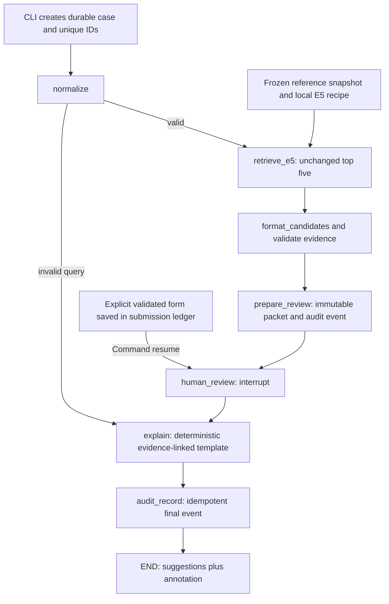

# Phase 7A — LangGraph orchestration and human review

Date: 2026-10-22. Scope: approved Phase 7A only. E5 remains the default; MiniLM remains an unchanged, disabled experimental baseline. No training, calibration, model/data downloads, cross-case memory, service or UI framework was added. This is a research workflow, not an identity adjudication or screening service.

## Outcome and approval boundary

Implemented a typed StateGraph, lazy E5 adapter, persistent SQLite checkpoints, immutable evidence packets, explicit review forms, deterministic explanations, an application audit ledger, and a local CLI. Successfully processed a fictional case across separate CLI processes, including reopening, recovery and final audit verification. Existing retrieval logic and previous evaluation artifacts were preserved.

Phase 5B/5C and Phase 6 remain deferred. This milestone advances the approved human-review workflow; it does not claim those earlier research stages were completed. Stop here before memory enhancements, thresholds, training, FastAPI, MCP, Streamlit or another milestone. Any next implementation needs explicit approval.

## The workflow in simple words and 5W1H

- **What:** a saved case form travels through named Python functions. It contains a name, candidate records and evidence, then a human annotation.
- **Why:** ordinary variables disappear when a process closes. We need the reviewer to see the same evidence tomorrow and to distinguish an accepted review from a failed or duplicate command.
- **Who:** E5 suggests records. The local reviewer chooses an annotation and supplies a reason. Software validates and records it; it never establishes identity or wrongdoing. The demonstration below is an explicitly simulated annotation submitted by the assistant, not an actual analyst decision.
- **When:** retrieval happens once on the normal path. Review can happen later, in a different process. Recovery runs only when requested and does not silently replace saved evidence.
- **Where:** the local CLI; existing model/cache/reference files; new `data/review/checkpoints.sqlite` and `data/review/cases.sqlite`. No hosted graph, tracing service or external model call.
- **How:** LangGraph checkpoints each completed step synchronously. A separate transactional ledger records immutable packets and submissions. An OS lock serializes commands. Replay-safe event keys bridge the crash windows between the two databases.

## Implemented request-level DAG



This logical path is acyclic. A pause is a boundary, not a backward edge. Process recovery may replay an unfinished node; that is an execution retry, not another retrieval algorithm or a reviewer-to-training feedback loop. Every successful valid retrieval, including an empty shortlist, pauses. Invalid input follows the audited error branch. Operational failures stop the attempt and are never converted into an empty-result clearance.

A `thread_id` locates LangGraph checkpoints; `audit_id` locates the case ledger. Neither is a credential. `interrupt()` suspends the review node; when `Command(resume=...)` arrives, that node starts again from its beginning. Therefore no write precedes its one unconditional interrupt. `prepare_review` does the write in an earlier node. `invoke(None, ...)` continues a failed non-interrupt step; this behavior was exercised with the pinned runtime before implementation.

## Dependencies, compatibility and resources

Approved direct versions installed: **langgraph 1.2.16**, **langgraph-checkpoint 4.3.0**, **langgraph-checkpoint-sqlite 3.1.2**. Their version-specific PyPI metadata declares MIT and Python >=3.10. Actual resolution required compatible binary wheels for the existing **Python 3.14.0, macOS ARM64** environment. No Python replacement or external source build occurred.

The temporary **uv 0.13.5** ARM64 wheel was SHA-256 verified and its executable extracted under `/tmp/polyglot-agent-tools/uv`. This avoids bootstrapping additional pip/tool packages. It is tooling, not an application dependency. The three requested packages brought **32 new distributions total**, including their transitive dependencies; all 32 match the generated `uv.lock`. No previously installed distribution changed version. The universal lock also records platform-specific alternatives that were not installed here.

`sqlite-vec` is a required transitive package of the SQLite saver; this application does not load its vector extension or use it for retrieval. LangChain/LangSmith/SDK packages are transitive requirements; the application has no LLM client, remote service or reranker node, and explicitly disables tracing. Exact new wheel filenames, sizes, SHA-256 values, URLs and available license metadata are saved in `data/review/verification/package-manifest.json`. A missing PyPI license field is not represented as a verified license claim; direct approved package license declarations were verified.

| Resource | Actual observation | Limit / interpretation |
|---|---:|---|
| uv wheel payload | 14,470,685 bytes | Included in 100,000,000-byte package/tool ceiling |
| New dependency wheel payloads | 7,661,778 bytes | All 32 size/hash checks passed |
| Combined package/tool payload | **22,132,463 bytes** | Below ceiling; no failed wheel transfers |
| Explicit JSON metadata reads | 1,423,249 bytes | Also recorded; uv resolver metadata traffic was not individually metered |
| Temporary uv cache / wheels / executable directory | 51,576 / 7,548 / 27,244 KiB from `du -sk` | Intermediate allocated-size observations, not network byte counts |
| Separate E5 adapter resource smoke | 4.149369 seconds; **986,824,704 bytes peak RSS** | Below 4 GB; one run, not a latency benchmark |
| Actual CLI start | 5.51 seconds from `/usr/bin/time` | Wrapper's resource-counter read failed; see errors below |
| Review workspace before report/scope receipts | 296,929 logical file bytes | Below 100 MB; one fictional case |

The package cap applies to package/tool downloads. Explicit JSON metadata is separately counted above; there is no claim that every HTTP header or resolver metadata byte was measured. Local installation and locking did not fetch model weights or dataset files. Budget checks and observed memory are not a hard OS memory sandbox. Case storage is checked on command entry, with a 100-case ceiling; there is no automatic cleanup or guaranteed bound against external filesystem changes.

## Every new application file and important function

**Who/when/where for this table:** developers maintain these files under `src/watchlist/agent/`; the learner invokes them locally after Phase 7A approval. The “what/why/how” columns explain the mechanics. None makes an identity decision.

| File / function | What and why | How the important code works |
|---|---|---|
| `__init__.py` | Keep the new path offline and prevent remote tracing. | Sets the model-offline, tracing-disabled and strict-MessagePack environment settings before graph imports. It loads no model. |
| `state.py`: `AliasEvidence`, `CandidateEntity`, `ReviewerDecision`, `ReviewState` | Name the fields in the case form so the graph is understandable. | `TypedDict` describes original/normalized query, recipe, candidate/evidence lists, review status/decision, explanation, errors and audit identifiers. Types are documentation; explicit validators enforce runtime rules. |
| `canonical`, `digest` | Give stored evidence a reproducible fingerprint. | Sort JSON keys, use fixed separators and UTF-8, reject nonfinite JSON numbers, then SHA-256 the bytes. Lists retain their original order and scores retain their float values. |
| `workflow_hash` | Prevent silent continuation with changed workflow code. | Hash agent Python/SQL, relevant unchanged baseline source, and checkpoint/runtime package versions. Pending and completed cases require that implementation to inspect/resume through the service. No automatic migration. |
| `packet` | Freeze only the evidence-bearing portion of state. | Select query, normalized query, IDs, workflow versions, recipe, candidates, evidence, retrieval manifest and review revision. Exclude changing review/audit status. |
| `text`, `validate_packet` | Reject malformed fields, scores and evidence links. | Require nonblank strings, unique entity/evidence IDs, ranks in order, finite cosine in [-1,1], a present winning alias, same-entity evidence links, correct provenance structure and approved top-K/reranker settings. |
| `validate_review` | Bind a human form to the exact displayed case. | Require exactly the known fields, a UUID submission ID, matching revision/digest/checkpoint, allowed outcome and nonblank reason <=1,000 characters. A selected entity must already be in the packet. |
| `retrieval.py`: `Retriever` | Define a small replaceable retrieval boundary for tests. | A protocol exposes `search(query, recipe)` returning JSON-ready candidates/evidence/manifest. Tests inject fictional outputs; production CLI constructs `E5Retriever`. |
| `make_recipe` | Record what a new case is allowed to search. | Read existing fictional records or a read-only SQLite snapshot, fingerprint complete entity/provenance records, preserve existing E5 configuration, acquisition-receipt hash and numerical package versions. |
| `E5Retriever.search` | Adapt E5 without changing scoring. | Recheck the frozen reference fingerprint; lazily call existing `E5Encoder`, `cached_aliases` and `rank_vectors(top_k=5)`; verify model receipt/runtime; copy candidate IDs, scores and winning aliases. Include all available aliases for each selected entity and their source provenance/attribution. Empty entities produce an empty shortlist. |
| `nodes.py`: `normalize` | Preserve the query and reuse existing normalization. | Calls the existing NFKC/casefold/whitespace function. Validation errors become structured error state, not a retrieval answer. |
| `format_candidates` | Validate the evidence before saving it. | Calls `validate_packet`, then computes its digest. No ranking or score changes. |
| `explain` | Describe recorded facts and an attributed annotation. | Uses a fixed template, candidate count, selected ID, packet digest and evidence references. Reviewer notes are JSON-quoted opinions. Missing DOB/nationality comparisons are explicitly stated. No LLM. |
| `make_nodes` / nested `retrieve_e5` | Inject runtime resources without serializing them. | Closures hold the ledger/retriever/failure hook outside state; the retrieval node passes normalized query and the frozen recipe. |
| nested `prepare_review` | Save evidence before asking a human. | Writes the immutable packet and `suggestions_ready` event, then returns `pending`. A retry must present the same packet. |
| nested `human_review` | Suspend until explicit input exists. | Calls one unconditional `interrupt`; after resume, requires exact equality with the persisted submission and revalidates it against its originating checkpoint. It does not incorrectly compare against the new checkpoint created during resume. |
| nested `explanation`, `audit_record` | Expose crash boundaries and finalize reliably. | The test-injected hook can fail at controlled stages. Finalization returns its durable event ID/hash; replay returns the same receipt. Production uses a no-op hook. |
| `graph.py`: `build_graph` | Make the DAG explicit. | Adds named nodes, the invalid-query conditional branch and forward edges, then compiles with the supplied checkpointer. There is no score-routing, LLM or reranker node. |
| `audit.py`: `now`, `envelope` | Record event time and a stable hash envelope. | UTC timestamp is allocated on first append; the envelope includes case, sequence, event key, canonical payload, timestamp and previous hash. |
| `verify_chain` | Detect inconsistent local history. | Recompute each hash and require consecutive sequence/previous-hash links. An optional separately retained head/count anchor detects deleted tails. |
| `append_event` | Make repeated effects safe. | Within the caller's transaction, verify the chain, then use a unique event key. Identical payload returns the original receipt; conflicting replay raises an error. |
| `schema.sql` | Separate application records from LangGraph internals. | Creates `cases`, `review_packets`, `review_submissions`, `audit_events`; primary/foreign keys and uniqueness enforce one packet/review revision and distinct submission IDs. It does not alter source SQLite databases. |
| `storage.py`: `Ledger.__init__`, `transaction` | Initialize and commit short local operations. | Verify supported schema, enable foreign keys and use `BEGIN IMMEDIATE`; commit on success, roll back even on interruption. No transaction remains open while the human thinks. |
| `Ledger.create`, `initial` | Persist and recover the original case envelope. | Save unique thread/audit IDs and initial state with a `request_created` event before graph invocation; later lookup by thread ID. Limit the pilot to 100 cases. |
| `Ledger.prepare` | Store immutable evidence once. | Compare bytes and digest on replay; conflicting content fails. Packet and event are committed together. |
| `Ledger.submission`, `submit` | Preserve the accepted form before graph resume. | Verify its checksum on reads. Store a unique submission and matching event in one transaction. Repeated user submissions are rejected, including identical duplicates. |
| `Ledger.finalize`, `final_payload` | Define exactly what completion records. | Require an accepted human decision unless this is the validation-error branch; append packet digest, decision, explanation and error under one final event key. |
| `Ledger.attempt_error` | Keep bounded failure evidence where possible. | Append up to 100 attempt-error events per case; if storage itself fails, logging is best effort and no durability guarantee is made. |
| `Ledger.verify` | Check agreement between case ledger and checkpoint. | Check SQLite integrity/FKs, chain, initial envelope, packet/submission checksums and audit links, case identity, frozen state and final receipt. A graph return alone is insufficient to report completion. |
| `ReviewService.__enter__`, `__exit__` | Own resource lifetime for one CLI command. | Create a private directory, restrict database/lock files, acquire `fcntl` advisory lock, open both SQLite stores and graph; close and release on exit. OS process death releases the lock. |
| `config`, `inspect`, `status` | Locate and display saved progress without E5. | Use the same `thread_id`, obtain the latest snapshot, verify workflow/hash/ledger agreement, and distinguish pending interrupt, unfinished node and completed audited case. |
| `invoke` | Run a step with durable checkpoints. | Uses `durability='sync'`, verifies resulting status, and records operational exceptions when possible. Exceptions include the thread ID needed for recovery. |
| `start` | Begin a new case. | Validate the bounded text envelope, create UUIDs/default state and ledger header, then invoke the graph. A changed query is a new case; optional parent audit ID links corrections without overwriting history. |
| `review` | Accept an explicit human action safely. | Require pending interrupt, validate exact form fields, assign local actor/time, check packet/checkpoint, persist submission, then invoke `Command(resume=value)`. No arbitrary state-update interface. |
| `recover` | Reconcile interrupted progress. | No checkpoint: replay stored initial envelope. Pending interrupt with stored submission: resume that exact submission. Pending without submission: remain paused. Failed later node: `invoke(None)`. Completed: verify and return existing receipt. |
| `cli.py`: `load_config`, `main` | Provide a minimal local interface. | Validate fixed policy; dispatch start/status/review/recover/audit-verify. `status` without an ID lists saved case IDs for early-crash recovery. Read bounded JSON review forms. Print ASCII-escaped JSON to prevent terminal control/bidi rendering while preserving original text after decoding. |
| `__main__.py` | Enable `python -m watchlist.agent`. | Calls `main()` and uses its exit code. |

Python's standard-library SQLite, JSON, UUID, hashing, filesystem and `fcntl` modules handle the application ledger and CLI. LangGraph supplies execution/checkpoint APIs. NumPy/Sentence Transformers/Torch remain existing E5 dependencies. No new model is introduced.

## Configuration, tests and other changed files

| File | What / why / how |
|---|---|
| `config/agent.json` | New fixed top-five, E5-config path, human-only policy, disabled reranker, review workspace and schema/workflow versions. No operating threshold. |
| `tests/agent_support.py` | New shared authored fictional retriever/form helper and subprocess worker. The worker can deliberately exit with code 77 at a named crash boundary; production CLI cannot enable this hook. |
| `tests/test_agent_state.py` | New malformed review, finite-score, alias-link and digest tests with hand-checkable records. |
| `tests/test_agent.py` | New mocked real graph, invalid/empty/error cases, six untrusted text fixtures, no-MiniLM import guard, in-memory checkpoint test and offline provenance/snapshot adapter check. |
| `tests/test_review_resume.py` | New separate-process restart, five abrupt crash windows, duplicate/stale/cross-case/version rejection and concurrent one-winner checks. A failing retriever proves review resume does not re-search. |
| `tests/test_review_audit.py` | New payload/hash/deletion/packet/submission/header/checkpoint tampering, replay conflict, foreign-key, cross-case submission and external-anchor tests. |
| `tests/test_agent_cli.py` | New escaped display, fixed policy and saved-ID listing checks. |
| `tests/integration/test_agent_e5.py` | New explicitly opted-in local-weight test: direct unchanged E5 versus adapter IDs/order/aliases/evidence and scores within 1e-6, followed by reopen/review without retrieval. |
| `pyproject.toml`, `uv.lock` | Added the three exact pins as optional `agent` dependencies; resolved transitive versions. Existing installed packages remained unchanged. |
| `.gitignore` | Added all of `data/review/`, including forms, SQLite WAL/SHM and receipts, to keep local review material out of accidental sharing. |
| `README.md` | Added CLI and review-form instructions, offline test commands and report link. Old RapidFuzz CLI remains intact. |
| `docs/design.md` | Added the authoritative implemented Phase 7A DAG and review-only boundaries; historical design remains available. |
| `docs/evaluation-plan.md` | Added workflow reliability/parity acceptance; no new retrieval-accuracy results. |
| `docs/implementation-phases.md` | Recorded this milestone and deferred phase boundaries. |
| `docs/adr/0005-review-workflow.md` | Appended approved implementation outcome and duplicate-submission refinement. |
| `docs/progress/phase-07a.md` | This execution, teaching and limitation report. Earlier planning/report files remain historical evidence. |
| ignored `data/review/` | Actual two SQLite stores, lock and one fictional case. `verification/` contains actual demo JSON, form, resource/environment/package receipts and scope inventory. These are local execution artifacts, not new datasets or learned memory. |

All tests are local once approved dependencies exist. Ordinary tests use mock retrieval; only the separately marked E5 integration loads weights. The names in the adapter provenance test and its `example.invalid` URLs are authored test fixtures, not downloaded public records.

## Actual test/check ledger

- Dependency smoke: strict MessagePack, SQLite reopen, `interrupt`/`Command` and intentional failed-node continuation all passed on Python 3.14.
- Initial new agent suite: **46 passed in 9.48 s**.
- First standalone E5 integration attempt: **1 failed** at helper import, before inference; repaired as described below.
- Repaired standalone E5 integration: **1 passed in 5.41 s**.
- Full offline suite after expanded integrity checks: **208 passed, 3 deselected in 11.14 s**.
- Full suite with all three existing/new model integrations opted in: **212 passed in 17.50 s**.
- Subsequently added offline provenance/snapshot test: targeted agent file **15 passed in 0.38 s**.
- `uv lock --check --offline`: passed; resolves 106 universal-lock packages, not 106 new installations.
- `uv pip check`: **82 installed packages compatible**. New installed additions matched `uv.lock`; all pre-existing installed versions unchanged.
- Local Hatchling wheel build: passed; inspection confirmed `watchlist/agent/schema.sql` is included.
- Actual CLI start/status/recover/review/recover/audit-verify: passed application assertions; four semantic audit events, same candidate packet after resume.
- Final full suite after the provenance test: **213 passed in 19.73 s**.
- Final documentation/scope checks are recorded below. No Recall, MRR, identity probability, accuracy improvement or new population claim was calculated in Phase 7A.

## Complete actual fictional walkthrough

**Input:** `Lumen Sira`; normalized copy: `lumen sira`. Existing source: `fictional-synthetic-v1`; model: `intfloat/multilingual-e5-small`, revision `614241f622f53c4eeff9890bdc4f31cfecc418b3`, CPU float32, symmetric `query: ` prefix, mean pooling, 384 dimensions, four Torch threads.

| Rank | Entity ID | Winning original alias | Actual cosine |
|---:|---|---|---:|
| 1 | syn-007 | Sira Lumen | 0.9946611523628235 |
| 2 | syn-001 | Luma Vesper | 0.8673111200332642 |
| 3 | syn-012 | Luma Vesper | 0.8673111200332642 |
| 4 | syn-002 | Lumo Vespar | 0.8658129572868347 |
| 5 | syn-005 | Mira Velune | 0.8469915986061096 |

Same-name records `syn-001` and `syn-012` remain different candidates. Cosine is a geometric ranking score, not 99.466% identity confidence.

Actual thread: `446f2137-621a-4426-8f95-9c82e07bcacf`.
Actual audit: `e449b466-466d-4b81-9a29-cb3c9d957823`.
Packet SHA-256: `5c116b73534e357a001c22199a642d72cd21dc583234047609f40ac624fc005f`.

1. **Start:** create case and IDs; normalize; run existing E5 once; preserve top five and all available aliases for those entities; save evidence packet; interrupt. No reviewer decision or final explanation exists yet.
2. **Process exits:** a new `status` process returns the same saved state. A separate `recover` while no submission exists remains paused. Neither loads the model.
3. **Explicit form:** a UUID plus the displayed checkpoint, digest and revision identifies this submission. Outcome `candidate_for_follow_up`, selected `syn-007`, reason: “Simulated fictional demo annotation by the assistant: reordered alias merits follow-up; additional evidence is required. This is not a real analyst identity decision.”
4. **Resume:** service records the form first; `Command(resume=...)` feeds it to the interrupt. The node checks the saved receipt and returns the annotation. Local OS username `odin` is recorded as actor; that is not proof that a human personally reviewed it. The note explicitly identifies the simulation.
5. **Explanation:** fixed template cites the packet and both `syn-007` alias evidence IDs, including preserved Arabic `سيرا لومين`; it labels the note as reviewer opinion and appends the no-identity/no-probability limitations.
6. **Final audit:** `request_created`, `suggestions_ready`, `review_submitted`, `case_finalized`. Final chain head: `b62fc08e60b609a5c56e6cd4a4710f60e15b5a43c352ed76cc9220a7f1848a9e`.
7. **Restart/recovery:** a new process verifies the completed checkpoint and the same final receipt. Event count stays four. The separate crash tests prove recovery at five earlier persistence boundaries; the live demonstration itself was not forcibly killed.

The selected entity's available evidence is preserved, not augmented with invented date/country/document facts. No name was marked criminal, identical to the query subject, or cleared.

## Commands actually used and reproduction

Run from the project root. The implementation session also used `cat`, `sed`, `rg`, Python `pathlib/json/hashlib/importlib.metadata`, and read-only metadata HTTP requests to inspect approved files, package requirements, results and hashes. Temporary scripts performed bounded wheel acquisition and receipt capture; they were not dataset fetches.

Dependency setup commands actually executed:

```sh
/tmp/polyglot-agent-tools/uv pip compile /tmp/phase07-requirements.in -c /tmp/phase07-constraints.txt --python .venv/bin/python --only-binary :all: --no-python-downloads --cache-dir /tmp/phase07-uv-cache --cert /etc/ssl/cert.pem -o /tmp/phase07-resolved.txt
.venv/bin/python /tmp/phase07-packages.py
/tmp/polyglot-agent-tools/uv pip install --python .venv/bin/python --offline --no-deps --cache-dir /tmp/phase07-uv-cache /tmp/phase07-wheels/*.whl
/tmp/polyglot-agent-tools/uv lock --offline --no-python-downloads --cache-dir /tmp/phase07-uv-cache
UV_NO_BUILD=1 /tmp/polyglot-agent-tools/uv lock --no-python-downloads --cache-dir /tmp/phase07-uv-cache --cert /etc/ssl/cert.pem
SSL_CERT_FILE=/etc/ssl/cert.pem UV_NO_BUILD=1 /tmp/polyglot-agent-tools/uv lock --no-python-downloads --cache-dir /tmp/phase07-uv-cache
/tmp/polyglot-agent-tools/uv lock --check --offline --no-python-downloads --cache-dir /tmp/phase07-uv-cache
/tmp/polyglot-agent-tools/uv pip check --python .venv/bin/python --cache-dir /tmp/phase07-uv-cache
.venv/bin/python -m compileall -q src/watchlist/agent
```

The offline lock attempt and `--cert` lock attempt failed; the next command repaired setup, as explained below. Do not copy the failed commands as a recommended setup sequence. Successful bounded acquisition used Python `urllib` with `/etc/ssl/cert.pem`, advertised byte limits and SHA-256 verification for every wheel. Temporary tool extraction used `zipfile` after verifying the pinned uv wheel hash `a42c85fa8156e1e5e2cecdbc77bb818ea1dcf5f78b8e2a8f84c7fe4f16f0702e`. Only the reviewed wheels were installed, offline and without dependency resolution at installation time. No broad `uv sync` was run, because the already-installed environment was preserved and only the approved additions were needed.

Testing commands actually used (repeated targeted runs are reflected in the check ledger):

```sh
HF_HUB_OFFLINE=1 TRANSFORMERS_OFFLINE=1 .venv/bin/python -m pytest -q tests/test_agent.py tests/test_agent_state.py tests/test_review_resume.py tests/test_review_audit.py tests/test_agent_cli.py
HF_HUB_OFFLINE=1 TRANSFORMERS_OFFLINE=1 RUN_AGENT_E5_INTEGRATION=1 .venv/bin/python -m pytest -q tests/integration/test_agent_e5.py
HF_HUB_OFFLINE=1 TRANSFORMERS_OFFLINE=1 .venv/bin/python -m pytest -q -m 'not integration'
HF_HUB_OFFLINE=1 TRANSFORMERS_OFFLINE=1 RUN_AGENT_E5_INTEGRATION=1 RUN_EMBEDDING_INTEGRATION=1 RUN_RERANKER_INTEGRATION=1 .venv/bin/python -m pytest -q
HF_HUB_OFFLINE=1 TRANSFORMERS_OFFLINE=1 .venv/bin/python -m pytest -q tests/test_agent.py
```

The wheel packaging check called `hatchling.build.build_wheel('/tmp/phase07-built')` with the already-installed backend, then inspected its ZIP entries. Python subprocess helpers ran the persisted graph worker in `tests/agent_support.py`; failure tests call `os._exit(77)` and reopen the same files. The additional resource smoke called `E5Retriever.search` on `Lumen Sira` and read `resource.getrusage(resource.RUSAGE_SELF).ru_maxrss`; it saved only a resource receipt, no evaluation outputs.

Actual CLI demonstration commands (the Python driver supplied the real ID below and captured JSON):

```sh
/usr/bin/time -l .venv/bin/python -m watchlist.agent start --name 'Lumen Sira' > /tmp/phase07-demo-start.json 2> /tmp/phase07-demo-time.txt
.venv/bin/python -m watchlist.agent status --thread-id 446f2137-621a-4426-8f95-9c82e07bcacf
.venv/bin/python -m watchlist.agent recover --thread-id 446f2137-621a-4426-8f95-9c82e07bcacf
.venv/bin/python -m watchlist.agent review --thread-id 446f2137-621a-4426-8f95-9c82e07bcacf --review-file data/review/verification/demo-review-form.json
.venv/bin/python -m watchlist.agent recover --thread-id 446f2137-621a-4426-8f95-9c82e07bcacf
.venv/bin/python -m watchlist.agent audit-verify --thread-id 446f2137-621a-4426-8f95-9c82e07bcacf
```

Do not resubmit that completed demo form: duplicates are rejected. To try a new case, run plain `start --name 'Lumen Sira'`, copy its `review_form` into a new local JSON file, generate a new UUID with Python's `uuid.uuid4()`, explicitly choose outcome/candidate/reason, and submit against that new thread. Copy the exact checkpoint/digest/revision returned by `status`. `status` without `--thread-id` lists case identifiers. Use `recover` after an interrupted accepted submission, never invent a fresh submission to overwrite it.

Future environment reproduction uses the committed optional extra and lock, e.g. `uv sync --locked --extra embeddings --extra agent --dev`, only within approved download limits for that environment. This is a future reproduction command, not a claim it ran here; a fresh ML environment may greatly exceed this phase's 100 MB incremental package budget. Temporary `/tmp` files may disappear; durable package receipts, resolved requirements and environment versions are retained under ignored `data/review/verification/`.

## Errors, fixes and limits

- Initial metadata requests failed DNS inside the network-restricted sandbox. Retried the same already-approved metadata reads with the appropriate network permission; no new user approval or version substitution was required.
- One exploratory HTML text-slicing helper used a nonexistent substring and failed; direct known Project 1/engineering HTML sections were then read. An earlier inventory search referenced a not-yet-existing `config` directory; the planned directory was created during implementation.
- Offline `uv lock` lacked cached metadata for existing RapidFuzz; the network metadata-only retry succeeded. `uv lock --cert` is unsupported; `SSL_CERT_FILE=/etc/ssl/cert.pem` fixed the command. A resolver warning repaired an upstream stray-quote version specifier; no local baseline version changed.
- Standalone E5 integration initially could not import a sibling test helper. Its own tiny fail-if-called retriever/form construction fixed the test, with no application scoring change.
- `/usr/bin/time -l` printed elapsed time but a sandbox-blocked `sysctl kern.clockrate` made the wrapper exit 1. Saved CLI JSON proved a successful pending case, and subsequent independent status/review/audit commands succeeded. Python's resource API supplied the separate measured peak RSS instead.
- Torch printed its existing macOS multiprocessing-redirect note during E5 loading; no distributed inference was requested and local inference/tests passed.
- Duplicate semantics intentionally refine the saved plan: the latest user explicitly required rejection of duplicate resumes. CLI user submissions therefore fail on duplicates; internal recovery reuses the immutable stored submission and idempotent audit events.

Remaining limitations:

1. One local OS user, one advisory writer lock. Actor names are labels, not authentication. No multi-user service, encryption or adversarial local-account protection.
2. Two SQLite stores are not one atomic transaction. Tested replay/reconciliation handles named crash windows; it is not a proof of every filesystem/power-loss failure or global exactly-once execution.
3. Hash chaining is limited tamper evidence. A separately retained head/count can reveal deleted tails; a local chain alone cannot. An attacker rewriting all stores and anchors can defeat it. No remote anchor or signature was added.
4. State serialization is strict MessagePack with primitives and no application pickle fallback; this does not protect against a compromised installed runtime or local code.
5. Workflow changes intentionally block old cases through the service. Restore the original code/runtime or design an explicitly approved migration; never silently reinterpret a pending packet. There is no migration/retention/secure-erasure feature.
6. SQLite integrity checks and case/attempt limits are adequate for a small pilot, not tuned for high volume. Storage-unavailable failures may not have an audit event. The service does not guarantee an OS-enforced 4 GB memory cap.
7. Existing benchmark/data limitations remain: only 20 public records, correlated synthetic queries, weak evidence of broad cross-script generalization and possible upstream duplicates. Scores remain uncalibrated. Human annotations are not automatically reliable labels or training data.
8. Display uses escaped JSON rather than a rich reviewer table. This keeps the CLI minimal and avoids terminal-control interpretation; Arabic originals remain exact in stored JSON and after decoding.
9. No live public-source refresh or private-person query collection was introduced. Local public-derived evidence, if explicitly selected, retains its existing provenance/terms; the demo uses fictional records only.

## Comparison with the original portfolio

This directly implements the proposal's StateGraph, checkpointing, `interrupt()`/`Command(resume=...)`, evidence preservation and local audit concepts. It deliberately uses unchanged E5 top five, human review for every successful query, and deterministic explanations. The proposal's trained reranker, top-50 retrieval, calibrated automatic decisions, LLM explanations, decision-memory reuse, APIs and hosted interfaces remain unimplemented or deferred.

The measured Phase 5A regressions still justify the current default: primary challenge top-1 E5→MiniLM was 26/27→25/27 fictional, 141/141→139/141 public, and 25/30→21/30 multilingual. These are historical saved results, not new Phase 7A measurements. Orchestration adds persistence and review accountability; it makes no claim to improve those retrieval metrics.

## Completion teaching recap and next approval

**What changed:** a durable review wrapper around the existing matcher. **Why:** a review must survive restart with unchanged evidence and an inspectable history. **Who decides:** the reviewer supplies an explicit annotation; neither cosine nor the graph declares identity. **When:** after candidate retrieval and before final audit completion. **Where:** local Python and two SQLite stores. **How:** typed state, validation, a checkpointed pause, immutable submission, deterministic explanation, idempotent event receipts and tested recovery.

Recommended next step: learner review of this implementation and an explicit manual fictional CLI walkthrough. Any broader memory/interface/calibration milestone should first receive its own plan and approval. No later phase has started.

## Final scope and documentation checks

SHA-256 verification of 107 pre-existing inventoried files found exactly the eight approved edits: dependency/lock files, ignore rules, README, design, evaluation plan, implementation phases and review ADR. The other **99 were byte-identical**, including all old application/test source in that inventory, original fixtures, source SQLite snapshots, model configurations, split manifests and saved evaluation results. No Git repository was initialized and no commit/push occurred.

All six modified/new Markdown documents passed local-link existence and code-fence pairing checks. The Mermaid flow was inspected for forward dependencies and its distinct invalid-input branch; it was not visually rendered. The local wheel check confirms SQL packaging. Installed new package versions match the lock and all previous installed versions remain unchanged. Final runnable application code was unchanged after the full 213-test run and actual demonstration; subsequent changes were documentation/verification receipts only.

The real CLI transcript, exact form, resource receipt, package manifest, original constraints, environment versions and scope record remain under ignored `data/review/verification/`. The actual case is completed and verified. It records a simulated fictional annotation, not real human identity verification. **Phase 7A is complete; stop pending explicit approval of the next step.**
