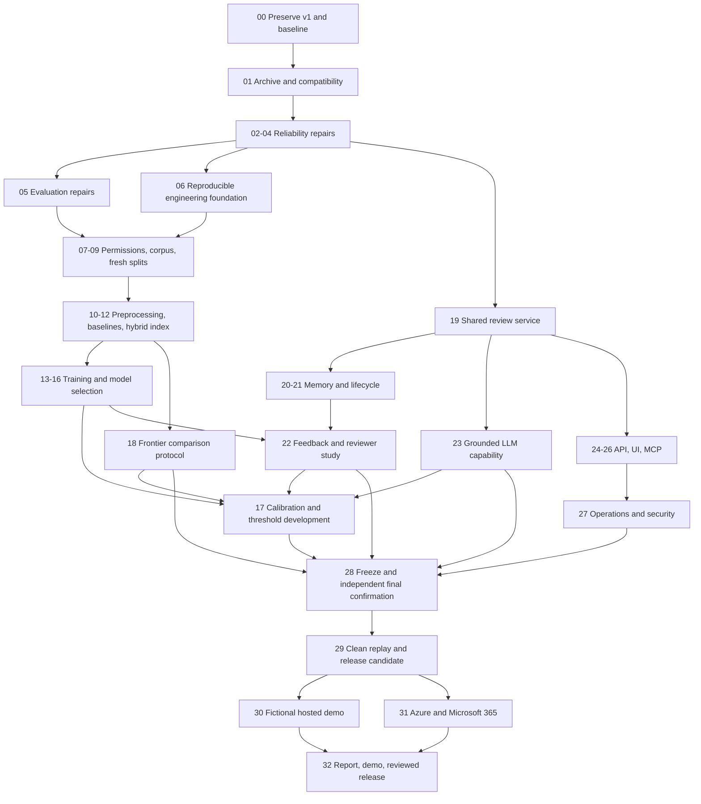

# Polyglot Watchlist — repair and complete Project 1

Date: 2026-10-23. Status: **complete planning proposal; application implementation is not authorized by this document**.

This plan follows the user's request for a complete sequence with nothing casually deferred. It incorporates five GPT-6 Astra workers using maximum reasoning, the source chat **Plan Polyglot Watchlist Phase 0**, the actual repository, and the [Project 1 proposal](reference/internship-2093-portfolio-plan.html). The companion [review record](progress/takeover-completion-planning.md) distinguishes work actually performed from future commands.

The original proposal is an aspiration, not evidence that a license, model, free compute tier, SDK name, statistical guarantee, or deployment entitlement is current. Project 2 and its blockchain/custom-engine work remain excluded by the user's scope. All Project 1 research, engineering, integration, and presentation deliverables below have explicit work and closure criteria.

## 1. What exists, and what completion means

The application suggests possible matching reference records for human research review. It does not establish identity, wrongdoing, current sanctions status, or clearance. The present workflow uses E5-small retrieval and an explicit human annotation. The user's earlier decisions to keep MiniLM experimental and prevent automatic match/clear actions remain in force. This plan includes training and calibration experiments for later approval; it does not silently reverse those decisions.

| Area | Verified present state | Work still required |
|---|---|---|
| Baseline | Python package, Unicode normalization, RapidFuzz Levenshtein matcher, JSON CLI; 12 invented entities and 24 aliases | Broader lexical/phonetic baselines, preprocessing experiments, stronger evaluation contracts |
| Public data | One selected historical OpenSanctions UN export; 20 non-person legal-entity groups, 79 searchable names | Current permission review, multiple source adapters, adequate reviewed multilingual corpus, cross-source links and immutable releases |
| Evaluation | Reproducible small fictional/public/bilingual experiments; existing datasets have been inspected | Fresh group-disjoint learning/calibration/confirmation data, absent/ambiguous cases, top-50 metric contracts, independent-group uncertainty |
| Embeddings | Pinned local E5-small, exact NumPy retrieval and caches | Larger baseline comparison, hybrid/vector index, actual fine-tuning and full reproducibility |
| Reranking | Pinned pretrained MiniLM experiment; no training; disabled in workflow | Task-specific training, frozen comparisons and candidate-depth/cost analysis |
| Calibration | No fitted calibration or threshold policy | Independent calibration fitting, threshold research, uncertainty and confirmation |
| Workflow | Phase 7A LangGraph, durable review pause/resume, deterministic explanation, two SQLite stores, hash-chained audit | Reliability repairs, archive/read compatibility, one reusable versioned service, lifecycle and authenticated boundaries |
| Memory | Detailed [Phase 8 plan](phase-08-plan.md), no implementation | Exact-ID history, lifecycle, publication/recovery, feedback adjudication, actual usefulness/feedback experiments |
| Interfaces and operations | CLI only | FastAPI, Streamlit, MCP, observability, CI, containers, reproducibility and recovery drills |
| External delivery | No completed HF/Azure/M365 integration in this project | Actual bounded deployments and integration checks after access, cost and publication approval |
| Repository | No Git repository at review time | Approved local initialization, reviewed small commits, later approved remote release |

The public names are **76 Latin and 3 Arabic**. Current group counts are **7 train / 3 development / 2 calibration-fit / 2 threshold-selection / 6 test**. Expanding only the already-downloaded UN export is insufficient for the intended coverage: its inventory has 269 eligible non-person records and 901 name/alias values, predominantly Latin. Inventory is not approval to import them.

Saved primary top-1 counts are RapidFuzz → E5 → pretrained MiniLM reranking:

| Existing diagnostic | Counts | Independent target groups |
|---|---|---:|
| Original fictional challenge | 20/27 → 26/27 → 25/27 | 3 |
| Small public challenge | 129/141 → 141/141 → 139/141 | 6 |
| Bilingual fictional challenge | 16/30 → 25/30 → 21/30 | 6 |

These historical measurements justify keeping E5 as the incumbent. They do not establish generalization, prove that fine-tuning cannot help, or justify skipping the missing experiments. Preserve the negative reranking result.

**Completion rule:** a valid experiment may finish with improvement, no gain, or regression. A missing implementation, unrun experiment, invalid split, missing permission, unavailable tenant, unsupported claim, or unverified deployment remains unfinished. It must retain an owner, the specific next action and required evidence. A limitation paragraph does not substitute for an undelivered capability. No final claim may exceed the completed evidence.

## 2. Defects to fix before feature work

The reliability worker reproduced R1–R5 in temporary fictional stores. R6 is intentional behavior that creates a migration prerequisite. The data worker reproduced E1–E2 with fictional in-memory inputs. Original project stores were not changed for these reproductions.

| ID | Severity / classification | Demonstrated behavior | Required repair and proof |
|---|---|---|---|
| R1 | Medium, side effects on inspection | `status` creates missing case/checkpoint databases and a lock; malformed commands also initialize storage. Status changes existing permissions. | Separate initialization, existing writable access and read-only inspection. Validate arguments first. Reads and rejected input create nothing and change no content, permissions or schema. |
| R2 | Medium, input contract | JSON such as `null`, `42`, `true`, and some arrays escapes as uncaught `TypeError`. | Check object shapes/types before set/unpack/lookup operations; return one structured CLI error. Preserve programming exceptions instead of broadly swallowing every `TypeError`. |
| R3 | High, content/provenance integrity | Identical reimport returns `created:false` after database rows have been altered, and the loader serves altered names under original provenance. | Verify complete logical content and its relationship to receipt-verified source bytes. Add a versioned content manifest; migrate by verified rebuild/comparison, never by merely blessing current rows with a new hash. |
| R4 | High, database ownership | Import into an unrelated version-99 SQLite database adds application tables and changes its version to 2. A review ledger overlays an unrelated nonempty version-0 database. | Recognize application identity and complete schema before DDL. Reject unrelated/partial/future databases unchanged. Explicitly initialize only a new empty destination. |
| R5 | High, lost checkpoint progress | Missing checkpoint storage makes pending/completed cases appear `not_requested`; recovery reruns retrieval and may fail only afterward. | Verify the established store pair and a protocol-state matrix before any replay. Distinguish a genuine initial crash from lost evidence/checkpoints. Inconsistent progress must fail before retrieval or mutation. |
| R6 | Compatibility prerequisite | A comment-only source change alters the workflow hash and blocks even completed-case inspection. | Preserve v1 first. Keep execution compatibility strict; add schema-specific read-only archival verification. An approved migration creates linked new records rather than rewriting historical hashes. |
| E1 | Evaluation contract defect | `audit_queries` accepts altered query text/alias ancestry; it skips absent rows, including invalid views/partitions and collisions. | Validate every query's provenance, ancestry, view, group, script and label. Presence/absence must be a label independent of the partition. |
| E2 | Future top-50 metric defect | A 1,000-entity index returning 50 records yields Recall@50 N/A when eligibility uses returned count. | Store index size, requested depth, returned count and evaluated depth separately. Test ranks 1/10/50/51, misses, small indexes and ties. |
| D1 | Documentation debt | Early README/data-card text contradicts later completed phases. | Preserve historical phase reports; provide a single current status and generated current measurements in living docs. |

Relevant current code: [CLI](../src/watchlist/agent/cli.py), [storage](../src/watchlist/agent/storage.py), [state and workflow fingerprint](../src/watchlist/agent/state.py), [database](../src/watchlist/database.py), [query audits](../src/watchlist/evaluation_data.py), [metrics](../src/watchlist/evaluate.py). R3/R4/R5 are higher-risk than cosmetic/refactoring work. R6 must be handled first because repairing those files changes execution compatibility.

**Fresh verification:** the existing reliability subset passed **85 tests, 13 warnings, in 10.75 seconds**, despite the reproduced gaps. Add failing regression cases before each repair. The earlier 213-pass full suite is historical; it was not rerun in this planning pass and is not added to the 85 count.

## 3. Responsibilities, approvals and dependency order

| Role | Responsibility in this review and later approved phases |
|---|---|
| Coordinator | Integrate the design, maintain one contract and issue ledger, resolve cross-component changes, review evidence and prepare phase reports |
| Astra worker 1 — reliability | Input/opening contracts, SQLite identity/content, compatibility, recovery and regression tests |
| Astra worker 2 — data/evaluation | Permissions, adapters, label/group review, splits, benchmark validity, metrics and uncertainty |
| Astra worker 3 — ML/calibration | Training mechanics, both trained encoders, comparisons, calibration, thresholds, confirmation and bundle promotion |
| Astra worker 4 — workflow/memory | Shared service, exact-ID memory, publication, lifecycle, feedback, grounded LLM integration and security |
| Astra worker 5 — interfaces/release | API/UI/MCP, authentication, observability, packaging/CI, hosting, M365 and release evidence |
| User / human reviewers | Approve each phase and resource use; supply or adjudicate genuine labels and reviews; accept claims and promotion; own account/tenant permissions |

Workers may research independent parts in parallel. Implementation remains bounded by approved phases. Shared files such as `pyproject.toml`, `uv.lock`, state contracts and schemas have one designated editor per phase. Other workers propose changes through the coordinator. Split work by modules and contracts, then integrate and test; do not let five workers edit the same service or lockfile simultaneously.

The step numbers below are a new completion sequence; they do not rewrite the historical Phase 0–10 reports. Each future step ends with `docs/progress/completion-NN.md`, the actual file/function explanations, commands/results, example input/output, limitations, 5W1H recap and a stop for the next approval. The progress report is a standard additional file for every step.

All commands marked **proposed** describe interfaces to implement; they are not available merely because they appear here. Existing test commands are distinguished. Abbreviated `python` commands mean the project's reviewed, locked Python environment, currently `.venv/bin/python`. Paths in this document are relative to `/Users/odin/Desktop/polyglot-watchlist-starter/`. Larger work packages, especially data acquisition and cloud/M365 delivery, must be divided into the numbered substeps for separate bounded approvals when dependencies or resources change; one approval never silently authorizes the whole roadmap.

This is a dependency diagram, not permission to start every node. Access/tenant/resource feasibility is checked in Step 06, early enough to resolve blockers before the final integration stages. Training and interface construction can proceed independently only after their contracts and phases have been approved. Final-test labels stay unused until Step 28.

## 4. Step-by-step execution plan

### Step 00 — preserve the working project and establish a recoverable baseline

**Goal / why:** protect existing cases, experiments and learning history before any hashed source file changes. Owner: reliability + coordinator. Dependencies: approval of this exact preservation scope; no new network or model.

1. Inventory source/configuration, dependency lock and installed versions, current data/model receipts, existing cases, audit heads and known origins. Measure required backup space first. Record the saved assistant-created case as `simulated_demo` in an external archive manifest; v1 has no origin field, so do not add one to its original headers or audit payloads.
2. Require both established databases and the existing lock before opening anything; access the lock without creation or chmod and never enter `ReviewService`. Quiesce processes that can write/checkpoint shared state. To preserve all original file bytes, capture the coherent complete database/WAL/SHM file set under that quiescence, recheck source hashes, then perform SQLite recovery/backup on private staged copies. Use SQLite backup APIs to produce the verified archive from those staged copies. Merely using `mode=ro` on originals does not guarantee sidecar preservation; never use `immutable=1` against unprocessed WAL to hide that problem. Preserve source/model/configuration manifests and the original implementation. Never copy only active WAL main files or remove sidecars by guesswork.
3. Verify backups in a new private directory. Record what can actually be restored. A list of package versions is not an executable environment backup.
4. Review `.gitignore` and explicit staging candidates for secrets, public-data restrictions, raw review notes and large weights. After explicit Git approval, initialize local Git and make a reviewed baseline commit. Do not invent a commit or push it.

**Files:** new standard-library utility `scripts/preserve_v1.py`, `tests/test_preserve_v1.py`, `docs/maintenance/baseline-and-backup.md`, `docs/releases/v1-manifest.json`; local ignored `data/review-archives/v1/`; edit `.gitignore` only if required by the reviewed staging list. The utility lives outside fingerprinted workflow code. The archive includes copies of existing source/config/lock and store files, not changes to originals.

**Proposed commands:** `.venv/bin/python scripts/preserve_v1.py --workspace data/review --output data/review-archives/v1 --dry-run`, then the explicitly approved `--apply`, then `--verify`; `.venv/bin/python -m pytest -q tests/test_preserve_v1.py`. Also `git init -b main`, explicit-path `git add`, `git diff --cached --check`, `git diff --cached`, and `git commit` only as separately included in the approval. No wildcard staging of `data/`.

**Tests / acceptance:** original application/data/model/configuration hashes and permissions preserved, including original SQLite sidecars; missing members, busy writers, changing sources and existing destinations fail safely; both backup databases and their relationships verify; a restore drill succeeds in a new destination; historical results and external simulation attribution survive. If an old runtime cannot be reconstructed, record that limitation and complete archival reading before editing hashed workflow files. Risk: inconsistent backups, disk exhaustion, or accidental secret/data staging. No subsequent hashed workflow edit until preservation is proved.

### Step 01 — separate archival reading from workflow execution

**Goal / why:** keep old evidence inspectable while allowing necessary fixes. Owner: reliability. Depends on Step 00.

1. Implement a narrow v1 archive reader that verifies schema, packet/submission links, audit sequence and stored receipts without loading a model or starting a graph.
2. Distinguish case schema, packet schema, execution manifest, source snapshot and model recipe. Report verification status separately from permission to resume execution.
3. Preserve the exact hash for pending v1 execution. Unknown formats fail. A migration/re-review creates a linked new case with the old case retained; it never replaces stored hashes with today's hash.
4. Specify primitive application-state decoding plus a narrow explicit allowance for required control records from the pinned LangGraph serializer, including interrupts. Reject unknown/unsafe serialized objects or dynamic type loading. Do not enable pickle as an archive shortcut.

**Files:** new `src/watchlist/review/{__init__.py,__main__.py,cli.py,archive.py,compat_v1.py}`, `tests/test_review_archive.py`, `tests/test_review_compatibility.py`, `docs/adr/0006-review-versioning.md`.

**Proposed commands:** `python -m watchlist.review archive verify --archive data/review-archives/v1`; `python -m watchlist.review archive inspect --archive data/review-archives/v1 --case-id CASE_ID`.

**Tests / acceptance:** inspect completed, pending and interrupted archived cases after a test changes current source bytes; reject mixed/corrupt stores and unknown schemas/control objects; zero writes, model loads, serializer migrations or chmod during inspection; preserve strict execution rejection for incompatible pending cases. Risk: confusing valid stored hashes with a valid protocol state. The reader checks both.

### Step 02 — repair input validation and nonmutating inspection

**Goal / why:** prevent malformed input or an inspection command from changing storage. Owner: reliability. Depends on Step 01.

1. Add failing R1/R2 regression tests. Validate command arguments and JSON object/type/field/path contracts before opening storage.
2. Split explicit new-workspace initialization, existing writable open, and read-only inspection. Missing storage yields an explicit error, not an empty new workspace.
3. Avoid implicit `SqliteSaver.setup()` in read paths: the installed saver changes journal/schema state. A read-only connection alone does not prove an operation is nonmutating; account for WAL/SHM behavior in the adapter.
4. Keep the approved distinction between a missing required CLI argument and a supplied semantically invalid name that may be recorded as an audited invalid-query case.
5. Return structured domain errors for expected input/storage contract failures; do not suppress unrelated programming exceptions.

**Files:** edit `src/watchlist/agent/{cli.py,storage.py,state.py}`; extend `tests/test_agent_cli.py`, `tests/test_agent_state.py`, `tests/test_review_audit.py`, `tests/test_review_resume.py`; use the archival compatibility contract from Step 01.

**Existing test command:** `.venv/bin/python -m pytest -q tests/test_agent_cli.py tests/test_agent_state.py tests/test_review_audit.py tests/test_review_resume.py`.

**Acceptance:** null/boolean/number/string/array/wrong-path/missing-argument cases produce the documented JSON error and exit code; no new store, permission/schema change or retrieval; valid start/review semantics remain covered. Risk: accidentally removing useful audited invalid-query behavior or masking code defects.

### Step 03 — establish database ownership and source-content integrity

**Goal / why:** stop unrelated-database modification and false provenance. Owner: reliability + data. Depends on Steps 01–02.

1. Add R4 tests for unrelated version 0/1/2/99 databases, forged expected table names and unsupported application identity. Validate full schema/constraints before DDL. Existing-store open never initializes a missing companion file.
2. Define an application identifier and explicit schema versions. Recognize legacy formats through a specific adapter rather than treating every version-zero database as new.
3. Add R3 tests for changed/deleted names, aliases, normalized strings, exclusions, grouping, raw evidence and source metadata. Verify complete logical data on a no-op reimport.
4. Add a canonical content manifest binding all retained records, alias status, provenance, receipt, parser/selection version and counts. Verify it when loading and before index construction.
5. Rebuild/migrate legacy source databases into a new destination only after comparison to receipt-verified original inputs and parser behavior. Hashing possibly altered rows alone is insufficient.

**Files:** edit `src/watchlist/database.py`, `src/watchlist/ingest/{import_source.py,schema.sql}`, relevant agent storage/schema recognition; extend `tests/test_database.py`, `tests/test_ingest.py`; new `docs/maintenance/source-database-migration.md` and explicit versioned migration implementation as reviewed in preflight.

**Commands:** focused database/ingestion pytest; proposed migration `python -m watchlist.ingest.import_source verify` / `rebuild` subcommands with separate source and destination paths.

**Acceptance:** rejected foreign databases are byte/permission/version-identical; valid repeats remain a no-op; corrupted semantic content is rejected even when SQLite integrity/FKs pass; old databases remain preserved and new ones verify. Risk: a digest stored beside mutable data is not protection against someone replacing both; retain independent original-source receipts and state the threat boundary.

### Step 04 — repair checkpoint reconciliation and prove crash recovery

**Goal / why:** a lost checkpoint must never cause a completed or reviewed case to become a fresh query. Owner: reliability. Depends on Steps 01–03.

1. Write a protocol-state matrix for initial request, formatted packet, prepared review, accepted submission, explanation, final event and checkpoint. Enumerate allowed crash windows and forbidden combinations.
2. Check both established store members and case/workspace identity before replay. Missing/replaced/truncated/rolled-back state produces an integrity/recovery-required error before retrieval.
3. Permit only the real initial-envelope-only crash to start from the original request. Preserve `after_packet` recovery using the earlier checkpoint that already contains the evidence digest; do not reretrieve.
4. Preserve accepted submissions and idempotent finalization through failures. Keep duplicate external submissions distinct from an internal recovery retry.
5. Add a bounded lock timeout and document lock order. Repeat actual subprocess termination and concurrent review tests in temporary stores.

**Files:** edit `src/watchlist/agent/storage.py`; extend `tests/test_review_resume.py`, `tests/test_review_audit.py`, `tests/test_agent.py`; new `docs/maintenance/recovery-state-matrix.md`.

**Commands:** targeted recovery/concurrency tests followed by the appropriate offline full suite and opt-in already-local integration checks once this repair changes model-bound workflow behavior. Tests use isolated workspaces.

**Acceptance:** zero retriever calls after durable evidence exists; missing store files, unexpectedly missing checkpoint threads after progress, and mixed generations fail before mutation. Preserve the documented initial-envelope-only `after_case` exception, where an intact store legitimately has no checkpoint thread yet. All five existing crash windows recover with unchanged evidence and one logical final event. Restore only complete coherent backups to new directories. Risk: overstrict checks can reject a legitimate mid-transaction state; test both allowed and rejected states.

### Step 05 — repair evaluation contracts before trusting new experiments

**Goal / why:** measurements must reject invalid labels/views and calculate shortlist metrics correctly. Owner: data/evaluation. Depends on repaired storage where relevant; use fictional fixtures first.

1. Add failing E1/E2 tests. Audit all queries, including absent queries, against owned aliases, original text, normalized text, generation ancestry, script sets, target groups and immutable reference views.
2. Replace `partition='absent'` in the new benchmark contract with independent `partition` and presence/ambiguity labels. Keep exposed historical artifacts unchanged.
3. Separate index size, requested k, returned count and evaluated depth. Define denominators for positive, absent, ambiguous and unlabelable cases.
4. Use actual script sets for mixed-script constraints rather than equality of coarse script labels. Ensure retrieval/reranking cannot reload withheld aliases or see gold labels.
5. Hand-check metrics before model work; tag old datasets `regression_only`.

**Files:** edit `src/watchlist/{evaluation_data.py,evaluate.py,compare_retrieval.py,splits.py}`; new `src/watchlist/{evaluation_metrics.py,scripts.py}`; extend existing evaluation/split tests and add `tests/test_evaluation_metrics.py`, `tests/test_evaluation_protocol.py`, `tests/test_scripts.py`.

**Commands:** focused pytest on those contracts; replay historical metrics into a separate comparison directory. Do not overwrite historical reports.

**Acceptance:** altered ancestry, alias ownership, absent collisions and invalid views fail; top-50 rank-30 in a 1,000-entity index counts correctly; rank-51/missing target is a miss; truncated outputs report MRR@K without invented tail ranks. Historical full-ranking results either reproduce or any difference receives a documented cause before proceeding.

### Step 06 — make the engineering foundation reproducible and surface access blockers early

**Goal / why:** avoid building on an environment available only in temporary paths, and resolve external prerequisites before the end. Owner: interfaces/release + coordinator. Depends on the baseline and repair contracts.

1. Select and test a supported Python/runtime matrix. The project declares 3.11–3.14, but only local 3.14 is demonstrated; test supported combinations or explicitly revise the declared range through review.
2. Verify `uv.lock`, optional dependency groups, package data, source distributions/wheels and execution outside the repository. Pin/record build and tooling versions with a minimal justified dependency change.
3. Add Ruff, pre-commit, deterministic CI, small fictional evaluation, secret scanning and dependency/license inventory. Start formatting/lint enforcement on new or explicitly migrated code; do not globally reformat fingerprinted v1 files. CI defaults to no live services, no model download and no licensed/private data. Pin CI actions to reviewed commit SHAs, use minimal permissions, and never execute untrusted pull-request code with privileged secrets.
4. Establish Makefile entry points incrementally: tests, lint, package smoke and existing evaluation. Extend them as later commands exist. Update living documentation status without rewriting historical reports.
5. Create an external-access ledger now: current source terms, compute availability, frontier-LLM provider/key/budget, HF account/hosting, Azure subscription/budget, Microsoft tenant/admin consent/Copilot entitlement. Verify current capabilities only in specifically approved network preflights. Assign each blocker a resolution owner and target deliverable.

**Files:** `pyproject.toml`, `uv.lock`, `.gitignore`, `README.md`, `docs/data-card.md`, `docs/model-card.md`, `docs/implementation-phases.md`; new `.pre-commit-config.yaml`, `.github/workflows/ci.yml`, `Makefile`, `.env.example`, `docs/access-and-resource-ledger.md`, packaging tests.

**Proposed commands:** `uv sync --locked --offline --dev --extra embeddings --extra agent` only if packages are already cached; `uv run --locked --offline ruff check .`; `uv run --locked --offline ruff format --check .`; `uv build --offline --no-build-isolation`; `make test`, `make eval-smoke`. Missing packages require the agreed acquisition budget.

**Acceptance:** clean local build/install/run succeeds from another directory; declared support is truthful; offline CI fixtures and minimal evaluation pass; secret-free reviewed staging; every external requirement has verified access or a specific outstanding action. A workflow file means CI is prepared; claim remote CI verification only after an actual approved GitHub run. Risk: changing the lock/runtime invalidates execution compatibility; follow Step 01.

### Step 07 — verify source permissions and implement bounded acquisition adapters

**Goal / why:** acquire permitted, traceable data without assuming that public means unrestricted. Owner: data. Depends on Step 06 access preflight and explicit network/acquisition approval.

1. Review current primary terms separately for OpenSanctions, direct UN, OFAC, EU and a supplementary Wikidata organisation-name corpus. Record dated URLs, terms hashes, attribution, purpose, field scope, retention, redistribution, model-training/release constraints and unresolved permissions.
2. Freeze corpus requirements and an approved source registry: allowed endpoints/redirects, schemas, byte/time/retry caps and selected non-person types. Keep INTERPOL notices and private individual scraping excluded.
3. Add source-specific parsers and acquisition receipts; preserve the legacy UN-only/20-record path as a historical contract.
4. Run a feasibility acquisition of at most 200 selected non-person groups and 10 MB per approved source, proposed 50 MB total, one request at a time. If a bulk file cannot meet the cap, revise the approval before transfer; filtering afterward does not make the download small.
5. Measure actual script/label/duplicate yield and derive the full acquisition and human-review workload.

**Files:** `docs/source-permissions.md`, `docs/data-retention.md`, `config/{data-sources.json,corpus-requirements.json}`; new `src/watchlist/ingest/{acquire.py,source_registry.py,parse_ftm.py,parse_un.py,parse_ofac.py,parse_eu.py,parse_wikidata.py}`; corresponding fictional fixtures and `tests/test_source_acquisition.py`, `tests/test_source_adapters.py`.

**Proposed commands:** `python -m watchlist.ingest.acquire preflight --sources config/data-sources.json`; approved `fetch --profile feasibility`; offline parser/acquisition tests with fabricated HTTP responses.

**Acceptance:** real receipts/hashes/byte counts and measured yield, malformed/redirect/interrupted/oversized download tests, no overwrites or unapproved source access. Current permission is established before use. Risk: terms or endpoint formats may prevent a named source; that source remains an explicit unresolved deliverable until permitted access or an approved scope revision exists.

### Step 08 — deliver the full reviewed multilingual corpus

**Goal / why:** replace toy-data dependence with independently reviewed learning and evaluation material. Owner: data engineer + human label reviewers. Depends on successful feasibility, final scope and full resource approval.

1. Approve acquisition quantities from measured yield. Planning target: about 5,000 usable reference groups plus about 2,000 independent absent-query groups; initial selected-response budget proposal 100 MB, revised before use if insufficient. These are workload proposals, not guaranteed data availability or statistical guarantees.
2. Deliver two documented populations: multilingual non-person names for learning and fresh permitted sanctions-domain cases for domain evaluation. A supplementary organisation corpus cannot silently replace the sanctions-domain study.
3. Create immutable multi-source releases with source-qualified IDs, original alias/property text, snapshots, parsing/transformation versions, evidence and terms references.
4. Separate canonical record equivalence, evaluation leakage groups and uncertain duplicate candidates. Use explicit/reviewed links; similar names and parent/subsidiary relationships do not automatically establish equivalence. Quarantine uncertainty before splitting.
5. Review at least 200 proposed positives and 200 negative candidates across source/script/type; adjudicate the hard negatives actually used. Independently review final labels where possible. Record disagreement and exclusion rates.
6. Aim for at least 100 independent final positive groups per claimed Latin↔Arabic, Latin↔Cyrillic and Latin↔Han direction; revise acquisition through approval until the agreed coverage gate is met. Translation, transliteration and spelling variation remain separate tags.

**Files:** `src/watchlist/{corpus.py,corpus_schema.sql,label_review.py}`, `src/watchlist/ingest/link_records.py`; `tests/test_corpus.py`, `tests/test_record_links.py`, `tests/test_label_review.py`; local `data/corpora/research-v1/`; update data/permissions cards.

**Proposed commands:** approved `ingest.acquire fetch --profile full`; `python -m watchlist.corpus build --release research-v1`; `python -m watchlist.label_review export` / `validate`; `python -m watchlist.corpus audit --release research-v1 --requirements config/corpus-requirements.json`.

**Acceptance:** actual independent group and agreed script coverage, complete lineage, label-review ledger, cross-source duplicate resolution and intact old artifacts. Shortfall is unfinished data work, not a completed training prerequisite. Risk: insufficient bilingual yield, incorrect negatives, source drift, excessive review burden; quantify and resolve them before training.

### Step 09 — freeze fresh partitions, query views and a prospective evaluation protocol

**Goal / why:** prevent information leakage and preserve a final confirmation set. Owner: data/evaluation. Depends on Step 08 and repaired evaluation contracts.

1. Allocate whole duplicate/alias families approximately 50/15/10/10/15 to training, development, calibration-fit, threshold-selection and final-test. Predeclare stratification and seeds; do not select seeds by model scores.
2. Assign absent-query families and ambiguous cases to those same roles. Absence means absent from the declared fixed index, not from all real lists. Exclude all equivalent reference copies of an absent target from that view.
3. Ensure both endpoints of training pairs/negatives are training groups. Build training-only mining indexes. Held-out references may be used for retrieval at evaluation time, but their labels/names may not leak into supervised training, mining or tuning.
4. Build natural held-out aliases and stratified typos, ordering, valid particles/initials, romanization, mixed-script/confusable and ambiguous queries. Remove withheld aliases across all equivalent source records. Preserve truth sets where several answers are supported.
5. Freeze denominators, uncertainty methods, result schema and benchmark exposure ledger. Custody of final labels must be documented; local hashes alone cannot prove nobody read them.
6. Derive final sample size from independent groups, branch coverage and intended uncertainty, not from the number of synthetic pairs. Reserve final query examples, labels, rankings, score distributions, failures and slice results from model developers until Step 28. Document necessary corpus preparation and independent label review separately. Before confirmation, automated holdout integrity checks expose counts/hashes and pass/fail checks, not case-level test diagnostics for tuning.

**Files:** `src/watchlist/training_data.py`, existing split/query modules, `eval/configs/research-v1.json`, `docs/training-protocol.md`, `docs/calibration-protocol.md`, `docs/benchmark-exposure.md`; `tests/test_training_data.py` and leakage/view tests; ignored immutable manifest/query files.

**Proposed commands:** `python -m watchlist.splits freeze --release research-v1 --config eval/configs/research-v1.json`; `python -m watchlist.training_data build --partition train`; `python -m watchlist.evaluation_data build` / `audit`.

**Acceptance:** poison held-out IDs never enter training/mining, reordered inputs preserve manifests, corrupted ancestry/views fail, absent and ambiguity labels are independent of partition, final-test custody is recorded. A later cross-partition duplicate discovery invalidates the affected release rather than being silently patched.

### Step 10 — complete normalization, structured parsing and evidence reconciliation

**Goal / why:** cover the proposal's richer input handling while preserving original evidence. Owner: data + workflow. Depends on the new schema/protocol.

1. Keep the existing conservative NFKC/casefold normalization as a versioned control. Add script-set detection and a separately evaluated ICU transliteration representation after dependency/license approval.
2. Preserve original text; record every transform/version. Do not drop diacritics, reorder tokens or infer language without an explicit experiment. Unsupported scripts get a visible support status.
3. Add typed optional structured fields appropriate to the entity type. For organisations use identifiers, jurisdictions and source-supported dates; person-specific DOB/gender examples remain fictional unless a separate scope approves public-person data.
4. Deterministically reconcile agree/disagree/missing/ambiguous field evidence. Missing is not disagreement; conflicting evidence is shown, not silently resolved. Keep these facts separate from learned name scores.
5. Define messy-text extraction contracts now; the LLM implementation and validation are Step 23. Require confirmation of consequential extracted values before retrieval.

**Files:** `src/watchlist/{preprocessing.py,structured_input.py,reconciliation.py}`, `config/preprocessing.json`; tests for Unicode, transforms, dates/identifiers and reconciliation; update data/packet contracts through explicit versioning.

**Proposed commands:** `python -m watchlist.preprocessing evaluate --config config/preprocessing.json --partition development`; focused tests.

**Acceptance:** transformations are reversible by provenance to original input, mixed scripts and invalid dates behave explicitly, no unsupported identity inference, preprocessing ablations use identical views. Risk: transliteration collisions and culturally inappropriate token rules; measure rather than assume benefit.

### Step 11 — complete the baseline matrix before training

**Goal / why:** know what learning must improve over. Owner: evaluation. Depends on Steps 09–10.

1. Run exact lookup and the existing normalized Levenshtein control; add Jaro–Winkler and token-sort with RapidFuzz.
2. Add a licensed pinned Double Metaphone implementation for its supported Latin inputs. Report unsupported scripts explicitly and compare the transliteration representation separately.
3. Verify and run the current locally usable OpenSanctions matcher, such as the applicable yente/logic implementation, under permitted terms on the same evidence. Do not quietly replace this with a paid/live screening API.
4. Run pretrained E5 and a pinned LaBSE baseline after its model/license/resource approval. Compare equal reference views and unique entity results.
5. Generate development/regression tables before any training: Recall@10/@50, top-1, MRR@K, missing-target/ambiguity diagnostics, applicable FPR measures, latency and resource counts. Keep final-test results sealed.

**Files:** `src/watchlist/{baselines.py,evaluate_baselines.py}`, baseline adapters where needed, `eval/configs/baselines-v2.json`, `tests/test_baselines.py`, evaluation protocol tests, generated development results.

**Proposed commands:** `python -m watchlist.evaluate_baselines --config eval/configs/baselines-v2.json --partition development`; model verification commands; local service integration tests for the external matcher after approval.

**Acceptance:** every listed baseline has a real completed comparison or a concrete unresolved license/resource blocker; same labels/evidence and hand-checked arithmetic; costs and unsupported cases visible. No baseline is presumed superior or a guaranteed upper bound.

### Step 12 — build and evaluate hybrid retrieval over a real vector index

**Goal / why:** deliver the proposal's top-50 fuzzy/phonetic/dense retrieval and measure scaling. Owner: ML + evaluation. Depends on baselines and corpus/view contracts.

1. Use exact NumPy search as the correctness oracle. Select one index technology, proposed local Qdrant, after supported-client/container/license/resource preflight. One proven backend satisfies the alternative choices; implementing every named vendor is unnecessary.
2. Store versioned alias vectors and immutable source/view/model identifiers. Retrieve and aggregate to distinct canonical entities; multiple aliases/source duplicates must not consume the shortlist.
3. Combine lexical, phonetic and dense candidates with a development-selected, predeclared fusion rule. Preserve raw component scores and evidence; do not call the fused number a probability.
4. Tune approximate-search parameters on development, measure candidate recall versus exact search, and freeze parameters. Reference/model/view changes require a new index build.
5. Test top-50, top-10 sensitivity, missing/stale index, interrupted build, deletion/update and deterministic tie/aggregation behavior. Build completely, verify, then atomically activate a new index version.

**Files:** `src/watchlist/{hybrid_retrieval.py,vector_index.py}`, `config/vector-index.json`, `tests/test_hybrid_retrieval.py`, `tests/test_vector_index.py`, opt-in local index integration tests, versioned index receipts; later compose configuration.

**Proposed commands:** `python -m watchlist.vector_index build` / `verify`; `python -m watchlist.hybrid_retrieval evaluate --partition development`.

**Acceptance:** informative top-50 metrics on an index larger than 50; known-equivalent records collapse correctly; measured search loss/latency/memory; no hidden fallback to a different index. Risk: ANN miss rates or alias aggregation bias; keep exact search available for diagnosis.

### Step 13 — implement training mechanics and a bounded resource pilot

**Goal / why:** prove that weights actually learn, save and resume before a full run. Owner: ML. Depends on reviewed training data and explicit training/resource approval.

1. Add a tensor training path; the existing E5 `.encode()` NumPy inference path is not differentiable training. Preserve base weights and original loader guards.
2. Define derived-model artifacts with base revision, trained hashes, data/mining lineage, code/environment, prefixes/pooling/tokenizer and inference recipe. A trained artifact must not masquerade as the approved pretrained checkpoint.
3. Verify finite gradients, intended parameter updates, hand-calculated losses, group-aware batching and false-negative masking on tiny authored fixtures.
4. Smoke-train each existing local model sequentially for at most 50 optimizer steps. Proposed pilot limits: 30 minutes/model, 8 GB working-memory planning ceiling, 4 GB extra disk; approve measured feasibility rather than promising these fit the machine.
5. Start CPU float32 for correctness. Test any MPS/CUDA/mixed-precision route explicitly, record device limitations and numeric tolerance, and stop on the configured budget. Estimate and approve full-run time/disk from actual pilot measurements.

**Files:** `src/watchlist/{training.py,training_losses.py,model_artifacts.py}`, `eval/configs/{train-e5-v2.json,train-minilm-v2.json}`, `tests/test_training.py`, `tests/test_training_losses.py`, `tests/test_model_artifacts.py`, `tests/integration/test_training_smoke.py`.

**Proposed commands:** `python -m watchlist.training preflight --config ...`; offline `training smoke --config ...`; focused tests.

**Acceptance:** changed weights, correct loss/gradient direction, save/reload equivalence, optimizer/scheduler/RNG resume, unchanged originals; OOM/nonfinite/deadline/corrupt/partial-write cases handled. Tiny loss reduction proves mechanics only. Risk: unsupported device/runtime or resource estimates; those are resolved before full training, not by silent fallback.

### Step 14 — actually fine-tune the bi-encoder

**Goal / why:** test learned multilingual retrieval. Owner: ML. Depends on Step 13 and full-run approval.

1. Use a copy of pinned local multilingual E5-small. Preserve the current symmetric `query: ` convention, pooling and normalization for the primary arm; any change is a declared ablation.
2. Build positives from reviewed aliases, cap each group's contribution, and mine easy/hard negatives from training-only RapidFuzz/E5 indexes. Both query and candidate endpoints must be training groups. Save miner/version/rank receipts and quarantine uncertain false negatives.
3. Train a contrastive objective such as MultipleNegativesRankingLoss with valid within-batch negatives. Proposed starting configuration: actual batch 8, learning rate `2e-5`, at most 3 epochs, seed 42; finalize optimizer/token/stop settings from the pilot.
4. Run predeclared replication seeds and a no-hard-negative ablation within the approved measured budget. Gradient accumulation alone does not increase the contrastive negative pool; report the real pool.
5. Select checkpoint/configuration on development only. Save curves, all run statuses, development retrieval/error slices and measured resources.

**Files:** `src/watchlist/negative_mining.py`, `tests/test_negative_mining.py`, training config; `data/models/derived/e5-name-v2/`, immutable mining and run manifests, generated development results.

**Proposed commands:** `python -m watchlist.negative_mining --config ... --partition train`; offline `python -m watchlist.training fit --config eval/configs/train-e5-v2.json`.

**Acceptance:** actual trained checkpoints, valid mining/batching lineage, full development comparison and reproducible reload. A result with no gain is completed research; an unrun experiment is not. Risk: overfitting/false negatives; final confirmation remains unopened.

### Step 15 — actually fine-tune the cross-encoder

**Goal / why:** test whether task-specific learning improves the passage-relevance reranker's name behavior. Owner: ML. Depends on training mechanics and a frozen training-only mining retriever.

1. Train a copy of the local multilingual MiniLM checkpoint using query/alias pairs, query first, no E5 prefix, a single raw logit and `BCEWithLogitsLoss`. Do not apply sigmoid twice.
2. Use reviewed positives and training-only easy/hard negatives, with group caps and recorded mining sources. Freeze the mining retriever before generating this dataset.
3. Select using development end-to-end rankings with fixed candidate sets; report conditional reranking accuracy separately. Never insert missing targets or restore withheld aliases.
4. Retain maximum-allowed-alias aggregation for the primary control; measure alias-count bias. Complete seed/negative-mining ablations as predeclared.
5. Save actual changed weights, curves, all runs, latency and the keep/reject recommendation. A different MiniLM/XLM-R backbone requires a distinct approved experiment; training one justified multilingual cross-encoder fulfills this component.

**Files:** cross-encoder training config, shared training implementation, `tests/integration/test_trained_reranker.py`; `data/models/derived/minilm-name-v2/` and development reranking results.

**Proposed commands:** offline `python -m watchlist.training fit --config eval/configs/train-minilm-v2.json`; development experiment runner.

**Acceptance:** actual trained artifact and full comparison, preserved candidate membership/alias provenance/ties/empty-result semantics, safe reload. Improvement is not guaranteed or required to report a completed valid experiment.

### Step 16 — select the complete experimental pipeline on development

**Goal / why:** isolate what each learned component contributes and freeze one finalist before calibration. Owner: ML + evaluation. Depends on Steps 11–15.

1. Compare RapidFuzz, pretrained E5, trained E5, pretrained E5+pretrained MiniLM, pretrained E5+trained MiniLM, trained E5+pretrained MiniLM, and trained E5+trained MiniLM. Include the other lexical/embedding/hybrid controls in the registry.
2. Predeclare top-50 as the new reranking depth and top-10 as cost/coverage sensitivity. Preserve the historical K=5/10 experiment unchanged.
3. Measure retrieval ceiling, end-to-end and conditional ranking, group-macro/query-weighted results, source/script/direction/alias-count slices, cold and warm latency, memory and cost evidence.
4. Bootstrap whole entity/query-origin groups, keeping paired method outputs together. Explain any conditional-on-fixed-index inference for pair metrics. Do not treat correlated aliases as independent cases.
5. Select one complete pipeline on development and freeze comparator arms, preprocessing/index/aggregation recipe and deployment budget. Final test may veto promotion; it cannot choose a different winner and then be called independent confirmation.

**Files:** `src/watchlist/{experiments.py,statistics.py}`, `tests/test_experiments.py`, `tests/test_statistics.py`, `eval/configs/experiment-matrix-v2.json`, frozen experiment manifest and development report.

**Proposed command:** offline `python -m watchlist.experiments --config eval/configs/experiment-matrix-v2.json --partition development`.

**Acceptance:** all planned arms and ablations have results/status, candidate/evidence parity and actual resource measurements; finalist and confirmatory endpoints are signed off before calibration/test. Risk: picking a favorable slice or seed after seeing results; report all predeclared runs.

### Step 17 — fit calibration, research thresholds and freeze abstention rules

**Goal / why:** study score reliability for a precise record-support task while retaining human responsibility. Owner: ML/statistical review. Depends on frozen pipeline and independent calibration/threshold groups. Implement and test the mechanics earlier if approved, but perform final fitting/selection for a release arm only after its Step 18 hybrid, Step 22 feedback and Step 23 input-parsing choices are frozen on development. The dependency DAG takes precedence over numeric order.

1. Define the target: whether the selected top record belongs to the independently supported target set for this query and fixed index. This is not real-world identity probability, wrongdoing or sanctions status.
2. Fit at the selected-record level after retrieval/reranking/alias aggregation. Include supported absent/missed-target negatives under the protocol; fitting random balanced pairs does not calibrate the selected maximum.
3. Fit a simple logistic/Platt map on calibration-fit groups. Evaluate isotonic only as a predeclared alternative with adequate support; any method/regularization selection stays within grouped internal validation of calibration-fit.
4. Report Brier score, log loss, fixed-bin ECE, reliability diagrams with counts, prevalence and unsupported slices. Declare source domain and query-mixture membership in each calibration artifact and report domain-specific diagnostics. Calibration predominantly fitted on supplementary organisation queries does not establish sanctions-domain support probabilities. Unsupported domains receive abstention or explicitly uncalibrated research ranking until independently supported. Save inspectable parameters and bundle hashes, not arbitrary untrusted pickle.
5. On separate threshold-selection groups choose a frozen finite-grid research presentation rule and abstention conditions. High support may highlight a possible record; low/intermediate support, ambiguity, unsupported domain, truncation, stale provenance or failures request review or an explicit error. Every successful case still requires human review.
6. Study the proposal's upper/lower bands offline. A low top-record score cannot establish that no target exists: report missed-target and target-presence errors separately. Label coverage as simulated suggestion coverage, not proven workload saved.
7. Freeze confidence endpoints, multiplicity treatment and sample/stopping rules before final confirmation. For illustration, zero errors needs 299 independent eligible cases for a one-sided 95% binomial upper error bound below 1%; two endpoints allocated alpha=.025 each need 368. Those numbers are prospective illustrations, not observations or guarantees. Eligible branch cases, not total aliases, supply that denominator.
8. Finalization gate: every changed model, routed hybrid, feedback-trained arm or consequential parser/input recipe freezes its own complete scoring recipe, fits a compatible calibrator on calibration-fit groups and selects thresholds on threshold-selection groups before Step 28. Calibrate the complete routed output, including routing failures and retrieval misses where the defined label permits. Never reuse an incumbent's calibrator silently. Freeze the development-selected release bundle again after these additions; no calibration/threshold result becomes a reason to tune the model or prompt on those held-out groups.

**Files:** `src/watchlist/{calibration.py,review_policy.py,evaluate_policy.py}`, `eval/configs/{calibration-v2.json,review-policy-v2.json}`, calibration/policy tests, fit/threshold manifests and plots, `docs/calibration-protocol.md`.

**Proposed commands:** offline `python -m watchlist.calibration fit --config ...`; `python -m watchlist.evaluate_policy select --partition threshold_selection --config ...`.

**Acceptance:** fitted artifact and actual diagnostics, explicit zero-support/one-class refusal, no threshold tuning on final data, all override/boundary/stale-bundle tests, frozen policy and confirmation design. Weak calibration or insufficient statistical support prevents the associated claim; it does not justify invented confidence or automatic clearance.

### Step 18 — complete the frontier-LLM and bounded hybrid comparison

**Goal / why:** test when small models and a frontier model are useful under equal evidence. Owner: ML + evaluation. Depends on frozen development protocol and specific provider/data-transfer/cost approval.

1. Verify a current provider/model revision and terms. Approve the exact data fields transmitted, retention treatment, request/token/time/retry and monetary caps; use fictional/public-permitted records only within that approval.
2. Freeze prompts and structured output on development. Compare the same shortlist/evidence with the small model; separately measure retrieval misses so the LLM is not given a target the pipeline did not retrieve.
3. Include the same structured metadata or omit it consistently. The LLM is a comparator, not ground truth or a guaranteed upper bound. Cache permitted request/response receipts with version, prompt hash, tokens, actual prices and timing.
4. Predeclare an uncertainty-band hybrid arm on development, including its routing cost/error budget, and freeze it before final test. Keep it a research comparison unless independently approved for integration.
5. Define each method's output/score semantics; LLM self-reported confidence is not a calibrated probability. Select intended recall/precision operating points on development or threshold-selection groups. On final test report achieved recall/precision at the frozen points, without retuning or interpolating to manufacture matched performance. Measure median/p95 end-to-end latency, cost per 1,000 queries and script/perturbation slices. Report unattainable targets honestly. Any calibrated hybrid completes Step 17 for its whole routed output.

**Files:** `src/watchlist/llm/comparison.py`, `eval/configs/llm-comparison.json`, prompt templates, mocked contract tests, opt-in provider integration tests and immutable response receipts.

**Proposed commands:** `python -m watchlist.llm.comparison preflight`; approved `run --partition development`; offline `replay`. Final calls occur only under the frozen Step 28 protocol.

**Acceptance:** actual bounded provider run and reproducible cached comparison, equal evidence and complete cost/error accounting. Fixtures alone do not complete the live comparison. No provider access remains an explicit unfinished dependency, not an excuse to remove this experiment.

### Step 19 — build one versioned review service for all interfaces

**Goal / why:** share correctness across CLI, API, UI and MCP instead of duplicating orchestration. Owner: workflow + reliability. Depends on repaired legacy behavior, archive support and approved v2 contract; model bundle experiments can proceed independently behind a stable adapter.

1. Move reviewed behavior into one `watchlist.review` service owning typed contracts, ledger, workflow, recovery and compatibility. Keep narrow v1 archival adapters; avoid several copied whole workflows.
2. Define create/get/submit/recover/cancel/audit operations and stable domain errors. Distinguish pending, accepted-but-finalizing, completed, incompatible and inconsistent-storage states.
3. Use one new explicit v2 workspace. Existing CLI behavior either delegates through a reviewed compatibility wrapper or retains an explicitly documented version boundary; do not silently reinterpret old cases.
4. Integrate frozen model bundles via interfaces and preserve raw scores/provenance. Experimental bundles may be tested in isolated workspaces before promotion; production/default selection stays E5 unless later confirmed and approved.
5. Keep inference outside short write transactions, serialize mutations with bounded locks/CAS/uniqueness, and freeze packet/checkpoint/context tokens. Human review remains required; errors stay errors.

**Files:** extend `src/watchlist/review/` with `contracts.py`, `validation.py`, `storage.py`, `schema.sql`, `workflow.py`, `nodes.py`, `service.py`, `recovery.py`; `config/review-v2.json`; v2 state/recovery/read/concurrency tests and adapter parity tests.

**Proposed commands:** `python -m watchlist.review init --workspace data/review-v2`; `start`, `status`, `review`, `recover`, `cancel`, `verify`; parity and subprocess tests.

**Acceptance:** one semantics implementation, strict review/version validation, successful archive/migration paths, unchanged pending evidence across model changes, explicit simulated/human/unknown origin, no silent reranking/policy promotion. Risk: a large refactor hiding behavioral changes; perform small adapter-first changes with existing tests at each boundary.

### Step 20 — implement fictional exact-ID memory and replay-safe publication

**Goal / why:** show prior dated annotations about a reference record without turning them into identity facts. Owner: workflow/memory. Depends on Step 19; reuse the substantive [Phase 8 design](phase-08-plan.md).

1. Create registered workspace/source namespaces, record snapshots, annotations, candidate/evidence relations, lifecycle events, frozen contexts and a publication outbox.
2. Lookup only registered namespace + exact source record ID + approved snapshot/observation. Similar names, query hashes or alias text never link cases. Same-name `syn-001`/`syn-012` remain separate.
3. Propose three cards per candidate with deterministic ordering, pagination/omission counts and a configurable 90-day visibility window. This is a pilot freshness policy, not deletion or legal retention.
4. Display origin, earlier query/case context, date, source/model, opinion and limitations. Preserve differing annotations and corrections; no majority vote or newest-wins identity conclusion.
5. Bind the displayed history and empty-history key revisions into the packet. Revalidate relevant revisions/expiry under the acceptance lock. Stale unaccepted forms require a linked fresh case; accepted immutable submissions finish recovery even if later history changes.
6. Commit final-audit/publication intent together. Publish after a compatible completed checkpoint receipt; memory projection/receipt/key revisions commit atomically. Retrying publication reuses the same logical receipt.

**Files:** `src/watchlist/case_memory/{__init__.py,identifiers.py,state.py,schema.sql,store.py,lookup.py,publisher.py,legacy.py,lifecycle.py,evaluation.py}`, v2 outbox/context integration, `eval/configs/memory.json`, authored fixtures and focused memory/publication tests.

**Proposed commands:** `python -m watchlist.case_memory.evaluation --config eval/configs/memory.json`; service history/publication inspection commands.

**Acceptance:** no wrong record/snapshot links in adversarial fixtures; rankings unchanged with display-only memory; simulated origin remains visible; valid empty lookup differs from unavailable/corrupt lookup; actual crash tests before/after memory commit and acknowledgement prove idempotent effects. Start with the planned 24 episodes/12 fictional groups; this tests software, not broad reviewer benefit.

### Step 21 — complete memory continuity, corrections, retention, backup and audit anchoring

**Goal / why:** make memory usable beyond a disposable fictional demo. Owner: workflow + data + reliability. Depends on Steps 08/19/20 and public-data/lifecycle permissions.

1. Distinguish source snapshot, record observation, corpus view and index build. Register refreshed sources and classify unchanged/revised/removed/merged/split IDs with evidence. Provider continuity is a documented assertion; reused IDs and changed snapshots do not inherit history automatically.
2. Add explicit supersession/withdrawal and linked replacement cases. Preserve original opinions historically while changing future visibility. Review cross-source continuity mappings; names alone cannot create them.
3. Inventory every content copy: ledger, checkpoints, memory, frozen contexts, forms, exports, traces, backups, labels and trained derivatives. Expiry/withdrawal is not deletion. Implement dry-run/apply retention with a verified deletion manifest and backup expiry policy.
4. Separate v2 content payload from minimal audit receipts where feasible. Retained hashes/IDs can remain linkable. Deleting v1 full-payload history cannot be called unchanged original-chain verification. If labels entered training, address derived model retirement/retraining.
5. Quiesce all writers for complete-set backup; restore to a new directory and verify before activation. Test migrations and rollback with mixed/missing/corrupt generations and measure actual recovery time.
6. Apply owner-only permissions, no-symlink/path-escape protection and approved encrypted storage/key recovery appropriate to deployment. Add independent anchor manifests covering the case catalogue and memory head; an anchor on the same writable disk is only a local receipt.

**Files:** `case_memory/{source_registry.py,continuity.py,migrations.py}`, `review/{retention.py,backup.py}`, `docs/{data-lifecycle.md,threat-model.md,maintenance/restore.md}`, lifecycle/backup/retention/anchor tests.

**Proposed commands:** `python -m watchlist.review retention plan --dry-run`; explicitly approved `retention apply`; `backup`, `restore --dry-run`, `verify`; source refresh preflight/audit.

**Acceptance:** actual restore and deletion-verification drills, old evidence attributable, stale/reused IDs blocked, original audit boundaries honestly represented, no false claim of tamper-proof storage or secure SSD erasure. Risk: retention changes can invalidate pending cases/derived models; the lifecycle must handle that explicitly.

### Step 22 — measure memory usefulness and complete feedback-driven learning

**Goal / why:** demonstrate whether memory helps people and whether adjudicated feedback improves research metrics. Owner: workflow + evaluation + human reviewers. Depends on implemented memory, labels and the training/calibration tools.

1. Conduct a counterbalanced fictional study, proposed 2–4 consenting reviewers with 24 matched tasks each, memory on/off, independent authored answers and misleading-history cases. Measure accuracy, active review time, history/source opens, abandonments and inappropriate reliance. If only one learner participates, label the N=1 descriptive result and keep any agreed multi-reviewer requirement open.
2. Build independent label adjudication. Follow-up/none-selected/unresolved are workflow opinions, not automatic positives/negatives; unselected candidates never become negatives by default.
3. Export permitted supported/unsupported/uncertain research pairs with case/evidence/actor/origin/adjudicator/terms lineage. Exclude simulated/unknown-origin material from human/real-world label claims; separately declared synthetic labels are allowed only in their own experiment.
4. Run a prospective feedback ablation, for example N=0/25/50/100 adjudicated pairs where group support permits. Both endpoints of every feedback-training pair must belong to immutable training groups; development, calibration-fit, threshold-selection and final groups are excluded from gradient updates and mining. Preserve original group assignments and chronology, including negatives. Keep model capacity/protocol fixed; freeze every feedback arm on development, then independently refit calibration and reselect thresholds through Step 17. Confirm all frozen arms together in Step 28.
5. Separate display-only memory effects on reviewer work from feedback-driven model effects. Display memory does not change scores; it cannot claim reduced model FPR by itself.

**Files:** `src/watchlist/feedback/{__init__.py,contracts.py,adjudication.py,export.py,evaluation.py}`, `config/feedback.json`, `docs/feedback-label-protocol.md`, `docs/reviewer-study-protocol.md`, lineage/split tests and actual study/ablation results.

**Proposed commands:** `python -m watchlist.feedback export --manifest ... --dry-run`; validated export and training experiment commands; paired memory-study analysis.

**Acceptance:** real recorded reviewer tasks and a completed feedback experiment with counts/uncertainty/failures. Insufficient reviewers or labels remains a named requirement to resolve; a fabricated human annotation or copy of test answers is not completion. Live requests never retrain or recalibrate themselves.

### Step 23 — implement grounded LLM parsing and explanations

**Goal / why:** deliver the reference's generative capabilities under a verifiable evidence boundary. Owner: workflow + ML. Depends on typed input, frozen evidence and approved provider/resource/data-transfer settings.

1. Call a model only for messy text; require typed extracted fields and exact supporting input spans. Validate spans, preserve ambiguity and ask the user to confirm consequential fields before retrieval. No guessed dates or identifiers.
2. Give the explanation model only necessary frozen structured evidence. Keep source facts, historical facts, earlier opinions and current review distinct. Require allowed evidence IDs and exact numeric/date support.
3. Prefer atomic claim selection plus deterministic rendering for authoritative text. Free prose is a draft until factual review; valid citation IDs alone do not prove the wording follows from evidence.
4. Give the model no tool credentials, DB handles, policy authority or ability to change scores/decisions. Bound time/tokens/retries and provide the deterministic fallback.
5. Test at least ten frozen attacks across remarks, memory notes, forged citations, Unicode controls, exfiltration requests and malformed outputs. Test decision invariance by altering non-scoring text while holding names/scoring evidence fixed.
6. Record model/prompt versions, validation outcome, actual cost/latency and approved retention. Do an actual opt-in provider run; mocked fixtures are necessary but insufficient live validation.

**Files:** `src/watchlist/llm/{client.py,schemas.py,parsing.py,explanations.py,validation.py}`, prompts/config, `tests/test_llm_contracts.py`, `tests/test_explanation_grounding.py`, `tests/test_prompt_injection.py`, opt-in integration and adversarial reports.

**Proposed commands:** contract/injection tests; `python -m watchlist.llm.validation evaluate --config ...` in replay mode and separately approved live mode.

**Acceptance:** no unsupported authoritative claim, no state/policy mutation from model output, failed parsing/explanation has an explicit fallback, live capability measured within budget. Risk: grounding validators are imperfect; retain factual review or constrained authoritative rendering rather than claim perfect entailment.

### Step 24 — implement FastAPI over the shared service

**Goal / why:** provide a typed, authenticated service without reimplementing review behavior. Owner: interfaces. Depends on Step 19 and lifecycle contracts; production bundle promotion still requires Step 28.

1. Use canonical `POST /screen`, `POST /review/{id}`, `GET /audit/{id}` from the reference; add explicit case status/cancel/health routes as justified. A legacy `/match` alias, if retained, must be documented and tested.
2. Validate strict bounded requests and return stable domain errors. Accept registered dataset/model identifiers only, never caller-selected filesystem paths, arbitrary URLs or policy overrides. Derive reviewer identity from authenticated context, not user-supplied JSON or the server's `getpass` account.
3. Do not hold a global blocking service lock for the web app's lifetime. Serialize mutations through a bounded local worker/queue or equivalent documented service design; inference occurs outside short SQLite transactions.
4. Create durable accepted-operation records before returning `202` from `POST /screen`; a principal + request UUID + body digest prevents duplicate case creation. Add authorized operation polling. Distinguish the HTTP timeout from inference deadline and human review duration. On a lost review response, inspect the durable status before an explicit recovery; never automatically issue a second human submission.
5. Enforce case ownership, stale packet/checkpoint/context validation, duplicate submission semantics, request IDs, timeout/rate/body limits and safe CORS/CSRF/session behavior for the chosen auth design. Initial proposed limits: one inference worker, queue eight, 64 KiB request body, 200-character names, 1,000-character reasons and 50-item pages, subject to measured acceptance. Specify `422` invalid input, `401/403` denied, `404` unknown/inaccessible, `409` stale/duplicate, `413` oversized, `429` full queue and `503` unavailable component.
6. Bind locally first. External authentication/TLS/configuration is prepared and tested before hosting. Keep errors as errors; no timeout becomes a negative match outcome.

**Files:** `src/watchlist/api/{__init__.py,app.py,schemas.py,auth.py,errors.py}`, `tests/test_api.py`, `tests/test_api_auth.py`, `tests/test_api_concurrency.py`, `docs/api.md`, generated OpenAPI artifact and dependency pins.

**Proposed commands:** local `uvicorn watchlist.api.app:app --host 127.0.0.1`; API contract/auth/concurrency tests; OpenAPI generation/validation.

**Acceptance:** API/CLI parity, two concurrent submissions yield one accepted review, stale/foreign/unauthenticated actions fail, restart preserves cases, no secret/source-note leakage in errors/logs. Risk: browser/API identity is stronger than a local username and must be actually tested.

### Step 25 — implement and test the Streamlit reviewer interface

**Goal / why:** make the workflow usable and understandable to a reviewer. Owner: interfaces + human reviewer. Depends on API/service contracts.

1. Build query entry, parsing confirmation, candidate evidence/provenance, raw/calibrated-score labels, uncertainty and separate prior-annotation panels. Explicitly show synthetic/demo origin.
2. Require a deliberate outcome/reason with current packet/context tokens and no preselected outcome. Distinguish none selected from clearance. Display submit/pending/finalized/failure states accurately; a refresh or double click must not create a new review. Keep unsent notes on a stale-form conflict while disabling submission against the old evidence; do not silently replace the packet under an apparent approval.
3. Support restart/resume and stale-form resolution through a linked fresh case. Handle memory unavailable, empty results, unsupported input and retired/deleted cases without fabricated certainty.
4. Escape all names/notes/LLM content; test right-to-left Arabic, mixed scripts, long strings, keyboard navigation, labels, contrast and small-screen layout.
5. Run actual end-to-end browser tasks against temporary fictional stores, including reconnect/session expiry and concurrent tabs. Record usability defects and fix them before acceptance.

**Files:** `src/watchlist/ui.py` or a small reviewed `src/watchlist/ui/` package, `tests/test_ui_contracts.py`, `tests/e2e/`, `docs/reviewer-guide.md`, screenshot/demo fixtures and UI dependency lock changes.

**Proposed commands:** `streamlit run src/watchlist/ui.py --server.address 127.0.0.1`; browser E2E suite after approved tooling setup.

**Acceptance:** completed fictional query→review→restart→memory walkthrough, accurate state and evidence, keyboard/RTL/rendering checks, no stored script injection or stale submissions. Screenshot appearance alone is not proof of behavior.

### Step 26 — implement MCP tools and verify real client use

**Goal / why:** expose bounded project capabilities to tool clients and M365. Owner: interfaces. Depends on the shared service/API auth contract and current SDK preflight.

1. Verify current MCP protocol/SDK APIs; do not copy the reference's version/class-name claim without checking. Pin the chosen implementation.
2. Expose `screen_name` and `get_entity` with typed bounded inputs, provenance-rich outputs, clear research wording and cancellation/timeouts. `get_entity` requires scoped identifiers/snapshot. `screen_name` persists a case, so tool metadata must not label it read-only; its result is not a submitted human decision.
3. Use local stdio for initial development if useful; complete authenticated streamable HTTP for the M365 requirement. Restrict host/origin/session behavior and prevent SSRF/path injection.
4. Keep review writes on the authenticated explicit-review path. If a review tool is added, its caller cannot claim a human actor without verified interaction and authorization.
5. Test a real client with fictional data and adversarial tool results. No Project 2 dependency is required to demonstrate Project 1 tools.

**Files:** `src/watchlist/mcp_server/{__init__.py,__main__.py,server.py,tools.py,auth.py}`, contract/transport/security tests, `docs/mcp.md`, client examples and pinned dependencies.

**Proposed commands:** `python -m watchlist.mcp_server --transport stdio`; local authenticated HTTP launch; recorded real-client smoke test and transport cancellation tests.

**Acceptance:** both tools actually work in a client, schemas/authorization/bounds/cancellation are tested, untrusted content cannot create extra actions, source/service parity holds. Mocks alone do not close the transport/client requirement.

### Step 27 — complete observability, operations and adversarial hardening

**Goal / why:** make failure diagnosable and recovery measurable before release. Owner: reliability + interfaces. Depends on service and interface implementations.

1. Choose one tracing system, proposed local Phoenix unless approved requirements favor LangSmith. Instrument request/node/tool timings and error states with case/run IDs while redacting raw query/notes/secrets by default.
2. Capture one real fictional trace and document its meaning. Instrumentation must not control decisions or break the workflow when the collector is down.
3. Enforce retention, backups, source/model/index freshness, resource budgets, health/readiness, bounded queues and graceful shutdown. Complete load/concurrency testing at the explicitly supported single-worker or multi-user scale.
4. Extend the threat model to API/UI/MCP/LLM and stored public data. Run injection, authorization, cross-case access, malicious serialization, path/symlink, stale replay, oversized payload, dependency/secret and data-license checks.
5. Drill crash/restart, partial publication, backup restore, expired credentials, collector/provider failure and whole-bundle rollback. Record measured recovery time and loss window; do not claim zero loss without evidence.

**Files:** `src/watchlist/observability.py`, tracing config, `docs/operations.md`, threat model and runbooks; `tests/test_observability.py`, security/load/failure suites; deployment health and resource configuration.

**Proposed commands:** `make security`, `make test-failure`, bounded load scripts, restore/rollback drill commands, local tracing capture.

**Acceptance:** redacted real trace, passing targeted adversarial tests, real restore/rollback results, documented limits and actionable errors. An owner-writable hash chain remains limited tamper evidence; use independent anchors where the agreed threat model requires them.

### Step 28 — freeze the whole study and run independent final confirmation once

**Goal / why:** produce defensible final results after all design choices have stopped. Owner: evaluation + user as experiment owner. Depends on all relevant model/calibration/LLM/feedback protocols and implementation checks.

1. Complete Step 17's finalization gate for all later hybrid/feedback/parser changes, then freeze data/labels/splits/views, code/environment, models/indexes, aggregation, prompts, compatible per-arm/domain calibrators, thresholds, memory chronology, comparator arms, costs and statistical endpoints in one manifest. The default release bundle must be selected on development before this gate.
2. Verify no final query example, label, ranking, score distribution, failure or slice result informed preprocessing, model, prompt, routing, threshold or feedback selection. Distinguish independent label preparation from developer access. Fix the sample/stopping rule prospectively. One representative case per independent group or a justified clustered estimand supports confirmatory bounds.
3. Open the final partition once and run all frozen comparisons, calibration/policy confirmation and feedback arms without intervening tuning. Actual external LLM calls require the preapproved final budget.
4. Report Recall@10/@50, top-1/MRR@K, pair FPR with its sampling definition, query-level absent/wrong-accepted/missed-target measures, achieved recall at the frozen operating point, calibration plots, risk–coverage, latency and actual cost. Unattainable 99% recall/precision targets stay explicitly unsupported.
5. Report 95% independent-group uncertainty and paired differences, per-script/source/perturbation/type slices, exclusions, failures and inadequate support. Do not use a degenerate zero-error bootstrap as certainty.
6. Apply the predeclared promotion rule to the development-selected bundle. A failed confirmation may retain the incumbent; selecting a new winner after test requires a fresh future confirmation set. Preserve all results, including rejected models.

**Files:** `src/watchlist/{evaluate_release.py,error_analysis.py,publish_results.py}`, `tests/test_release_evaluation.py`, `eval/configs/final-v1.json`, frozen final manifest/results, generated final metrics and error gallery.

**Proposed commands:** `python -m watchlist.evaluate_release verify --config eval/configs/final-v1.json`; explicitly approved `run --partition final_test`; `python -m watchlist.error_analysis --run ...`; publication consistency check.

**Acceptance:** actual completed fixed-protocol study, valid denominators/lineage, every planned run status visible, supported claims only, one selected bundle accepted/rejected transparently. Unsupported confirmation is not successful fulfillment of a promised high-precision claim; either resolve with a prospectively redesigned study or explicitly revise that claim through review.

### Step 29 — reproduce the release from a clean environment

**Goal / why:** another person must be able to reproduce published numbers and the fictional demo. Owner: interfaces/release. Depends on final artifact freeze.

1. Build source and wheel artifacts from the reviewed lock/runtime. Test a clean installation and a Linux container; match declared platform support to actual checks.
2. Make `make eval` reproduce every README number offline from frozen permitted artifacts. Separate saved-prediction replay from fresh model inference; recorded LLM replies are replay evidence, not a new independent run.
3. Provide explicit approved acquisition commands for nonredistributable data/weights, with version/hash verification and a complete fictional default path. A public clone without restricted data must still run its promised demo/tests. Select a code license with the owner; add `LICENSE`, `THIRD_PARTY_NOTICES.md` and a component-license manifest. A model's license does not grant rights to its training data or the reference corpus. `make data` and `make train` use approved local inputs or fail with missing-input guidance, never silently download.
4. Add nonroot container, read-only application filesystem where appropriate, explicit writable volumes, health probes, resource limits, versioned index/model mounts and compose integration. Recheck backup/retention/rollback in that environment.
5. Run required CI: lint, format, unit tests, fictional eval, package smoke, attack fixtures, API/MCP contracts and selected E2E. Real-model/provider runs are named opt-in jobs with bounded permissions, not silent downloads.

**Files:** `Dockerfile`, `.dockerignore`, `docker-compose.yml`, completed `Makefile`, `.github/workflows/ci.yml`, lock/build config, `LICENSE`, `THIRD_PARTY_NOTICES.md`, `docs/licenses/manifest.json`, release manifest, `docs/reproduction.md` and packaging/container tests.

**Proposed commands:** `make lint`, `make test`, `make eval`, `make package-smoke`, `make demo`; approved container build/test; fresh-inference check where resources allow.

**Acceptance:** clean-machine/container rehearsal with no inherited user cache and denied network, using staged hashed wheels/models/base images; deterministic non-timing metrics; exact byte hashes for frozen inputs/artifacts; separately declared numerical tolerances for fresh inference. Platform-specific artifacts receive separate manifests and exact hashes, never a hash tolerance. No secret/private/licensed-data leakage; all published values generated rather than hand-edited. An offline command does not make unstaged dependencies available. Do not claim Windows support while the implementation depends on `fcntl`.

### Step 30 — publish and verify a bounded fictional Hugging Face demo

**Goal / why:** deliver the reference's usable hosted demonstration. Owner: interfaces/release + user as publisher. Depends on final release candidate and explicit account/publication/resource approval.

1. Prepare a synthetic-only Space with a precomputed permitted index and allowlisted fictional input scenarios. Free-text public input requires a separately reviewed logging/retention design before enabling it. Do not expose local review stores or a live screening service.
2. Review dependencies, model/data redistribution, public input/retention behavior and resource needs. Verify current hosting capabilities and limits; no assumption that a free tier is sufficient.
3. Test the complete upload/container/configuration locally before the publication approval step. Configure secrets through the host's secret mechanism only if needed; prefer a deterministic/local-model demo with no ongoing API bill.
4. Publish the reviewed artifact, then test actual external load/cold start, health, quota/error behavior and synthetic review/memory flow. Give each visitor/session separate case and memory namespaces; test that another session cannot read status/audit/history or submit a review for those cases. Document and test restart/expiry behavior, including any intentionally ephemeral state. Provide a disable/delete runbook.

**Files:** `deploy/huggingface/`, synthetic demo config/data manifest, `docs/hosted-demo.md`, deployment smoke tests and receipt.

**Commands:** local demo/package verification; reviewed host-specific publication command only after approval; actual remote smoke checks after deployment.

**Acceptance:** reachable verified demo URL, measured host limits, allowlisted fictional inputs, clear synthetic/research labels, successful cross-session access-denial tests and truthful restart/expiry/retention behavior. A screenshot, manifest or local-only app does not complete the live-hosting deliverable.

### Step 31 — complete Azure and Microsoft 365 integration for Project 1

**Goal / why:** demonstrate the reference's Microsoft ecosystem work using the same tested backend. Owner: interfaces/release + user/tenant administrator. Depends on authenticated API/MCP, release candidate, verified entitlements and explicit deployment/cost/publication approval.

1. Complete a tested durable cloud-storage backend before deployment: propose Postgres for the review ledger/checkpointer and durable operation/outbox contracts. Use additive migrations and verify parity, concurrency, crash windows and coherent backup/restore in a local container first. Do not place live SQLite stores on an arbitrary shared Azure file mount and assume reliable locking/durability. The local SQLite path remains supported under its tested local constraints.
2. Deploy the reviewed Project 1 container to Azure Container Apps with HTTPS/authentication, secrets/managed identity as appropriate, budget alerts, resource limits, protected Postgres persistence and a rollback plan. Use fictional demo data initially. Use Azure OpenAI only if separately selected/approved for the LLM capability; no assumed student credit or free service.
3. Build a Copilot Studio agent with Project 1's authenticated streamable-HTTP MCP tools. Route name-research requests to `screen_name` and record lookup to `get_entity`; refuse Project 2 routing. Configure knowledge sources from the approved research documentation.
4. Implement an Adaptive Card review action through the authenticated review endpoint. Bind actual reviewer identity, tenant/audience/scopes, one-use nonce and case/packet/context token; reject replay, expired/stale cards and cross-case substitutions. A tool invocation or model-generated approval string is not itself a human review.
5. Test in the permitted development tenant, then separately approve Teams publication. Record real tool calls, permissions and the fictional review result. Basic matching/review needs no mailbox send permission or broad SharePoint/directory access; notifications are not implied by this integration.
6. Build a Microsoft 365 declarative agent using the currently supported Agents Toolkit and an OpenAPI-derived API plugin. Validate its manifest/schema and perform actual tenant execution against the same service.
7. Document Copilot Studio versus declarative agents versus custom-engine agents. The reference's custom-engine implementation wraps Project 2, so it remains outside this Project 1 scope; the conceptual comparison can still explain it.
8. Record provisioned resources, consent/scopes, actual cost, screenshots/receipts, deployment teardown and credential rotation. Verify account/license/SDK claims at implementation time.

**Files:** `src/watchlist/review/postgres_store.py`, `deploy/postgres/migrations/`, `tests/integration/test_postgres_review.py`, `deploy/azure/`, `integrations/m365/{copilot-studio/,declarative-agent/,adaptive-card/}`, `src/watchlist/integrations/m365/{auth.py,approval.py}`, generated OpenAPI plugin, `docs/m365.md`, `docs/deployment.md`, local manifest/card tests and opt-in tenant integration tests.

**Commands:** current reviewed Azure/toolkit build/validate/deploy commands chosen after preflight, local schema/security tests, actual tenant/Teams smoke checks. No guessed SDK command is presented as already working.

**Acceptance:** real Azure endpoint and real Copilot Studio plus declarative-agent executions, bounded correctly attributed review, least-privilege permission evidence, costs and teardown verified. Tenant access missing means this deliverable is blocked until access is obtained; local manifests remain useful partial artifacts but do not count as completed integration. Account blockers were intentionally surfaced in Step 06.

### Step 32 — finish documentation, the demo and a reviewed release

**Goal / why:** make the work understandable, reviewable and accurately presentable. Owner: coordinator + all specialists + learner. Depends on every agreed deliverable's acceptance evidence.

1. Generate the final README results table and headline from frozen evaluation artifacts. Include confidence intervals/denominators, diagram, actual trace, run instructions, model/data cards, failures, scope, research limitations and “Not affiliated with INTERPOL. Public data only.”
2. Write a six-to-eight-page technical report covering problem, sources/labels/splits, methods/training, calibration/abstention, script results, cost, agent/memory integration and limitations. Produce and visually verify `docs/report.pdf`; never insert guessed results.
3. Publish a reviewed error gallery of the 20 worst failures, or all if fewer; synthetic/public-permitted examples only. Preserve the original MiniLM regression and all rejected experiments.
4. Record a roughly three-minute fictional demo plus GIF: input in multiple scripts, candidates/evidence, uncertainty, actual review/pause/restart, a second case with dated memory, audit, evaluation and limitations. Show calibrated values only where supported; do not stage an automatic identity/clearance verdict.
5. Complete a cold explanation: draw the DAG from memory; explain normalization, grouping, mining, losses, calibration, independent confirmation, checkpoint recovery, audit limits and one failure. Review every new function with the learner.
6. Rebuild the final artifact after Step 31's Postgres/M365 code or dependency additions. Repeat clean installation/container/API/MCP/authentication/tenant contract checks affected by those additions and verify deployed artifact digests. Preserve Step 28's frozen scientific study; these checks do not authorize tuning on its final data. If a later change alters the evaluated scoring/input/routing pipeline, require an explicitly revised study and fresh independent confirmation before claiming that changed pipeline is validated.
7. Reconcile the requirements ledger below. Every item has a completed artifact/test or remains explicitly open. Obtain final code/data/model/license/security review; make meaningful approved commits, tag the release and push/publish only after reviewing the concrete staged result and receiving the required approval.
8. Archive the final manifests/reports and a restore-tested backup; document ongoing maintenance actions and triggers. Define who handles source refresh, model drift, expired terms/credentials, backups and bug reports. A future change creates a new version and evaluation cycle.

**Files:** final `README.md`, data/model cards, `docs/{report.md,report.pdf,error-analysis.md,demo-script.md,operations.md}`, `docs/adr/`, video/GIF artifacts or verified links, final release/requirements manifest and `docs/progress/completion-32.md`.

**Commands:** `make eval` and publication-consistency check, document render/visual inspection, final required CI, reviewed Git diff/commit/tag/push and hosting publication as individually authorized.

**Acceptance:** each claimed result reproducible; every requested capability genuinely delivered; no unresolved high-severity correctness defect; no open requirement hidden as “later”; learner can explain the system and its evidence. Passing tests, a beautiful UI, or a negative-result disclaimer alone cannot close the whole project.

## 5. Requirement-to-evidence ledger

| Original Project 1 / engineering deliverable | Completion steps | Required closure evidence |
|---|---|---|
| Multiple permitted sanctions sources | 07–09 | Current permissions, source-specific parsers, actual receipts and reviewed immutable multi-source corpus |
| Multilingual labels, perturbations, grouped splits | 08–10 | Reviewed label/duplicate ledger, natural and synthetic cases, fresh partitions, executable leakage audit |
| Fuzzy, phonetic, OpenSanctions and embedding baselines | 11 | Actual paired development/final results for the complete approved baseline matrix |
| Hybrid top-50 and vector index | 12 | Real index integration and comparison with exact search, unique canonical entity results |
| Fine-tuned bi-encoder and cross-encoder | 13–16 | Actual changed-weight artifacts, manifests, curves, ablations and independent evaluation |
| Calibration, upper/lower threshold research, risk–coverage | 17, 28 | Fitted calibration, separate threshold selection, independent confirmation, supported uncertainty and explicit human-review policy |
| Small model versus frontier LLM and hybrid | 18, 28 | Real bounded provider calls, frozen same-evidence protocol, costs/latency and offline replay |
| Script/transliteration/structured fields/reconciliation | 10, 23 | Provenance-preserving transforms, typed confirmed extraction and deterministic evidence checks |
| LangGraph, checkpointed human review and audit | 00–04, 19, 27 | Repaired storage, compatible archive, shared service, crash/restart/concurrency and audit tests |
| Long-term memory, corrections and source continuity | 20–21 | Exact-ID retrieval, frozen context, actual publication/recovery/lifecycle/restore checks |
| Feedback/retraining/recalibration and memory usefulness | 22, 28 | Actual adjudicated-label experiment and reviewer study, chronology/leakage controls and honest uncertainty |
| LLM explanations and prompt-injection controls | 23, 27 | Grounded actual provider behavior plus adversarial tests and safe authoritative fallback |
| FastAPI/OpenAPI and Streamlit | 24–25 | Real service/browser workflow, identity/stale submission checks, usability/RTL/security evidence |
| MCP / real tool client | 26 | `screen_name` and `get_entity`, real client, authenticated HTTP and transport/security tests |
| uv/Ruff/pre-commit/CI/builds | 06, 29 | Locked clean setup, actual lint/tests/eval/package/container CI, truthful platform support |
| Tracing and operations | 27 | Real redacted trace, backup/restore/rollback drills, measured service limits |
| One-command results reproduction | 28–29 | `make eval` matches every published non-timing value from frozen artifacts |
| Live Hugging Face demo | 30 | Published fictional demo and actual external smoke checks |
| Azure / Copilot Studio / Teams / declarative agent | 31 | Actual permitted deployment and tenant executions, authenticated review and cost/teardown receipts |
| Report PDF, error gallery, video/GIF, cards, README | 32 | Rendered/checked artifacts with measured numbers, real demo and reviewed claims |
| Git and maintainable release | 00, 06, 29, 32 | Approved small commits, checked release artifact, reproducible backup and maintenance ownership |

Reference alternatives are choices, not cumulative requirements: Streamlit fulfills Gradio-or-Streamlit; one evaluated vector backend fulfills the listed index alternatives; Phoenix or LangSmith fulfills tracing; one multilingual cross-encoder training architecture fulfills that model role. The explicit human-review/no-wrongdoing scope supersedes the proposal's automatic identity/clear wording. These are stated scope decisions, not hidden deferrals.

## 6. Metrics and claim rules that apply across the plan

- Count independent entity/query-origin groups. Keep all their aliases and perturbations together in splitting and bootstrap resampling.
- Separate query-level absence/wrong-selection/missed-target behavior from pair-level FPR. State the negative-pair sampling population and query prevalence.
- Report the achieved held-out recall at a threshold selected earlier; never tune to final-test 99% recall and present its FPR as independently validated.
- Top-50 retrieval can miss the target. Reranking/calibration/LLM explanation cannot recover a missing candidate unless a separately evaluated retrieval action supplies it.
- An uncalibrated cosine/logit/fusion score is a ranking signal. Calibrated record support is valid only for the defined event, frozen pipeline and represented query mixture.
- Repeated labels, synthetic perturbations and seed runs do not create independent entities. A zero-error result on a few groups is weak evidence.
- Changing model, tokenization, normalization, reference/index view, aggregation or routing can invalidate a calibrator. Promote/rollback a compatible bundle, not isolated weights.
- Test-set inspection is irreversible exposure. Saved-prediction replay is reproducibility; a tuned rerun needs a new independent confirmation set for a new claim.
- Workload savings require measured human work. Display-only memory cannot reduce model FPR by changing no scores. Simulated policy coverage is not measured labor saved.
- Model improvement is not required to complete a well-run experiment. Actual execution, valid evidence and honest reporting are required.

## 7. Beginner-friendly 5W1H and one complete example

| Concept | What and why | Who, when, where and how |
|---|---|---|
| Entity group | All aliases/known duplicate records that must stay together; prevents leakage | Data reviewer resolves links before splitting; the local manifest assigns the whole family once |
| Baseline | A simpler method used for comparison; establishes whether complexity helps | Engineer runs it before training on the same frozen views and labels |
| Bi-encoder | Encodes names separately; supports fast candidate retrieval | Optimizer trains on approved pairs; inference compares cached reference vectors to a query |
| Cross-encoder | Reads query and alias together; can reorder a shortlist | Trained offline after retrieval data is ready; scores only actual supplied candidates |
| Hard negative | A supported different record that looks confusing | Miner proposes from training-only groups; reviewer adjudicates before the optimizer uses it |
| Calibration | Maps a score to frequency for a defined record-support label | Fit on independent calibration groups after freezing the complete scoring pipeline |
| Abstention | Declines to favor a conclusion with insufficient support | Deterministic policy handles uncertainty/unsupported input; the human keeps responsibility |
| Checkpoint | Saved progress within one request; enables safe restart | Workflow writes versioned state; recovery verifies it against durable evidence before replay |
| Long-term memory | Dated prior annotations about scoped reference records | The next case looks up exact IDs; the reviewer sees opinions with origin and evidence |
| Outbox | A durable publication intention saved with completion | A retrying worker publishes history after compatible completion; unique receipts prevent duplicate effects |
| Migration | An explicit version transition with evidence preserved | Maintainer approves and tests it after backup; old records are never relabeled by rewriting hashes |
| Independent confirmation | A final check untouched during development | Experiment owner freezes choices first; evaluator opens final data once and reports all outcomes |

Example, entirely fictional: a researcher submits an Arabic alias for `syn-007`. The software retains original text and confirmed structured fields, retrieves distinct candidates, optionally applies the approved frozen reranker, and shows raw scores plus supported research calibration. It retrieves history only for exact scoped record IDs. A previous `candidate_for_follow_up` annotation is shown as an earlier opinion, not an inherited identity fact. The packet freezes candidates, sources, model recipe and memory context. A real reviewer deliberately records `unresolved` with a reason. If the process crashes after acceptance, recovery finishes that same accepted event without reretrieving. The final audit and memory publication preserve origin and evidence. On the next day another query may see that dated annotation; no live request retrains itself. Only later independently adjudicated, permitted labels enter the offline training/calibration cycle.

That request graph is acyclic. The feedback cycle is a separate approved offline process: completed reviews → adjudication → train-only labels → training → independent calibration/evaluation → approved versioned release → future requests. It never edits the current case's evidence or silently updates a live model.

## 8. First approval package and stop boundary

The recommended immediate next action is **Step 00 only**, followed by Step 01's independently read-only archive reader. Step 00's concrete scope is preservation, coherent backup/restore verification and the baseline/manifest documentation listed above. Local Git initialization and its baseline commit occur only if explicitly included in the approval. No download, training, migration of original stores, external service or new feature belongs to this first step.

The user has requested this complete plan, not application implementation. [AGENTS.md](../AGENTS.md) requires: **“BEFORE every phase ... Wait for the user's explicit approval before implementing.”** Each subsequent phase will be restated against the then-current files and dependencies, performed only after approval, and closed with actual evidence and a progress report. This sequencing keeps every deliverable visible while preventing an unreviewed whole-project rewrite.
